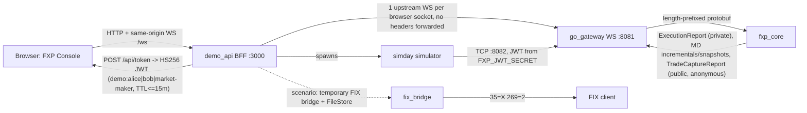

# FXP: Technical Analysis, Round 6 (re-run + console review + what's next)

**Repository:** https://github.com/StephT0560/fxp, analyzed at `main` @ `8e85fea` (merge of PR #52). That is 162 commits after round 5's `f784045`: PRs #30–#48, #51, #52. 454 files changed, +42.2k / −0.3k lines (394 files, +33.3k excluding `benchmarks/` evidence).
**Scope:** Read-only, same parameters as rounds 1–5, plus a live review of the new FXP Console demo. Nothing on `main` was changed and no PR was opened. Earlier reports are in this branch's history: round 1 `f0d310c`, round 2 `12b1809`, round 3 `07b2c46`, round 4 `c3d4195` / `e6adcf9`, round 5 `bb59383`.
**Environment:** same VM. Ubuntu 22.04 KVM, 8 vCPU Intel Xeon, 31 GiB. rustc 1.97.1, Go 1.26.10, protoc 25.3, Python 3.10.12, Node 22.21.0 (see L3 for 22.11), Docker 29.7.2.

---

## 0. Executive summary

**Every round-5 code finding is fixed, and the console demo works end to end. I verified it live, not only from CI.** No Critical, High or Medium findings remain. What is left is repository governance, dependency hygiene for the new `web/` package, and the work needed before anyone else hosts the demo.

| R5 # | R5 item | R6 status |
|---|---|---|
| C1 / #3 | No public trade feed | ✅ **Fixed (PR #30).** Core emits an anonymous `TradeCaptureReport` per fill: `buy_order_id`/`sell_order_id` empty, new `aggressor_side` (9), per-symbol gap-free `seq` (10), `is_auction` (11). Auctions emit one print per matched pair. FIX maps it to `35=X 269=2`. Seven engine tests in `fxp_core/src/engine/trade_feed_tests.rs` plus `TestTradeCaptureReportProducesFIXIncrementalTradeEntry`. Live: tape showed seq #307–#340 with `gaps 0` |
| C2 / #2 | Simulator hard-codes dev secret and address | ✅ **Fixed (PR #31).** Signs with `FXP_JWT_SECRET` (24-byte minimum enforced); address from `-gateway` / `FXP_SIM_GATEWAY_ADDR`. Live, with a random secret in the demo stack: 6/6 participants connected; a 40 s day ran pre-market → auction → continuous → close auction → closed with 1,734 orders and 174 fills |
| C3 | Same-origin WS constraint | ✅ Handled by the `demo_api` BFF (see §3) |
| C5 / #6 | Fan-out cost per subscriber | ⚠ **Investigated, not removed (PRs #45, #46).** Marshal is already once per update; enqueue and `Write` stay per recipient; a stalled reader is now isolated with bounded retention. Still matters only for hosted use |
| C6 / #7 | No metrics/admin API | ⚠ Open (no `/metrics` in any Go or Rust component) |
| #1 | Ruleset not active; branches not auto-deleted | ⚠ **Still open.** `rulesets` → 0 entries, `delete_branch_on_merge` = `false`, 7 Dependabot branches, 3 open Dependabot PRs (#24, #49, #50) |
| #8 | `docs/fix-conformance.md` stale paragraph | ✅ Fixed |
| #8 | Pegs, HS256 only, no releases, bus factor 1 | ⚠ Unchanged. `CHANGELOG` 0.1.0 prepared, no tag or release |

**Checks (all clean):**
- Rust: **247** lib (1 ignored) + 2 + 10 integration tests pass, clippy `-D warnings` clean, `cargo audit` 0 advisories (139 crates), `cargo deny` ok.
- Go: `vet`, `go test -race`, `staticcheck`, `govulncheck` clean in **three** modules now: `go_gateway`, `fix_bridge`, `demo_api`.
- Web: `npm ci`, typecheck, **69/69 Vitest tests (14 files)**, `vite build`, bundle budget (initial 151.3/160 kB, deferred 118.3/120 kB gzip), `npm audit --omit=dev` 0.
- `scripts/e2e.sh`: **76/76** FIX checks (75 in R5), 29/29 order types, 7/7 cancel-on-disconnect, all restart/persistence checks. Exit 0.
- **Hosted CI** on `8e85fea` (run `41558158560`): all **12** jobs green, including the new `demo-api`, `console-e2e` (Playwright) and `repro-smoke`. QuickFIX unchanged: default 45 pass / 14 allow-listed, `quickfix` preset 57 / 2, `unexpected_failures: []` in both.
- Live: `make demo` came up healthy and the console logged in, streamed depth/tape/chart and ran the `stop-cascade` scenario to `passed` (§3).

**Open items (no Critical, High or Medium):**

| # | Severity | Item |
|---|---|---|
| L1 | Low | `main` ruleset still not active; head branches not auto-deleted; 3 open and 7 stale Dependabot branches |
| L2 | Low | `web/` is not covered by Dependabot (only cargo, gomod, github-actions). `npm audit` (dev deps) shows Vitest 3.2 advisories: GHSA-82fw-gwwq-j7x9, GHSA-qxg6-89mg-rqv8 (`@vitest/mocker`), GHSA-5gmw-xhrv-c9v3, GHSA-85c8-ppgw-ccpr (`tinypool`, critical). Dev/test only; the shipped bundle is clean. Fix is Vitest 5.x (major) |
| L3 | Low | No `engines` / `.nvmrc`. On Node 22.11.0 all 14 Vitest files fail with `ERR_REQUIRE_ESM` (jsdom 30 needs `require(esm)`, Node ≥ 22.12). Passes on 22.21.0; CI uses `node-version: 22` |
| I1 | Info | One CSP violation in the browser console: `style-src 'self'` refused an inline `<style>` (hash `sha256-3pRED1tOXas1FXFoPb9TGCjmYe9XQsmO9OV23khV2nY=`), likely injected by a charting library. The page renders correctly |
| I2 | Info | Deferred bundle is at 118.3 of 120 kB; the next chart or panel will trip the budget |
| I3 | Info | e2e prints `FIX transport failed for DURABLE01: EOFError('FIX peer closed the connection')` before `durable_before_kill`, yet passes. Probably expected during the kill drill, but the line reads like a failure |
| I4 | Info | Hosted-mode gaps (not defects for a local demo): BFF opens one upstream WS per browser tab, `/api/token` hands out tokens for 3 fixed demo users to anyone who can reach it, no metrics/admin, no tenant isolation (§3) |
| I5 | Info | Pegs design-only, HS256 only (no JWKS), no tags/releases, single maintainer |

**Updated readiness (my judgement):** matching engine **9/10** (8.5; trade feed done with invariant tests), FIX bridge **9/10** (unchanged), gateway **9/10** (unchanged), **console 8.5/10** for a local demo (new). As a *hosted* product it is not ready yet; see §6.

---

## 1. Orientation

### 1.1 What changed since round 5

| Area | PRs | What arrived |
|---|---|---|
| Core | #30 | Public trade feed (proto v2.x additive fields 9–11), FIX `269=2` |
| Simulator | #31 | Secret and address from env/flags |
| Console BFF | #32, #36, #41 | `demo_api/` Go service: static UI, token issuance, WS proxy, simulator control, six seeded scenarios with SSE, FIX restart/resend scenario, benchmark evidence API, FIX preview inspector |
| Console UI | #33–#35, #37–#39 | `web/`: React 18 + TypeScript + Vite, protobuf-es, Zustand, Lightweight Charts, Recharts, Tailwind 4; Market, Scenarios, Latency, Protocol inspector pages; Vitest + Playwright (+ recording config) |
| Packaging | #40, #41, #52 | `docker-compose.demo.yml`, `Dockerfile.demo`, `make demo` / `demo-down` / `record`; netns owner container so the secure stack survives core restarts |
| Reproducibility | #42, #43, #47, #48 | Recorded command bundles, `fxp-replay` CLI (timeline, explain, report), bug gallery (`examples/bot_repro`, `make repro-demo`, blind/reveal), run-report JSON schema, Python SDK `sdk/python` (`fxp-client`) |
| Performance | #45, #46 | Phase-1-lite work-per-update attribution and subscriber isolation; counts and relative ratios only, no absolute claims |
| QA | #51 | Core-loss handling (cancel-on-disconnect skipped on core loss, consoles follow core down/up), replay fixes, pseudonymised anonymous identities |

`docs/product-plan.md` (new) defines the product as *"an execution environment where trading-bot developers can reproduce failures, inspect every order and fill, and verify strategy changes"*, and explicitly defers hosted sandboxes and other SDK languages.

### 1.2 Architecture (console path added)



The native and FIX order paths from round 5 are unchanged.

### 1.3 Build and test log

| Command | Result |
|---|---|
| `bash scripts/gen_proto.sh` | exit 0 |
| `cargo build --all-targets && cargo test` | 247 passed / 1 ignored; 2 + 10 integration |
| `cargo clippy --all-targets -- -D warnings`, `cargo audit`, `cargo deny check` | clean; 0 advisories, 139 crates |
| `go build/vet/test -race/staticcheck/govulncheck` × `go_gateway`, `fix_bridge`, `demo_api` | all clean; `demo_api` tests 32.5 s |
| `cd web && npm ci && npm run gen && npm run typecheck && npm test && npm run build && npm run size` | all pass on Node 22.21.0; `npm test` fails on 22.11.0 (L3) |
| `npm audit --omit=dev` / `npm audit` | 0 / 3 dev-only (L2) |
| `bash scripts/e2e.sh` | exit 0, 76/76 FIX, 29/29 order types |
| `make demo` | all four containers healthy, `http://127.0.0.1:3000` |
| `bash scripts/bench.sh` | exit 0 (§5) |

---

## 2. Matching engine (Rust)

Engine matching logic is unchanged apart from trade emission. The trade feed is an output only, so event-log replay semantics do not change. Tests cover: single-fill anonymity, one ordered print per fill across a sweep, iceberg prints only for executed display slices, stop-cascade print order matching execution-report order, one auction print per matched pair (`aggressor_side` unspecified, `is_auction=true`), STP/cancel/expiry not consuming sequence numbers, and a seeded invariant test (sum of print quantities = filled quantity, `seq` gap-free). That matches the design approved in round 5, including the recommended answer to the auction-print question.

Still missing: pegged orders (design-only in `docs/pegged-orders.md`).

## 3. Console demo review (new)

**Live session (`make demo`):**

| Probe | Result |
|---|---|
| `GET /healthz`, `GET /` | 200, 200 |
| `GET /` with `Host: evil.example:3000` | 403 (Host pinning against DNS rebinding) |
| `POST /api/token {"user":"zzz"}` | 400 unknown demo user |
| `POST /api/token` with `Origin: http://evil.example` | 403 |
| WS upgrade `/ws`, foreign Origin / same Origin | 403 / 101 |
| Response headers | strict CSP (`default-src 'none'`, `frame-ancestors 'none'`), `Cross-Origin-Resource-Policy: same-origin`, `Referrer-Policy: no-referrer` |
| `POST /api/sim/start {"seed":7,"symbols":2,"participants":6,"duration":40}` | 202, day completed (1,734 orders, 174 fills) |
| `POST /api/scenarios/stop-cascade/run` while the simulator runs | 409 "stop the simulator before running a scenario" |
| Same after stop, `{"seed":7}` | 202 → `state: passed` on isolated book `SCN-b0efa038cb278338` |
| Browser (Chrome via CDP, logged in as alice) | live badge, depth ladder with spread, price chart, tape with seq numbers and `gaps 0`, order ticket, blotter; 1 console error (I1) |

**Security model, good for local:** the token endpoint is rate-limited per IP (default 10/min), token lifetime is 1–900 s, the proxy forwards no browser headers (cookies, Origin, Authorization) upstream, and the compose demo publishes only `127.0.0.1:3000`. The JWT secret is generated into `.env.demo` by `scripts/demo_env.py` and never put on a command line.

**Why it is not hostable as-is (I4):** anyone who can reach port 3000 can mint a token for `alice`, `bob` or `market-maker` and trade as them; all visitors share those three identities and one book. Inside the stack, core auth is empty and the gateway hop is plaintext loopback (`FXP_ALLOW_PLAINTEXT=true`), which is fine in one network namespace, not across hosts. `proxy.go` pairs each browser socket with its own upstream gateway connection, so N viewers means N gateway subscribers.

## 4. FIX bridge, gateway, protocol

- FIX: 76/76 e2e checks; QuickFIX counts unchanged and fully explained by the two allow-lists (14 policy/out-of-scope in default mode, 2 in `quickfix` mode).
- Protocol: trade-feed fields are additive with new numbers; `SessionControl.symbol` (field 4) added for scenario isolation with "empty = all symbols" kept. Backward compatible.
- Gateway (PR #51): on core loss, cancel-on-disconnect is no longer triggered, and the core-loss marker is dropped when a client writer unregisters.

## 5. Performance

`scripts/bench.sh` on this VM (GOMAXPROCS=2, TOKIO_WORKER_THREADS=2, no pinning; median of 5 runs; revision `8e85fea`):

| Run | Orders/s | ACK p50 | ACK p99 | R5 ACK p50 / p99 |
|---|---:|---:|---:|---|
| open, 1 conn @ 1,000/s | 999.9 | 0.758 ms | 1.563 ms | 0.777 / 2.712 ms |
| open, 10 conn @ 1,000/s each | 9,972.7 | 0.808 ms | 1.822 ms (max run 4.18) | 0.901 / 3.889 ms |
| closed, 1 conn | 7,050.9 [6,880–7,736] | 0.116 ms | 0.396 ms | 0.132 / 0.916 ms |

Closed-loop throughput recovered to round-4 levels (6,754 in R4, 4,958 in R5), which supports the round-5 guess that the dip was VM noise. Shared-VM numbers, not SLOs.

Maintainer evidence (`docs/performance/phase1-lite.md`, `subscriber-isolation.md`): per source update the core encodes once and the gateway marshals once; enqueue locks and `Write` calls scale with N subscribers (10 and 100 per update at N=10/100). The subscriber-isolation change had no measurable throughput effect (after/before 0.99×, 0.98×, 1.00× at N=0/10/100) but bounds a stalled reader. Fan-out remains the main hosted-scale cost; the lever is now a multiplexing BFF, not the gateway encoder.

## 6. Project health and what's next

**Governance and hygiene (L1–L3):**
1. Turn on the ruleset from `docs/repo-settings.md` (require `ci-success`). Six rounds in, this is the one item that has not moved, and with 12 jobs it is now the only thing stopping a red merge.
2. Enable auto-delete of head branches; merge or close Dependabot #24, #49, #50 and delete the 7 stale branches.
3. Add `npm` (`/web`) to `.github/dependabot.yml`; move to Vitest 5.x; add `"engines": {"node": ">=22.12"}` and `.nvmrc`.

**Recommended order of work (my judgement):**

| Step | What | Why now | Size |
|---|---|---|---|
| 1 | Housekeeping above + cut **v0.1.0** (tag, release workflow, checksums/SBOM already exist) | Gives the demo a fixed, citable version | hours |
| 2 | **Go public with the local demo:** record the 75-second script (`make record`), put the video and `make demo` at the top of the README, publish a write-up (bot-failure reproduction + FIX inspector), post where bot developers and FIX engineers are | The demo is ready; the open question is now demand, not code | 1–2 days |
| 3 | **Talk to 5–10 target users** before building hosted infra. Test both wedges: (a) bot developers reproducing failures (`docs/product-plan.md`), (b) FIX certification/test venue (round-4 suggestion). The repo is now built for (a); (b) reuses the FIX scenario and inspector work | Hosted work is expensive and depends on which wedge wins | 1–2 weeks elapsed |
| 4 | **Hosted sandbox prerequisites** (only after step 3 says yes): real sign-in and per-tenant identities replacing the 3 shared demo users; per-tenant books or namespaces and quotas; BFF multiplexing of one upstream subscription per symbol; TLS + core token between hosts; `/metrics` and an admin API (halts, kill switch, session monitor); log retention and abuse limits | Each item in I4 | several sessions |
| 5 | Venue-grade capabilities (only if a real-money customer appears): HA/replication, drop copy, pre-trade risk limits, surveillance export, JWKS/asymmetric keys, pegs | Not needed for either sandbox wedge | large |

Also worth doing early: a second maintainer or a company entity. Everything since round 5 was authored by one person (two author names, same email domain), and a paying sandbox user will ask who supports it.

---

## Appendix: commands used this round

```bash
git fetch origin && git checkout -B review origin/main             # 8e85fea
bash scripts/gen_proto.sh
cd fxp_core && cargo build --all-targets && cargo test \
  && cargo clippy --all-targets -- -D warnings && cargo audit && cargo deny check
for m in go_gateway fix_bridge demo_api; do (cd $m && go build ./... && go vet ./... \
  && go test -race -count=1 ./... && staticcheck ./... && govulncheck ./...); done
cd web && npm ci && npm run gen && npm run typecheck && npm test && npm run build \
  && npm run size && npm audit --omit=dev && npm audit --json        # Node 22.11.0 and 22.21.0
bash scripts/e2e.sh
bash scripts/bench.sh
make demo                                                          # then curl probes in §3
curl -H 'Origin: http://127.0.0.1:3000' -H 'Content-Type: application/json' \
  -d '{"seed":7,"symbols":2,"participants":6,"duration":40}' http://127.0.0.1:3000/api/sim/start
curl ... -X POST /api/sim/stop; curl ... -d '{"seed":7}' /api/scenarios/stop-cascade/run; curl /api/scenarios
node <playwright-core connectOverCDP script>                       # login as alice, screenshot, console errors
make demo-down
gh run view 41558158560 --json jobs; gh run view --job <quickfix job> --log   # hosted CI + QuickFIX counts
gh api repos/StephT0560/fxp/rulesets --jq length; gh api repos/StephT0560/fxp --jq .delete_branch_on_merge
gh pr list --state open; git branch -r | grep dependabot
```
