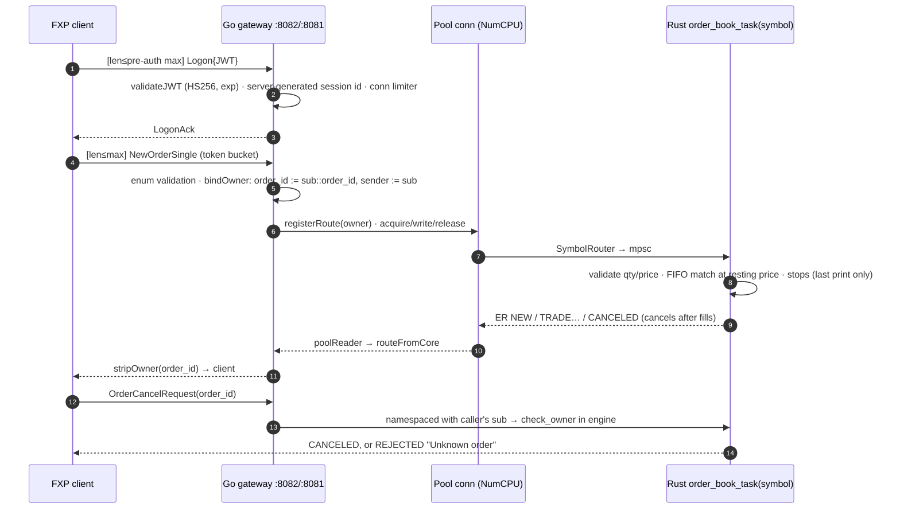
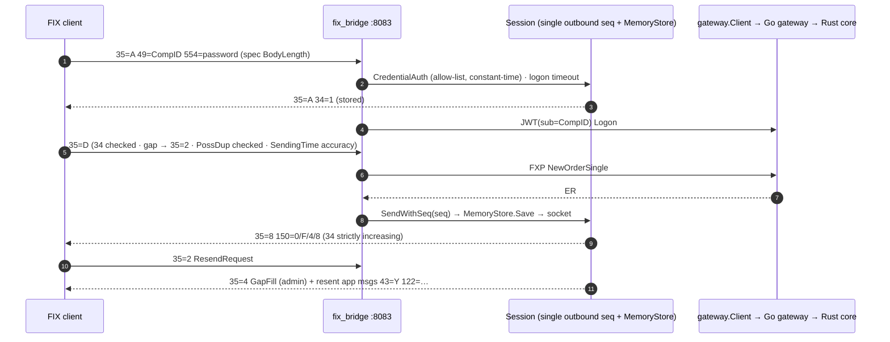

# FXP: Technical Analysis, Round 2 (re-run)

**Repository:** https://github.com/StephT0560/fxp, analyzed at `main` @ `032f331` (merge of PR #4). This is 35 commits after the round-1 baseline `472a7ff`.
**Scope:** Read-only, with the same parameters as round 1. Nothing on `main` was changed. Proposed tests and probes ran in scratch copies outside the repo. The round-1 report is still in this branch's history at commit `f0d310c`.
**Environment:** same VM as round 1. Ubuntu 22.04 KVM guest, 8 vCPU Intel Xeon (Skylake-SP, model 94), 31 GiB RAM. rustc 1.97.1, Go toolchain go1.26.10 (selected by `toolchain` in `go.mod`), protoc 25.3, Python 3.10.12.

---

## 0. Executive summary

**Every round-1 Critical item is fixed. I verified each one live, not just in the code.** Most High and Medium items are fixed too. The project now builds from a fresh clone (`scripts/gen_proto.sh`, `go.work`). It has 52 Rust tests and Go unit tests in both modules, all passing under `-race`. govulncheck and cargo audit report **no vulnerabilities**. The FIX session layer now does authentication, resend, gap-fill, PossDup handling and Reject correctly in my probes.

**Still open, in priority order:**

| # | Severity | Open item | Evidence |
|---|---|---|---|
| 1 | **High** | **FIX market-data repeating groups still collapse.** An X message with 3 changes still carries `268=3` but only the last `279/270/271` entry, because the translator loops still call `Builder.Set` instead of the new `Builder.Append`. W snapshots are affected the same way | Re-ran the round-1 repro on `032f331` |
| 2 | **High** | **Stop triggers check only the last print of a sweep, and fire in insertion order instead of stop-price order.** Parked stops still can't be cancelled or replaced (`cancel_order*` never searches `stop_book`) | P09 and P10 still fail. Code at server.rs ~L603–611 |
| 3 | **High** | **FIX sequence numbers are not persisted** (`session.MemoryStore` only). Every reconnect, even without a restart, starts again at `34=1` | Probe 15 |
| 4 | **High** | **No CI.** There is no `.github/workflows`. On top of that, **`go test ./...` fails in `go_gateway`**: vet blocks the `benchmark` package build (`benchmark.go:481` redundant newline) | §1.2 |
| 5 | Medium | **~36–41 ms p95/p99 latency mode is unchanged.** The Rust core still never calls `set_nodelay(true)` | §5 |
| 6 | Medium | Gateway pool reconnect still starts a **second `poolReader`** on the same connection (goroutine leak, and two readers on one stream) | pool.go `SendFramedToCore` |
| 7 | Medium | JWT: still no `alg` header check, no `aud`/`iss`/`nbf`/`jti`, one shared HS256 secret. WS `CheckOrigin` still returns `true` | auth.go, ws_server.go |
| 8 | Medium | Auction matching, Day/GTD expiry and GTC persistence are still unimplemented (the docs now say so honestly) | README, matcher.rs |
| 9 | Low | NOS without `TransactTime(60)` is accepted (required in 4.4). `35=H` gets `35=j` (OrderStatusRequest not supported). The FIX `stop_order` e2e case still never triggers a stop | Probes, e2e log |
| 10 | Low | Lint debt: 3 rustc warnings, ~115 clippy style warnings, staticcheck 2 (U1000, ST1005), 28 `println!` in `server.rs` | §1.2 |

**Updated readiness (my judgement):** matching engine **6/10** (was 2), FIX bridge **5/10** for counterparty certification (was 1), gateway **6/10** (was 3). The session layer would now get through Logon, sequencing and resend tests. It would fail market-data certification (#1), and any recovery or restart test (#3).

---

## 1. Orientation

### 1.1 What changed structurally
- **New in the repo:** `go.work`, `Makefile` (`proto`, `build`, `test`, `bench`, `fmt`, `fmt-check`, `lint`, `clean`), `scripts/gen_proto.sh`, `scripts/e2e.sh`, `rustfmt.toml`, `.golangci.yml`, `SECURITY.md`, `CONTRIBUTING.md`, `CHANGELOG.md`, and SPDX headers.
- **Moved / split:** benches are now in `fxp_core/benches/`. `go_gateway/test_clients/` is split into `devjwt`, `tcp_client` and `ws_client`.
- **Removed:** the committed 6.6 MB Windows binary, and the dead `src/test.rs` / `integration_test.rs`.
- **New code:**
  - Gateway: `transport/limits.go` (connection limiter, token bucket, bounded `readFrame`, server-generated session IDs) and `transport/ownership.go` (`owner::id` order namespacing, `bindOwner`/`stripOwner`, owner check on cancel/replace).
  - FIX bridge: `session/auth.go` (CompID allow-list with `554` password, constant-time compare), `session/store.go` (in-memory `MessageStore`), and `cancel_reject.go`.
  - Engine: `OrderBook::check_owner` / `cancel_order_for` / `replace_order`, and accept() backoff.
- **Schema v2.0 (wire-breaking):** every enum now has `*_UNSPECIFIED = 0`, and unknown or unspecified enum values are rejected.

### 1.2 Build and test log (exact commands)

| Step | Command | Round 1 | Round 2 |
|---|---|---|---|
| Proto codegen | `bash scripts/gen_proto.sh` | README command broke the build | ✅ |
| Rust build | `cd fxp_core && cargo build --all-targets` | ✅ (needs protoc), 1 warning | ✅, 3 warnings (`unused client_id` etc.) |
| Rust tests | `cargo test` | 23 passed | ✅ **52 passed**, 0 failed |
| Clippy | `cargo clippy --all-targets` | 85 style warnings | style only: 98× digit grouping, 7× `clone` on `Copy`, 2× `too_many_arguments`, misc |
| cargo audit | `cargo audit` | 7 advisories | ✅ **0** (105 crates) |
| cargo deny | — | not configured | still not configured (no `deny.toml`) |
| Go build | `go build ./...` (both modules) | ❌ test_clients | ✅ |
| Go vet | `go vet ./...` | 1 + compile error | ⚠ `benchmark/benchmark.go:481` redundant newline. **This makes `go test ./...` fail** (`go_gateway/benchmark [build failed]`) |
| Go tests + race | `go test -race -count=1 ./...` | no tests existed | `go_gateway/transport` ✅ · `fix_bridge`, `codec`, `session`, `translator` ✅ · `go_gateway/benchmark` ❌ (vet) |
| staticcheck | `GOTOOLCHAIN=go1.26.10 go install honnef.co/go/tools/cmd/staticcheck@latest && staticcheck ./...` | 3 | 2: `benchmark.go:174` unused `latencySample` (U1000), `translator/fix_to_fxp.go:118` ST1005 |
| govulncheck | `govulncheck ./...` (both) | 33 + 2 stdlib | ✅ **No vulnerabilities found** (Go 1.25 / toolchain go1.26.10) |
| E2E | `bash scripts/e2e.sh` | (manual stack) 16/16 | ✅ **27/27** (new: cross-session cancel, outbound sequencing). Friction: the script calls `go` directly, so it fails with `go: command not found` unless Go is on `PATH` (only `gen_proto.sh` falls back to `/usr/local/go`) |
| Encoding bench | `cargo bench --bench encoding_benchmark` | ✅ | ✅ (§5) |
| E2E bench | `go run ./benchmark …` | ✅ (c=1 never filled) | ✅ (c=1 now fills, §5) |

### 1.3 Data flow (as implemented now)





---

## 2. Matching engine (Rust)

### 2.1 Round-1 proposed tests, re-run on `032f331`
I appended the same 11 tests from round-1 §2.7 to a scratch copy of `lib.rs` and ran `cargo test proposed_tests`. **9 pass, 2 fail** (round 1: 2 passed, 9 failed).

| ID | Test | R1 | R2 |
|---|---|---|---|
| P01 / P02 | FIFO within a price level (aggressive / passive) | ❌ | ✅ (`VecDeque` push_back / pop_front) |
| P03 | Passive cross trades at the resting price | ❌ | ✅ |
| P04 / P05 / P11 | `order_lookup` removed on fill / qty updated on partial / cancel market data qty | ❌ | ✅ |
| P06 / P07 | IOC never rests | ✅ | ✅ |
| P08 | FOK sum overflow | ❌ panic | ✅ |
| **P09** | Stop fires on an intermediate print of a sweep | ❌ | ❌ still. `last_trade_price = all_fills.last()` and `drain_triggered_stops` is called once per batch |
| **P10** | Triggered stops ordered by stop price, then time | ❌ | ❌ still (insertion order) |

### 2.2 Status of the remaining engine findings

| Round-1 finding | Status |
|---|---|
| LIFO within level | ✅ fixed |
| Stale `order_lookup`, resurrection via cancel/replace | ✅ fixed (`replace_order` rejects non-live orders and duplicate `new_order_id`s). The e2e `cancel_filled_order` case now gets `35=9` |
| Aggressor-price execution | ✅ fixed |
| Validation (qty ≤ 0, limit price ≤ 0, unknown/unspecified enums) | ✅ fixed in the engine and gateway (schema v2.0) |
| `accept().unwrap()` kills the server | ✅ fixed (capped exponential backoff, with a unit test) |
| ER content: `EXEC_NEW` ack, cumulative leaves/cum/avg, cancel after fills | ✅ fixed per code and e2e (ack confirmed live, cancel queued in `pending_cancels` and sent after fill reports). ExecIDs now come from `next_exec_id()`, and a server test asserts they are unique |
| Stop (market) with no liquidity silently dropped | ✅ fixed (now added to `pending_cancels`) |
| **Stop trigger on last print only, insertion-order firing** | ❌ open (P09/P10) |
| **Parked stops can't be cancelled or replaced** | ❌ open (`stop_book` is only touched on park and drain) |
| StopLimit IOC/FOK TIF ignored after trigger | ❌ open (not changed) |
| `last_trade_price` starts at 0 and isn't persisted | ❌ open |
| AT_OPEN / AT_CLOSE | ⚠ still rest as continuous limits, but the README now says ❌ Not supported |
| Day/GTD expiry, GTC persistence | ❌ open (now documented) |
| Self-trade prevention, iceberg, pegs, mass cancel, cancel-on-disconnect | ❌ open |
| Hot-path logging | ❌ open (28 `println!` in `server.rs`) |
| Slow consumer blocks the symbol task (`send().await` on output and MD channels) | ❌ open |
| Global `SymbolRouter` `tokio::Mutex` per message; unbounded symbol creation | ❌ open |
| Price precision fixed at 2 dp | ❌ open (design limitation) |

### 2.3 Proposed tests still worth adding
- P09 and P10 from round 1 (rewrite P09 against a per-print API once that exists).
- Cancel a parked stop → `EXEC_CANCELED`. Replace a parked stop's `stop_price`.
- A cascade of 3 stops: assert ER ordering and the final `last_trade_price`.
- StopLimit with `TIF=IOC`: after trigger, the remainder is cancelled, not rested.
- A property test against a naïve reference book (random add / cancel / replace / IOC / FOK). This is the single highest-value test to add now that the basic invariants hold.

---

## 3. FIX bridge (FIX 4.4)

### 3.1 Live probe results (new probe scripts, run against an `e2e.sh`-equivalent stack with `FXP_FIX_CREDENTIALS`)

| Probe | R1 | R2 |
|---|---|---|
| Spec-compliant Logon (BodyLength excludes `10=`) + `554` | no response | ✅ `35=A 34=1`. Every received frame's BodyLength checked correct |
| Logon with no password / wrong password / unknown CompID | accepted (no auth) | ✅ `35=5 58=authentication failed` |
| Resting limit `35=D` | no ack | ✅ `35=8 150=0 39=0` |
| LogonAck then first ER | both `34=1` | ✅ `34=1`, `34=2`. The e2e run asserts `34=1..30` gap-free |
| ATTACKER cancels VICTIM's order | succeeded | ✅ `35=9 39=8 "Unknown order"` to the attacker (it doesn't reveal that the order exists). Victim gets nothing |
| Inbound seq gap | accepted silently | ✅ `35=2` ResendRequest |
| Inbound `35=2 7=1 16=0` | ignored | ✅ `35=4` GapFill for admin messages + resent `35=8` (PossDup) + trailing GapFill |
| Bad checksum | connection dropped | ✅ message ignored, session stays up (spec behavior) |
| Seq too low without PossDup | dropped | ✅ `35=5 "MsgSeqNum too low, expecting 7 but received 1"` |
| Unsupported `35=H`, `35=AE` | logged only | ✅ `35=j` BusinessMessageReject |
| NOS missing `44` on a limit | ER reject | ✅ `35=8 150=8` with text |
| NOS missing `TransactTime(60)` | accepted | ⚠ still accepted (required field in 4.4) |
| Reconnect with the same CompID | seq restarts at 1 | ⚠ **still restarts at 1** (no persistence, §3.3) |
| MD incremental with 3 entries | only last entry | ❌ **still only the last entry**: `268=3|279=2|55=AAPL|270=102.00|271=9` |

### 3.2 Session layer against the FIX 4.4 spec

All of these are now implemented, as confirmed by the probes and the new `session_behavior_test.go`:
- Logon authentication and logon timeout
- `141=Y` handling (it must arrive with `34=1`)
- Inbound sequence checks on every message
- Gap detection with ResendRequest
- PossDup handling with OrigSendingTime validation
- SendingTime accuracy check
- SequenceReset in both GapFill and Reset modes
- Reject(3)
- Resend from the message store with GapFill for admin messages
- Logout handshake with a timeout
- A single outbound sequence counter

**Remaining:**
- **Store durability.** `MemoryStore` is a `map[int][]byte` with no persistence and no bound. It lives per connection, so even a reconnect resets sequencing.
- No session schedule or daily reset.
- No DataDictionary-style required-field validation (e.g. `60` on `35=D`).

### 3.3 Known gap: sequence-number persistence

Still open. `MessageStore` is now an interface (`Save` / `Get` / `Reset`), so the round-1 design (§3.3 at `f0d310c`) drops in as a `FileStore` implementation:
- an append-only `outbound.log` with CRC records
- a `seqnums` file updated via write-temp + fsync + rename
- strict / group / async fsync modes
- tail-truncate recovery on open
- a store keyed by `(BeginString, SenderCompID, TargetCompID)`, **not by connection**

Two additions are needed:
1. Store and session state must outlive the TCP connection (look up by CompID at Logon).
2. Cap or rotate the in-memory store (it currently grows for the life of the session).

### 3.4 Message mapping

| Item | Status |
|---|---|
| ExecType 4.4 values | ✅ `150=F` (Trade) for fills, `0/4/5/8/C` otherwise |
| Required ER fields `54`, `38`, `6` | ✅ present (`AvgPx` always set) |
| Cancel / replace reject as `35=9` with `434` | ✅ (`cancel_reject.go`) |
| Per-firm ClOrdID namespace | ✅ via gateway `owner::id` namespacing, stripped on the way out |
| Price rounding and sign | ✅ fixed |
| **W/X repeating groups** | ❌ open: `translateMarketDataSnapshot` / `translateMarketDataIncremental` still use `b.Set` in the loop. Switching to `b.Append` (already added to `Builder`) fixes it. Also add `269` to X entries and echo `262` |
| SellShort (`54=5`) → Sell | ❌ unchanged |
| OrderStatusRequest (`H`), mass cancel / status, TradeCaptureReport | ❌ not supported (`35=j`) |

### 3.5 Certification rating
**5/10.** The session-level conformance cases (Logon, sequencing, resend, gap-fill, reject, logout) would now largely pass. It would fail market-data certification (groups), restart / recovery tests (persistence), and strict field validation. Recommendation: add a `FileStore`, fix the groups, then run the QuickFIX acceptance suite (`_test/definitions/server/fix44`) in CI.

---

## 4. Gateway, protocol and security

| Round-1 finding | Status |
|---|---|
| Unbounded pre-auth frame length | ✅ fixed: `readFrame(r, max)` with separate pre-auth and post-auth limits (env-tunable). WS `SetReadLimit` before and after auth |
| No connection limits / rate limiting | ✅ fixed: `connLimiter` and a per-connection token bucket (`limits_test.go`) |
| Client-chosen session IDs in a global map | ✅ fixed: server-generated (`newSessionID`) |
| Cross-user cancel/replace, order routing hijack | ✅ fixed: `bindOwner` namespaces `order_id` with the JWT `sub`, and the engine checks the owner. Verified live and by `ownership_test.go` |
| Zero-value enums | ✅ fixed (v2.0 `*_UNSPECIFIED`, rejected in `enum_validation_test.go`) |
| Go stdlib CVEs, RustSec advisories | ✅ fixed (0 / 0) |
| Proto version drift between modules | ✅ aligned (protoc-gen-go v1.36.12 in `gen_proto.sh`, `go.work`) |
| **JWT `alg` header check, `aud`/`iss`/`nbf`/`jti`, key rotation** | ❌ open. `validateJWT` still checks only the MAC + `sub`/`exp`/`iat`. The bridge still mints JWTs with the shared secret (now only for authenticated CompIDs, which removes the token-oracle problem) |
| **WS `CheckOrigin` returns `true`** | ❌ open |
| **Pool reconnect starts a duplicate `poolReader`** | ❌ open: `SendFramedToCore` still calls `go poolReader(pc)` after `reconnect()`, while the original reader resumes once `rawConn() != nil` |
| Synchronous client writes inside `poolReader` (head-of-line blocking), concurrent WS writers | ⚠ not re-verified in depth; I saw no structural change in `routeFromCore` |
| Graceful shutdown / signal handling | ❌ open |
| `update_type` int32, `protocol_version` string per message, no `reserved` | ❌ open (low) |
| Plaintext on all interfaces (`:8081-8083`) | ❌ open (TLS not wired) |

Static analysis (§1.2): clean on vulnerabilities. Remaining lint: vet 1, staticcheck 2, clippy style only.

---

## 5. Performance and benchmarks

### 5.1 Methodology: what changed
- ✅ `concurrency=1` now produces fills, and the c=50 unlimited run completes (all 24,000 expected fills), so throughput is no longer computed over the 60 s timeout.
- ⚠ Still unchanged in `benchmark.go`:
  - The JWT secret is hard-coded (`jwtSecret = "dev-secret-change-in-production"`), so the gateway must run with exactly that secret.
  - `basePrice := 3_000_000_000 // $3000.00` is $30,000,000 in cents.
  - Latency is timed from the actual send, not the intended send (coordinated omission).
  - Samples come from a single run with no HDR histogram.
  - The unused `latencySample` type is still there.
- ⚠ Encoding benchmarks:
  - FIX still encodes with `format!` against a pre-allocated FXP buffer, which favors FXP.
  - `SBE_heap` (11.9 ns) is still faster than `SBE_stack` (27.9 ns), and SBE decode is 1.1 ns. That still points to constant folding.
  - There is still no roundtrip benchmark group.

### 5.2 Results (same VM, same commands as round 1; single runs)

*Encoding (Criterion median):*

| Benchmark | FXP | FIX 4.4 | SBE | R1 FXP |
|---|---|---|---|---|
| NOS encode (pre-alloc) | 95.7 ns | 387.6 ns | 27.9 ns stack / 11.9 ns heap ⚠ | 85.0 ns |
| NOS encode (fresh alloc) | 186.3 ns | — | — | 196.0 ns |
| NOS decode | 253.0 ns | 1,672 ns | 1.10 ns ⚠ | 239.5 ns |
| ExecutionReport encode | 121.9 ns | 394.1 ns | 23.9 ns | 102.1 ns |
| Snapshot 5L encode | 344.3 ns | 1,311 ns | — | 340.5 ns |
| Incremental encode | 55.8 ns | 285.8 ns | — | 55.9 ns |
| Batch 10k NOS | 1.09 ms | 3.79 ms | 110.9 µs | 843 µs |

**Sizes (bytes), FIX / FXP / SBE:**

| Message | FIX | FXP | SBE | R1 FXP |
|---|---|---|---|---|
| NOS | 164 | **86** | 82 | 82 |
| ExecutionReport | 192 | **91** | 76 | 84 |
| Snapshot 5L | 331 | **134** | 168 | 123 |
| Incremental | 102 | 30 | 24 | 30 |

FXP messages grew 4–11 bytes because schema v2.0 moved every enum off zero: proto3 omits zero-valued fields, so `BUY` / `LIMIT` / `DAY` / `EXEC_NEW` are now encoded on the wire. That is an expected and acceptable cost of the safety fix, but the README's size table should be refreshed.

Criterion reports +9–24% for several FXP encode timings versus round 1. This is a shared KVM guest with no CPU pinning, and FIX and SBE moved by similar amounts in the same run, so I treat most of the delta as noise plus the larger messages. I don't read it as a regression without a pinned re-run.

*End-to-end (release core, non-race gateway):*

| Run | Orders | Fills | Elapsed | Orders/s | RTT p50 | p95 | p99 | Max | R1 |
|---|---|---|---|---|---|---|---|---|---|
| c=1, o=500 | 500 | 480 | 14 ms | 35,543 | 9.5 ms | 11.2 ms | 11.3 ms | 11.5 ms | 0 fills (timeout) |
| c=10, o=500 | 5,000 | 4,800 | 117 ms | **42,854** | 51.6 ms | 98.9 ms | 108.6 ms | 114 ms | 29,224/s, p50 91.5 ms |
| c=50, o=500 | 25,000 | **24,000** | 639 ms | **39,129** | 435 ms | 548 ms | 581 ms | 628 ms | timeout, 23,986 fills |
| c=50, o=200, 25/s | 10,000 | 9,000 | 8.0 s | 1,249 | **1.45 ms** | 35.8 ms | 36.4 ms | 38.7 ms | p50 1.17 ms, p95 40.9 ms |

Market-data fan-out p50 is about 40 µs (the p95/p99 tail of the c=1 run hit the same ~41 ms mode).

**Reading the numbers:**
- Unlimited-rate throughput improved about 1.5× at c=10, and c=50 now completes (≈39k orders/s), even with ownership namespacing, limits and enum validation added.
- The unlimited-mode "RTT" is still queueing delay.
- In the rate-limited run, **p50 is ~1.4 ms but p95/p99 sit at ~36 ms**. This bimodal shape is unchanged from round 1 and is consistent with Nagle / delayed-ACK on the Rust sockets (`set_nodelay` is still absent from the codebase).

### 5.3 Top 5 likely bottlenecks (re-ranked)

| # | Bottleneck | Status vs R1 | How to confirm |
|---|---|---|---|
| 1 | No `TCP_NODELAY` on Rust accepted sockets (~36–41 ms mode) | unchanged | `tcpdump -i lo port 8080` for 40 ms gaps. A/B with `stream.set_nodelay(true)` in `start_server` |
| 2 | Hot-path logging (`println!` ×28 in `server.rs`, `log.Printf` on every message in Go) | unchanged | `perf record -g` → flamegraph. Look for `std::io::stdio` and `log.(*Logger).output`. A/B with logging off |
| 3 | Gateway: proto re-marshal passes, pool `acquire()` contention, synchronous client writes in `poolReader` | unchanged (plus new ownership / namespace string ops) | `pprof` CPU + block/mutex profiles, `go tool trace` |
| 4 | Symbol task awaits slow output/MD channels; global `SymbolRouter` mutex | unchanged | `tokio-console`, `RuntimeMetrics`, a slow-subscriber experiment |
| 5 | Allocation per order (String clones, `Vec` per fill, frame buffers) | unchanged | `dhat-rs` / `heaptrack`, Criterion microbench of `process_aggressive` on a 10k-order book |

---

## 6. Gaps, roadmap and project health

### 6.1 The three known gaps
- **Auction matching:** not started. The README now says so correctly. The round-1 design (phase state machine, uncross maximizing volume → minimizing imbalance → closest to reference price, single-price allocation, indicative data) still applies. The engine is now correct enough for that work to start.
- **Seqnum persistence:** not started. A `MessageStore` interface now exists, so this is a `FileStore` + session-registry change (§3.3). About 3–5 days including kill -9 recovery tests.
- **CI/CD:** **still no workflow.** The pieces are there (`Makefile` `fmt-check` / `lint` / `test`, `scripts/e2e.sh`, `gen_proto.sh`), so the round-1 workflow simplifies to the jobs below. **Fix `benchmark.go:481` first**, otherwise the Go test job fails immediately.

```yaml
name: CI
on: { push: { branches: [main] }, pull_request: {} }
permissions: { contents: read }
concurrency: { group: ci-${{ github.ref }}, cancel-in-progress: true }
jobs:
  rust:
    runs-on: ubuntu-latest
    steps:
      - uses: actions/checkout@v4
      - uses: arduino/setup-protoc@v3
        with: { version: "25.3", repo-token: ${{ secrets.GITHUB_TOKEN }} }
      - uses: dtolnay/rust-toolchain@stable
        with: { components: "clippy, rustfmt" }
      - uses: Swatinem/rust-cache@v2
        with: { workspaces: fxp_core }
      - working-directory: fxp_core
        run: |
          cargo fmt --all -- --check
          cargo test --all-targets --locked
          cargo clippy --all-targets --locked -- -D warnings   # fix the ~115 style lints first, or start with -W
          cargo bench --no-run --locked
      - uses: rustsec/audit-check@v2
        with: { token: ${{ secrets.GITHUB_TOKEN }}, working-directory: fxp_core }
  go:
    runs-on: ubuntu-latest
    strategy: { matrix: { module: [go_gateway, fix_bridge] } }
    steps:
      - uses: actions/checkout@v4
      - uses: actions/setup-go@v5
        with: { go-version-file: go_gateway/go.mod, cache-dependency-path: "**/go.sum" }
      - uses: arduino/setup-protoc@v3
        with: { version: "25.3", repo-token: ${{ secrets.GITHUB_TOKEN }} }
      - run: bash scripts/gen_proto.sh
      - working-directory: ${{ matrix.module }}
        run: |
          go vet ./...
          go test -race -count=1 ./...
          go run honnef.co/go/tools/cmd/staticcheck@latest ./...
          go run golang.org/x/vuln/cmd/govulncheck@latest ./...
  e2e:
    needs: [rust, go]
    runs-on: ubuntu-latest
    steps:
      - uses: actions/checkout@v4
      - uses: arduino/setup-protoc@v3
        with: { version: "25.3", repo-token: ${{ secrets.GITHUB_TOKEN }} }
      - uses: dtolnay/rust-toolchain@stable
      - uses: Swatinem/rust-cache@v2
        with: { workspaces: fxp_core }
      - uses: actions/setup-go@v5
        with: { go-version-file: go_gateway/go.mod }
      - uses: actions/setup-python@v5
        with: { python-version: "3.12" }
      - run: bash scripts/gen_proto.sh && bash scripts/e2e.sh
        env: { E2E_LOG_DIR: ${{ runner.temp }}/e2e }
      - uses: actions/upload-artifact@v4
        if: always()
        with: { name: e2e-logs, path: ${{ runner.temp }}/e2e }
  proto:
    runs-on: ubuntu-latest
    steps:
      - uses: actions/checkout@v4
        with: { fetch-depth: 0 }
      - uses: bufbuild/buf-action@v1
        with: { input: fxp_core/proto, lint: true, breaking: ${{ github.event_name == 'pull_request' }},
                breaking_against: "${{ github.event.repository.clone_url }}#branch=main,subdir=fxp_core/proto" }
```
Also: add a `deny.toml` + `cargo-deny-action`, Dependabot, and branch protection on these jobs. Building the e2e stack with `-race` would catch gateway races during the FIX suite.

### 6.2 Docs vs code
README and `Benchmark.md` now match the code on everything I checked in round 1:
- AT_OPEN / AT_CLOSE are marked "❌ Not supported".
- Expiry and persistence are described as not enforced.
- FIFO is documented and tied to a test.
- The pool size is stated as `runtime.NumCPU()`.
- The `Benchmark.md` link resolves.
- Cancel/replace is documented as losing priority.
- CI and auctions are still unchecked in the roadmap.

Minor items:
- The README's benchmark environment line still describes Windows 11 / Rust 1.85 / Go 1.24.1, while `go.mod` now requires Go ≥ 1.25.
- `scripts/e2e.sh` needs `go` on `PATH`, but the README Quick Start doesn't say so.
- The FIX `stop_order` scenario still passes with "stop not triggered". It should assert a trigger, which would expose P09.

### 6.3 Licensing, hygiene, structure, contributors
- ✅ MIT, copyright "FXP contributors", SPDX headers. SECURITY / CONTRIBUTING / CHANGELOG added.
- ✅ Unused and wildcard Rust deps removed. Lockfile updated. Go modules aligned under `go.work`. Binary removed. Generated code produced by a script.
- ⚠ Still no `deny.toml`, Dependabot, issue/PR templates, Dockerfile or compose file. `server.rs` has grown to ~1.6k LOC (networking + orchestration + reports). Extracting a synchronous `engine.rs` would make the auction and stop work testable without Tokio.
- Contributors: still a single author (Stephen). The 35 new commits arrived through 4 PRs (`fix/critical`, `fix/high`, `fix/medium`, `fix/low`) with Conventional-Commit-style messages tied to findings. That is a clear improvement in process.

### 6.4 Suggested next steps (ordered)
1. **Unblock CI:** fix `benchmark.go:481`, add the workflow above, and gate PRs on it.
2. **FIX MD groups:** `Set` → `Append` in the W/X loops, plus a unit test asserting N entries.
3. **Stops:** trigger per print, order by stop price then time, cancel/replace of parked stops, StopLimit TIF.
4. **FIX `FileStore`** + a session registry keyed by CompID (persistence across reconnect and restart).
5. **Rust `set_nodelay(true)`** on accepted sockets (§5). Remove the hot-path `println!`s.
6. **Gateway:** remove the duplicate `poolReader` on reconnect. Origin allow-list. JWT `alg`/`aud`/`iss` checks.
7. Auctions → expiry → persistence of GTC → STP / iceberg.
