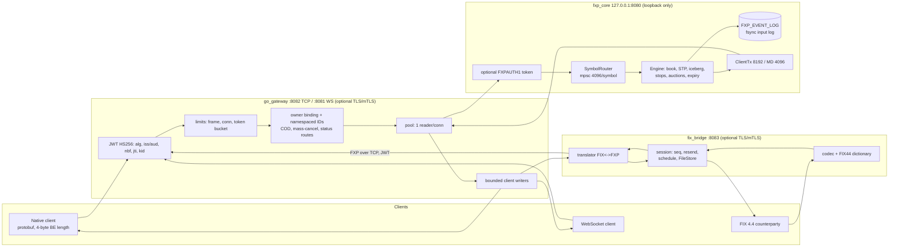

# FXP: Technical Analysis, Round 4 (re-run)

**Repository:** https://github.com/StephT0560/fxp, analyzed at `main` @ `5334383` (merge of PR #22). That is 82 commits after round 3's `61c3d03`: PRs #17–#22 plus 8 Dependabot bumps (prost 0.14, criterion 0.8, actions v7). 148 files changed, +25.6k / −1.8k lines.
**Scope:** Read-only, with the same parameters as rounds 1–3. Nothing on `main` was changed and no PR was opened. Proposed tests and probes ran in scratch copies. Earlier reports are in this branch's history: round 1 `f0d310c`, round 2 `12b1809`, round 3 `07b2c46`.
**Update (re-check after the user's follow-up):** `main` is still `5334383`. PRs #6, #7 and #8 had already been merged before this round, so the code and test results below are unchanged. Only Low #3 and the branch-hygiene note were refreshed.
**Environment:** same VM. Ubuntu 22.04 KVM (kernel 6.8.0-1061-aws), 8 vCPU Intel Xeon, 31 GiB. rustc 1.97.1, Go go1.26.10, protoc 25.3, Python 3.10.12.

---

## 0. Executive summary

**Every open item from round 3 was addressed, and I verified each one by running something.**

| R3 # | R3 item | R4 status |
|---|---|---|
| 1 | No STP, iceberg, pegs, mass cancel or cancel-on-disconnect; 2 dp price precision | ✅ STP (5 modes, owner or group scope), owner-bound mass cancel (`35=q`/`35=r`), cancel-on-disconnect, iceberg/reserve (`MaxFloor 111`) and per-symbol tick/lot/precision rules are all implemented and covered by e2e. ⚠ **Pegged orders are design-only** (`docs/pegged-orders.md`) |
| 2 | FIX: no schedule/daily reset, no dictionary, no `35=H` | ✅ Scheduled sessions with archived daily resets, a pinned FIX44 XML dictionary validator, owner-scoped `35=H` and `35=AF`, and a QuickFIX v1.15.1 acceptance gate in CI. ⚠ The gate passes **28 of 59** definitions strictly; 31 are allow-listed (see §3) |
| 3 | Benchmark harness: hard-coded secret, $30M price, coordinated omission, unfair encoders | ✅ Rewritten: intended-time open loop plus closed loop, HDR histograms, warmup, 5 repetitions, fails on any reject or missing report. Price is now $3000.00 at the symbol's scale. The secret is read from `FXP_JWT_SECRET` (the dev value is a fallback only). Reused-buffer FIX encoder, opaque SBE |
| 4 | Plaintext transport; core trusts any local client | ✅ Reloadable TLS 1.2+ and mTLS on the gateway TCP/WS and FIX listeners. Core is loopback-only with an optional pre-parse shared-token handshake (constant-time compare, 5 s timeout). ⚠ **Both are opt-in and off by default** |
| 5 | Single maintainer | ⚠ unchanged |

Also new: bounded slow-consumer backpressure in core and gateway, symbol admission limits, and graceful shutdown for all three processes (PR #18). There is a nightly benchmark workflow, a tag-triggered static-release workflow with checksums and CycloneDX SBOM, plus `SECURITY.md` and `docs/{risk-controls,operations,tls-trust,fix-conformance,benchmark-methodology,iceberg-orders,pegged-orders,symbol-config}.md`.

**Checks (all local, all clean):**
- Rust: 191 + 2 tests pass, 0 build warnings, clippy `-D warnings` clean, `cargo audit` 0 (120 crates), `cargo deny` ok.
- Go: `vet`, `staticcheck`, `govulncheck` and `go test -race` clean in both modules.
- `scripts/e2e.sh`: **69/69** FIX checks, 29/29 order-type checks, plus 7/7, 3 × 2/2, 1/1 and 3/3 persistence checks. Exit 0.
- **Hosted CI (inspected this round):** the run on `5334383` is green across all 7 jobs (`rust`, `cargo-deny`, `go` × 2, `e2e`, `quickfix-acceptance`, `proto`).

**What's left (no Critical or High items):**

| # | Severity | Open item |
|---|---|---|
| 1 | Medium | **QuickFIX conformance is 28/59 strict.** Most of the 31 allow-listed cases are fixture assumptions (QuickFIX's echo application sends orders with no `OrderQty`), so the session check named in the file often never runs. A handful are real gaps: no `OnBehalfOf`/`DeliverTo` routing reversal, no buffering of out-of-order admin messages, and a repeated low-sequence ResendRequest is rejected |
| 2 | Medium | **Secure transport and core auth are off by default.** `FXP_TLS_REQUIRED=false` and an empty `FXP_CORE_AUTH_TOKEN` are the defaults, including in `docker-compose.yml`. JWTs and FIX passwords cross the wire in plaintext unless an operator opts in. Plaintext on a non-loopback address only logs a warning |
| 3 | Low | **Required checks aren't enforced on `main`.** Dependabot PRs #6, #7 and #8 were merged on 2026-10-25 while their CI runs were failing; `main` was fixed later by `38fd351` (PR #20). On re-check, those PRs were already merged, there are no commits after `5334383`, and `HEAD` is green, so nothing is broken now. The gap is the process: there are still 0 rulesets, and branch protection can't be read with this token (HTTP 403) |
| 4 | Low | `massCancelRoutes` (`go_gateway/transport/pool.go:268-297`) has no timeout and no per-connection cleanup, unlike `statusRoutes`. If the core never answers, the entries leak and keep closed connections referenced |
| 5 | Low | FIX edge replies: `35=H` for an unknown or another owner's order gets `35=j` (FIX 4.4 expects `35=8 150=I 39=8`). `35=AE` is dictionary-validated before the unsupported-type check, so it gets a misleading `35=3 "Required tag missing"` |
| 6 | Low | README drift: the roadmap still lists auctions, live stop triggering and cancel/replace as unchecked (all three are done). The test-count table (163 / 49 / 123) is stale (193 / 69 / 125). "GTC orders are not persisted" contradicts the `FXP_EVENT_LOG` section |
| 7 | Info | Pegged orders are not implemented (design doc only). Old P09 test is still stale. 3 merged Dependabot branches still on the remote. No tags or releases yet. Single maintainer |

**Updated readiness (my judgement):** matching engine **8.5/10** (7.5 in R3), FIX bridge **8/10** for counterparty certification (7 in R3), gateway **8.5/10** (7.5 in R3). What remains is secure-by-default configuration, conformance edge cases and governance, not engine correctness.

---

## 1. Orientation

### 1.1 What changed structurally since round 3
- **Core (Rust):** `core_auth.rs` (`FXPAUTH1` + u16 length + token, before any FXP frame is parsed), `symbol_config.rs` (`FXP_SYMBOL_CONFIG` CSV: tick, lot, min/max quantity, scale), and STP/iceberg logic in `order_book/{matcher,order_book}.rs`. Bounded `ClientTx` queues (8192 critical / 4096 MD). Symbol admission (`FXP_SYMBOLS`, `FXP_MAX_SYMBOLS`) and graceful shutdown (`FXP_SHUTDOWN_TIMEOUT_SEC`). `server.rs` grew to 3.4k lines, mostly tests.
- **Gateway (Go):** `tlsconfig/` (server reload + verified client), `coreauth/`, `symbolconfig/`, `transport/{client_writer,status}.go` (bounded per-client writers, order-status routing), and cancel-on-disconnect plus mass cancel in `transport/`. `test_clients/security_probe`.
- **FIX bridge:** `session/schedule.go` (start/end time, day, zone, archived reset), `session/store_epoch.go`, `codec/dictionary.go` + pinned `codec/spec/FIX44.xml` (QuickFIX license preserved), `status.go` + `translator/status.go` (`35=H`/`35=AF`), STP tags and `35=q`/`35=r`.
- **Protocol:** `fxp.proto` v2.4 (v2.2 STP/COD/mass cancel, v2.3 order status, v2.4 iceberg). All additive, buf-checked in CI.
- **Tooling:** `.github/workflows/{ci,bench,release}.yml`. Scripts: `bench.sh`, `e2e_tls.sh`, `quickfix_acceptance.py`, `tls_reload_probe.py`, `gen_test_certs.sh`, `build_release.sh`, `verify_static_elf.py`. Raw benchmark artifacts in `benchmarks/round3/`.

### 1.2 Architecture (updated)



The native path is client → gateway auth/limits/owner binding → pooled TCP → core auth → per-symbol engine task → `ExecutionReport` → pooled reader → bounded client writer. The FIX path adds dictionary validation, the session layer and translation in front of the same gateway hop, and on the way out it allocates the sequence number, stores the message, then sends.

### 1.3 Build and test log

| Step | Command | R3 | R4 |
|---|---|---|---|
| Codegen | `bash scripts/gen_proto.sh` | ✅ | ✅ |
| Rust build | `cargo build --all-targets` | 0 warnings | ✅ 0 warnings |
| Rust tests | `cargo test` | 118 | ✅ **191 lib + 2 integration passed** |
| Clippy | `cargo clippy --all-targets -- -D warnings` | clean | ✅ clean |
| cargo audit | `cargo audit` | 0 (114 crates) | ✅ 0 (120 crates) |
| cargo deny | `cargo deny check` | ok | ✅ advisories / bans / licenses / sources ok |
| Go build + vet | `go build ./... && go vet ./...` (both modules) | clean | ✅ clean |
| Go tests | `go test -race -count=1 ./...` | all pass | ✅ all pass. go_gateway: `benchmark`, `coreauth`, `logging`, `symbolconfig`, `devjwt`, `tlsconfig`, `transport`. fix_bridge: root, `codec`, `gateway`, `session`, `translator` |
| staticcheck | `staticcheck ./...` | clean | ✅ clean |
| govulncheck | `govulncheck ./...` | 0 | ✅ 0 (both modules) |
| E2E | `bash scripts/e2e.sh` | 35/35 + 8 | ✅ **69/69** FIX + **29/29** order types + 7/7 + 2/2 ×3 + 1/1 + 3/3. Exit 0. `e2e.sh` now adds `/usr/local/go/bin` to `PATH` itself |
| Hosted CI | `gh run list --branch main` | not inspected | ✅ `5334383`: 7/7 jobs green. ⚠ Runs for Dependabot merges #6, #7, #8 failed on `main` |
| QuickFIX gate (hosted log) | `python3 scripts/quickfix_acceptance.py` | — | ✅ `ok: true`: passed 28, unexpected failures 0, allow-listed 31 |

I did not run the QuickFIX gate locally (it needs Ruby, which isn't on this VM). I read its result from the hosted job log of run `40206732927`.

---

## 2. Matching engine (Rust)

**Round-1 proposed tests on `5334383`: 10/11 pass**, unchanged from R3. P09 still calls the single-price `drain_triggered_stops` API. Per-print behavior is correct: `run_stop_cascade` is used and PR #21 added per-print cascade tests. Rewrite or delete P09.

| R3 open item | R4 status |
|---|---|
| Self-trade prevention | ✅ `StpMode::{None, CancelNewest, CancelOldest, CancelBoth, DecrementAndCancel}`. The key is the owner or an STP group (group keys can't collide with owners, `30f0ab0`). The mode is taken from the **newer** order. Reports use `EXEC_RESTATED` (9) for reductions. `FXP_STP_DEFAULT` defaults to `none`. e2e covers it |
| Iceberg / reserve | ✅ FIFO reserve slices: a replenished slice loses time priority, snapshots exclude reserve, and cumulative fills use the total quantity. Replace keeps the cumulative quantity and resets the slice. FIX `111 MaxFloor`. `order_book/iceberg_tests.rs` + e2e 29/29 |
| Pegged orders | ❌ Design only (`docs/pegged-orders.md`, a well-specified Stage C: reference BBO from non-pegged displayed orders, rounding toward less aggressive). `ExecInst 18 P/R/M` and `211` are unsupported |
| Mass cancel / cancel-on-disconnect | ✅ Owner-bound and includes parked stops. Mass-cancel ERs keep each order's ClOrdID (`796d4f7`). COD cancels are counted only after they are stored (`cd75ec0`) |
| Fixed 2 dp precision | ✅ Per-symbol scale, tick, lot and min/max (`symbol_config.rs`). Ticks are validated only for active price fields (`451cd3e`). e2e checks int64 max accepted and overflow rejected |
| Slow-consumer backpressure; router mutex | ✅ Bounded per-client queues. A full critical queue disconnects the slow consumer, a full MD queue drops (counted). The per-symbol inbound channel is bounded at 4096. The only unbounded channel holds writer `JoinHandle`s (one per connection). A router-contention benchmark and probe were added (`7936cf7`) |

**Hot path:** each order is still keyed into four `String`-keyed `HashMap`s (`order_lookup`, `displayed`, `cum_filled`, `arrival`), and cancel is O(level) through `VecDeque::retain`. This is fine at the measured rates. Interning IDs to `u64` would remove four allocations per order (see §5.3).

**Edge cases I'd add:** STP `CancelOldest` where the older order is an iceberg mid-replenish; STP against a parked stop elected during the same sweep; an iceberg slice exactly equal to the lot size with odd reserve; a replace that changes `MaxFloor` above the remaining quantity; mass cancel racing an auction uncross at the phase boundary; and event-log replay containing STP restatements (checking the ExecIDs are deterministic).

---

## 3. FIX bridge (FIX 4.4)

The same probe scripts as rounds 2–3, plus a new `fix_probe4.py` for status, mass status and mass cancel, against a fresh stack with `FXP_FIX_STORE_DIR`.

| Probe | R3 | R4 |
|---|---|---|
| Compliant Logon; no / wrong password or unknown CompID → `35=5 "authentication failed"` | ✅ | ✅ |
| Resting ack `34=2`; cross-session cancel → `35=9 39=8` to the attacker only; gap → `35=2`; resend → GapFill + ER + GapFill | ✅ | ✅ |
| Reconnect same CompID with `34=1` | ✅ `35=5 too low` | ✅ same (durable store) |
| Bad checksum ignored, session still answers TestRequest; seq too low → `35=5` | ✅ | ✅ |
| NOS without Price → `35=8 150=8`; without `60` → `35=3` | ✅ | ✅ |
| `35=H` on own order | `35=j` unsupported | ✅ `35=8 150=I 39=0` |
| `35=H` on another owner's order / unknown order | — | ✅ no leak: the victim sees nothing. ⚠ The reply is `35=j 380=1 "Unknown order"` rather than an ER with `39=8` |
| `35=AF` mass status | `35=j` | ✅ own orders → `35=8 150=I`. No orders → `35=j "No orders"` |
| `35=q 530=7` from the attacker | — | ✅ `35=r` to the attacker; the victim's orders are untouched |
| `35=AE` | `35=j` unsupported | ⚠ `35=3 "Required tag missing: NoSides (552)"`, because dictionary validation runs before the unsupported-type check |

**Dictionary:** standard tags are always validated against the pinned `FIX44.xml`. `FXP_FIX_DICTIONARY_STRICT` (default `false`) only controls undeclared user tags ≥ 5000.

**Schedule:** `FXP_FIX_START_TIME`/`_END_TIME`/`_START_DAY`/`_END_DAY`/`_TIME_ZONE`, with DST transition tests. Crossing a reset boundary logs out and archives the store (failed archives are preserved). `FXP_FIX_RESET_ON_LOGON`/`_LOGOUT`/`_DISCONNECT` are available.

**QuickFIX acceptance (`tests/quickfix/expected-failures.json`, every entry has a reason):**
- **About 16 entries are application-echo fixtures.** QuickFIX's test server echoes orders, and its orders have no `OrderQty`, so FXP rejects them as a venue should. The session check named in the file is then never reached. The README says so honestly, but it means about a quarter of the suite isn't actually testing FXP's session layer.
- **About 9 entries are policy differences:** FXP sends an explanatory Logout where QuickFIX expects a silent disconnect (`1b`, `1c` ×2, `1d` ×2, `1e`, `AlreadyLoggedOn`). After a fatal error (`2i`, `2k`, `2o`), FXP doesn't wait for the peer's Logout. These are defensible, but a certifying counterparty may flag them.
- **Genuine gaps:**
  - `ReverseRoute` ×2: no `OnBehalfOf`/`DeliverTo` reversal on Reject.
  - `RejectResentMessage`: out-of-order admin messages aren't buffered.
  - `8_OnlyAdminMessages`: a repeated ResendRequest with a low sequence is rejected.
  - `4a`, `6`: heartbeat cadence and fixed TestReqID.
  - `14a`: legacy invalid tag syntax is ignored.
  - `21`: SecurityDefinition is out of scope.

**Recommendation:** add a test-only "QuickFIX fixture" mode, for example a default `OrderQty` injected by the adapter, so that the echo-blocked definitions reach their session checks. Then shrink the allow-list.

**Still absent:** pegs (`18`/`211`), OnBehalfOf routing, initiator mode, TradeCaptureReport and SecurityDefinition.

**Certification rating: 8/10.** The session layer, recovery, scheduling and dictionary are in place, and there is a real third-party gate in CI. Certification would mostly probe the policy differences and routing fields above.

---

## 4. Gateway, protocol and security

| R3 open item | R4 status |
|---|---|
| TLS | ✅ `tlsconfig/server.go`: TLS 1.2 minimum. The certificate's validity window is checked at load. Hot reload via `GetConfigForClient` keeps the last good snapshot and never falls back to plaintext. With a client CA set, mTLS uses `RequireAndVerifyClientCert` and disables session tickets. `FXP_TLS_REQUIRED=true` refuses to start without certificates. `e2e_tls.sh` + `tls_reload_probe.py` run in CI. ⚠ **Default off** |
| Core trusts any local client | ✅ The core listener is hard-wired to `127.0.0.1:8080`. The optional `FXP_CORE_AUTH_TOKEN` handshake runs before any frame is parsed (max 1024 bytes, `constant_time_eq`, never echoed, 5 s timeout), and gateway reconnects and the health check authenticate too. ⚠ **Default off**; Compose passes it through but defaults it to empty |
| Symmetric HS256 | ⚠ unchanged (rotation exists). JWKS/asymmetric keys are still recommended so the bridge doesn't hold a signing key |
| Graceful shutdown | ✅ Implemented and tested for all three: core drains writers after the symbol tasks finish, the gateway flushes terminal responses, and the bridge bounds Logout by the shutdown deadline. e2e `graceful_shutdown` passes |
| Unbounded queues | ✅ Gateway `clientWriter` is bounded (`FXP_GW_CLIENT_QUEUE` 8192, `FXP_GW_MD_QUEUE` 4096); a full critical queue disconnects the client, MD drops are counted. ⚠ `massCancelRoutes` is a global map with no timeout or disconnect cleanup (Low #4). `statusRoutes` does have both (30 s timer and `clearStatusRoutes`) |

**Protobuf:** v2.2–v2.4 are additive, with `*_UNSPECIFIED = 0` sentinels, unknown enums rejected and 1000–1999 reserved for firm extensions. `buf` lint/breaking runs in CI. NOS grew from 86 to 94 bytes because of the STP and display fields.

**Secure-by-default suggestion:** make `FXP_TLS_REQUIRED=true` and a required `FXP_CORE_AUTH_TOKEN` the Compose defaults (with a `dev` profile that opts out), or fail startup when non-loopback listeners are plaintext and an explicit `FXP_ALLOW_PLAINTEXT` is not set.

Static analysis: all clean (§1.3).

---

## 5. Performance and benchmarks

### 5.1 Methodology (R3 issues all resolved)
- ✅ Open loop measures from the **intended** send time (`phase_start + i/R`) and reports `max_send_lag_ns`. Closed loop is labeled ACK-controlled. Coordinated omission is handled for this finite workload, as `docs/benchmark-methodology.md` documents.
- ✅ Separate endpoints: ACK (`EXEC_NEW`) and final fill. Exact counts, a separate warmup, 5 repetitions with median and min/max of per-run statistics, HDR at 3 significant figures, and the environment and build versions recorded in JSON. Any reject, missing report or histogram overflow fails the run.
- ✅ The price is $3000.00 = 300 000 minor units at scale 2. The secret comes from the environment (the dev fallback applies only when unset, and it's documented).
- ✅ Encoding is fairer: a reused-buffer integer FIX encoder, opaque SBE input and output, and full owned decode. The R3 SBE 1 ns artifacts are gone.
- ⚠ Still loopback on a shared VM with no `taskset` pinning, as the harness itself notes.

### 5.2 Results (this VM, `scripts/bench.sh`, GOMAXPROCS=2, TOKIO_WORKER_THREADS=2)

*Live (1000 measured + 100 warmup orders per connection, 5 repetitions; median [min–max]; ms):*

| Scenario | Orders/s | ACK p50 | ACK p99 | ACK p99.9 | ACK max | Fill p50 | Fill p99 |
|---|---:|---:|---:|---:|---:|---:|---:|
| open, c=1, 1000/s | 1000.4 | 0.776 | 1.586 | 2.019 | 3.03 | 1.304 | 2.533 |
| open, c=10, 1000/s each | 9978.3 | 0.836 | 2.078 [1.85–3.91] | 3.21 [3.02–12.2] | 4.46 | 1.438 | 2.941 |
| closed, c=1 | 6754.3 [6516–7173] | **0.115** | 0.447 | 0.870 | 1.95 | 0.198 | 0.634 |
| closed, c=50 spread, 3 reps (my stress run) | **71 037** [70 058–72 595] | 0.604 | 2.206 | — | 5.06 | — | 3.049 |

These numbers are consistent with the README's figures from the maintainer's EPYC 7763 machine (open-c1 ACK p50 0.777 ms; closed-c1 0.226 ms). R3's numbers came from the old harness (actual send time, single run), so they are **not comparable** to this table.

Open-loop ACK p50 (~0.78 ms) is about 7× the closed-loop p50 (0.115 ms) at a lower offered load. That points at pacing or wakeup cost, either in the sender's sleep-until-intended loop or in idle-to-busy transitions in the gateway and core, rather than at matching. It's worth confirming before quoting open-loop latency as system latency (see §5.3 #1).

*Encoding (Criterion, 100 samples, idle VM; median):*

| Benchmark | FXP | FIX 4.4 | SBE |
|---|---:|---:|---:|
| NOS encode, reused buffer | 116.7 ns | **77.3 ns** | 21.7 ns stack / 25.6 ns heap |
| NOS encode, fresh / `format!` | 214.7 ns | 426.2 ns | — |
| NOS decode (owned) | 286.3 ns | 1,648 ns (tag map) | 94.7 ns |
| NOS encode + decode | 410.2 ns | 1,707 ns | 103.7 ns |
| ExecutionReport encode | 137.5 ns | 436.7 ns | 20.2 ns |
| Snapshot (5 levels) encode | 419.6 ns | 1,407.5 ns | — |
| Incremental encode | 65.3 ns | 344.1 ns | — |
| 10k-order batch | 1.246 ms | 4.097 ms | 165.4 µs |

Sizes in bytes (FIX / FXP / SBE): NOS 164 / 94 / 95, ER 192 / 91 / 76, Snapshot-5L 331 / 134 / 168, Incremental 102 / 32 / 24.

As the README now says, **a reused-buffer FIX encoder beats protobuf encode.** FXP's advantage is size and decode (5.8× faster than FIX tag-map decode); SBE dominates both.

### 5.3 Top 5 likely bottlenecks (re-ranked for R4)

| # | Bottleneck | How to confirm |
|---|---|---|
| 1 | Open-loop wakeup/pacing latency (0.78 ms p50 vs 0.115 ms closed) | Run open-loop with a busy-spin pacer vs `time.Sleep`; `perf sched latency`; `go tool trace` on the gateway at 1k/s |
| 2 | Gateway per-message proto re-marshal + owner namespacing string ops + client-writer goroutine handoff | `pprof` CPU and alloc profiles at closed c=50; `go test -bench` on `bindOwner`/`namespacedOrderID` |
| 3 | Per-order `String` keys in four book `HashMap`s and `VecDeque::retain` on cancel | `dhat-rs`; a Criterion `Engine` bench on a 10k-order book with a 50% cancel mix; A/B with interned `u64` IDs |
| 4 | Protobuf decode in core (286 ns per NOS) on the per-symbol task | `perf record` on core during closed c=50; measure decode on the connection task vs the symbol task |
| 5 | fsync costs with `FXP_EVENT_LOG` / `FXP_FIX_STORE_FSYNC` enabled (both off in these runs) | Repeat `bench.sh` with each enabled; `perf trace -e fsync,fdatasync`; compare group-commit intervals |

---

## 6. Gaps, roadmap and project health

**Original known gaps:** auctions, seqnum persistence and CI/CD stay closed (R3). CI/CD is now stronger: the QuickFIX gate, TLS e2e, a nightly non-gating benchmark, and a release workflow producing static amd64/arm64 builds with checksums and a CycloneDX SBOM as draft releases. Hosted CI is green on `HEAD`.

**Governance gap:** red Dependabot merges reached `main` (runs `40157351581`, `40157088928` and `40156896237` failed). Enable branch protection or a ruleset requiring the 7 CI jobs, and prefer Dependabot grouping or auto-merge only on green. Re-merging the PRs doesn't close this; a ruleset does: Settings → Rules → Rulesets → target `main` → require status checks `rust`, `cargo-deny`, `go (go_gateway)`, `go (fix_bridge)`, `e2e`, `quickfix-acceptance`, `proto`, and block force pushes.

**Docs vs code (Low #6):**
- README roadmap: "Opening/closing auction batch matching", "Stop/StopLimit trigger on live last-trade-price feed" and "`OrderCancelRequest`/`OrderCancelReplaceRequest` full round-trip" are still unchecked, but all three are implemented and e2e-tested.
- README test table says 163 / 49 / 123. Current counts: 193 Rust test attributes (191 + 2 run), 69 `go_gateway` and 125 `fix_bridge` top-level tests.
- README line 72, "GTC orders … are not persisted across process restarts", should say "unless `FXP_EVENT_LOG` is set" (as the later section explains).
- The README project tree omits most of the new scripts and docs.
- Everything else I checked matched the code: the risk-control defaults, TLS variables, benchmark caveats, and protocol version history.

**Hygiene:**
- ✅ MIT license with SPDX headers, the QuickFIX license preserved for the vendored dictionary, `SECURITY.md` with a trust-model table, CHANGELOG, CONTRIBUTING, `deny.toml` and Dependabot.
- ⚠ 3 merged Dependabot branches are still on the remote (`criterion-0.8.2`, `prost-build-0.14.4`, `setup-go-7`), down from 6. Turning on "Automatically delete head branches" prevents this. There are no tags or releases yet ("only latest `main` is supported").
- The old 6.6 MB `go_gateway/bench` binary is still in history (optional purge).
- Single maintainer (3 author identities, 160 commits, plus 8 from Dependabot). Bus factor 1.

**Suggested next steps:**
1. Make TLS and core auth secure by default in Compose and production configuration (Medium #2).
2. Add a QuickFIX fixture mode so the echo-blocked definitions reach their session checks; implement `OnBehalfOf`/`DeliverTo` reversal and ResendRequest idempotency (Medium #1).
3. Enforce required checks on `main` (Low #3).
4. Add a timeout and disconnect cleanup for `massCancelRoutes` (Low #4).
5. Reply to `35=H` for unknown orders with an ER (`150=I 39=8`) and check unsupported message types before dictionary validation (Low #5).
6. Refresh the README roadmap, test counts and GTC wording (Low #6).
7. Implement pegged orders per `docs/pegged-orders.md`; consider JWKS; cut a first tagged release.

---

## Appendix: commands used this round

```bash
git fetch origin && git checkout -B review origin/main            # 5334383
cd fxp_core && cargo build --all-targets && cargo test \
  && cargo clippy --all-targets -- -D warnings && cargo audit && cargo deny check
bash scripts/gen_proto.sh
for m in go_gateway fix_bridge; do (cd $m && go build ./... && go vet ./... \
  && go test -race -count=1 ./... && staticcheck ./... && govulncheck ./...); done
bash scripts/e2e.sh
cd fxp_core && cargo bench --bench encoding_benchmark
bash scripts/bench.sh <out-dir>
benchmark --mode closed --concurrency 50 --symbols spread --orders 1000 --warmup 100 --repetitions 3
python3 fix_probe2.py; python3 fix_probe3.py; python3 fix_probe4.py   # scratch, not committed
gh run list --branch main; gh run view 40206732927 --log            # hosted CI + QuickFIX gate
```
