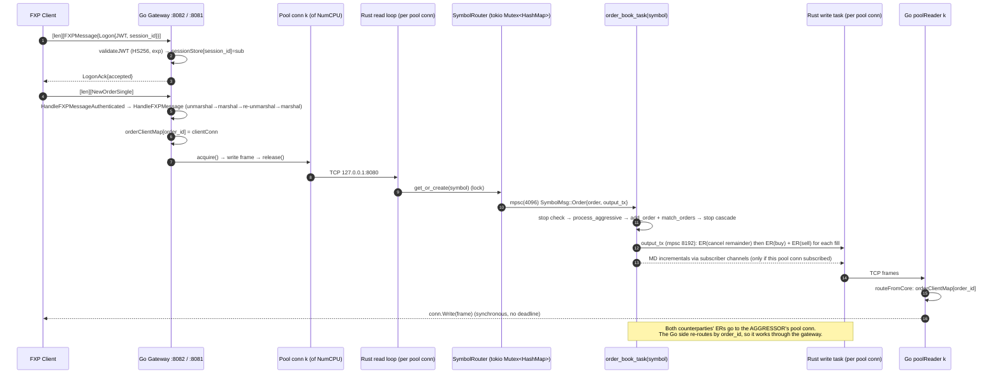

# FXP — Read-only Technical Analysis

**Repository:** https://github.com/StephT0560/fxp, analyzed at `main` @ `472a7ff` ("Update to fix bridge")
**Scope:** Read-only review. Nothing on `main` was changed. All proposed tests and probes ran in a scratch copy outside the repo.
**Analysis environment:** Ubuntu 22.04 VM, KVM, 8 vCPU Intel Xeon (Skylake-SP, model 94, AVX2), 31 GiB RAM. rustc/cargo 1.97.1, Go 1.23.4 host toolchain (auto-switched to go1.24.1 because both `go.mod` files say `go 1.24.1`), protoc 25.3, protoc-gen-go v1.36.5, Python 3.10.12.

---

## 0. Executive summary

FXP is a small (~6.5k LOC), readable, well-commented prototype. The architecture is sensible: one Tokio task per symbol, Protobuf frames with a length prefix, a Go edge gateway, and a FIX translation bridge. **It is not yet a correct matching engine, and the FIX bridge is not interoperable with standard FIX engines.** The headline problems, each confirmed by running something (not only by reading the code):

| # | Severity | Finding | Evidence |
|---|---|---|---|
| 1 | **Critical** | **The engine is LIFO, not FIFO, within a price level.** Orders are `push`ed onto a `Vec` and matched with `pop()` / `last_mut()`, so the *newest* order at a price fills first. | Proposed tests P01/P02 fail (§2.1) |
| 2 | **Critical** | **`order_lookup` is never updated on fills.** Filled orders stay "cancelable", and cancel/replace of a filled order *re-creates it with its original quantity*. Leaves memory growing without bound. | P04/P05/P11 fail; the FIX test `cancel_filled_order` passes only because it accepts `Canceled` |
| 3 | **Critical** | **Any authenticated user can cancel or replace any other user's order** (cancel is routed by `order_id` only). The canceller's connection also takes over the victim's execution-report routing. | FIX probe §3.6: session `ATTACKER` canceled `VICTIM`'s order |
| 4 | **Critical** | **FIX BodyLength(9) is off by +7** in the builder, the parser and the Python client. All three agree with each other, so the tests pass, but the bridge cannot exchange messages with a spec-compliant FIX engine. | Spec-compliant Logon gets no response. Bridge's LogonAck says `9=77` where the spec value is 70 |
| 5 | **Critical** | **Duplicate outbound MsgSeqNum.** The session and the app handler each keep their own outbound counter, so LogonAck and the first ExecutionReport are both sent as `34=1`. | FIX probe §3.6 |
| 6 | High | Passive crosses trade at the **aggressor's** price when the aggressor is a sell (price improvement goes to the wrong side). An existing test asserts this wrong behavior. | P03 fails; `test_stop_limit_rests_after_trigger` |
| 7 | High | Execution reports have wrong `leaves_qty` / `cum_qty` / `avg_px`, ExecIDs that are not unique, the IOC cancel is sent *before* the fills, and resting limit orders get no `EXEC_NEW` ack. | Code (§2.6), FIX probe |
| 8 | High | No ResendRequest, SequenceReset, Reject(3) or PossDup handling. Gaps are accepted silently. FIX clients are not authenticated (any CompID can log on and trade). | FIX probe |
| 9 | High | Gateway: unbounded pre-auth frame length (it will try to allocate up to 4 GiB), no rate or connection limits, and session IDs chosen by the client in a global map. | Code (§4) |
| 10 | Medium | Proto3 zero-value enums are real values (`MARKET=0`, `BUY=0`, `DAY=0`, `EXEC_NEW=0`), so a missing field silently means "buy at market, DAY". | Schema (§4.1) |
| 11 | Medium | 33 reachable Go stdlib CVEs (toolchain pinned at go1.24.1) and 7 RustSec advisories in the lockfile. | govulncheck / cargo audit |
| 12 | Medium | Docs overstate things: "release build" e2e, auction support marked ✅, "lock-free", 8-connection pool, a broken `BENCHMARK.md` link, and the FIX bridge still listed as a roadmap item. | §6.2 |

**Production readiness (my judgement):** matching engine **2/10** (it fails basic priority rules). FIX bridge **1/10** for counterparty certification (it would fail the first Logon). Gateway **3/10** (works for demos, unsafe on any network that is not trusted).

Recommended order of work: (1) fix FIFO plus `order_lookup` bookkeeping, add owner checks on cancel and replace; (2) fix FIX BodyLength and use a single seqnum counter; (3) add CI (§6.3) so these stay fixed; (4) everything else.

---

## 1. Orientation

### 1.1 Repository map

```
fxp/
├── fxp_core/                 Rust 2024 crate (lib + bin), Tokio, prost 0.13
│   ├── build.rs              prost-build: compiles proto/fxp.proto (needs `protoc` on PATH)
│   ├── proto/fxp.proto       Single source of truth for the wire schema (v1.1)
│   └── src/
│       ├── main.rs           bin entry → server::start_server() on 127.0.0.1:8080
│       ├── lib.rs            module roots + the 23 unit tests
│       ├── server.rs         TCP server, SymbolRouter, per-symbol task, stop book, exec-report building (833 LOC: most engine logic is here)
│       ├── order_book/       order.rs, order_book.rs (BTreeMap<i64, Vec<Order>>), matcher.rs, execution_report.rs, market_data.rs, broadcaster.rs (println-only)
│       ├── benches/encoding_benchmark.rs  Criterion: FXP vs FIX text vs hand-rolled SBE
│       ├── test.rs, integration_test.rs   ⚠ identical files, NOT compiled (not in module tree), reference a nonexistent fn
├── go_gateway/               Go module `go_gateway` (gorilla/websocket, protobuf v1.33.0)
│   ├── main.go               starts WS :8081 and TCP :8082
│   ├── transport/            auth.go (JWT), tcp_server.go, ws_server.go, common.go (router + MD fan-out), pool.go (NumCPU conns to core)
│   ├── protobuf/             ⚠ generated fxp.pb.go — gitignored, must be generated locally
│   ├── benchmark/benchmark.go  E2E latency/throughput tool
│   ├── simulation/trading_day.go  multi-participant simulation
│   ├── test_clients/         ⚠ two `package main` files in one dir: `go build ./...` fails
│   └── bench                 ⚠ 6.6 MB committed Windows PE32+ executable
├── fix_bridge/               Go module `fix_bridge` (replace go_gateway => ../go_gateway, protobuf v1.36.5)
│   ├── main.go               FIX acceptor :8083, bridgeHandler
│   ├── codec/                fields.go, parser.go, builder.go
│   ├── session/session.go    Logon/Logout/Heartbeat/TestRequest state machine
│   ├── translator/           fix_to_fxp.go, fxp_to_fix.go
│   └── gateway/client.go     one FXP TCP conn per FIX session, mints a JWT
├── fix_test_client/fix_client.py  Python FIX client, 8 scenarios / 16 assertions
├── README.md, Benchmark.md, LICENSE (MIT)
```

Languages and build systems: **Rust** (Cargo, prost-build), **Go** (two modules joined by a `replace` directive, no `go.work`), **Python 3** (stdlib only), **Protobuf** (protoc + protoc-gen-go for Go, prost-build for Rust). There is no Makefile, Dockerfile or CI.

**Component boundaries (all plain TCP on localhost, no TLS):**

| Link | Transport | Framing | Auth |
|---|---|---|---|
| Client → Go gateway `:8082` (all interfaces) | TCP | `u32 BE length` + `FXPMessage` | JWT in `Logon` |
| Client → Go gateway `:8081/ws` (all interfaces) | WebSocket binary | WS frame = one `FXPMessage` | JWT in `Logon` |
| FIX client → fix_bridge `:8083` (all interfaces) | TCP | FIX tag=value | **none** (any SenderCompID accepted) |
| fix_bridge → gateway `:8082` | TCP, 1 conn per FIX session | length-prefixed | JWT minted by bridge with the shared HS256 secret |
| Go gateway → Rust core `127.0.0.1:8080` | TCP pool, `runtime.NumCPU()` conns | length-prefixed | **none** (trusted) |

### 1.2 Build and test log (exact commands)

| Step | Command | Result | Friction |
|---|---|---|---|
| Rust build | `cd fxp_core && cargo build --all-targets` | ❌ first, then ✅ | `build.rs` panics: *Could not find `protoc`*. Fixed by installing protoc 25.3. 1 warning (`unused variable client_id`, order_book.rs) |
| Rust tests | `cd fxp_core && cargo test` | ✅ **23 passed**, 0 failed (0.00 s) | `src/test.rs` and `src/integration_test.rs` are byte-identical, never compiled, and reference `crate::server::handle_tcp_client_for_test` (does not exist) plus stale proto fields. They are dead code |
| Rust release | `cargo build --release` | ✅ 11.6 s | |
| Clippy | `cargo clippy --all-targets` | ⚠ 23 lib warnings, 56 test warnings, 6 bench warnings | 34× inconsistent digit grouping, 9× `clone()` on `Copy` `Timestamp`, `too_many_arguments`, `module_inception`, `enum_variant_names`, `new_without_default`, doc lints |
| cargo audit | `cargo install cargo-audit --locked && cargo audit` | ⚠ 7 advisories | see §4.4 |
| cargo deny | n/a | not configured | no `deny.toml` |
| Go codegen | README: `protoc --go_out=../../go_gateway --go_opt=paths=source_relative fxp.proto` | ❌ | **The README command writes `go_gateway/fxp.pb.go` into the `main` package directory**, so the build fails with *found packages protobuf and main*. Working command: `cd fxp_core/proto && mkdir -p ../../go_gateway/protobuf && protoc --go_out=../../go_gateway/protobuf --go_opt=paths=source_relative fxp.proto` |
| Go build | `cd go_gateway && go build ./...` | ❌ | `test_clients/ws_test_client.go:24: main redeclared` (two `main` funcs in one package). `go build .`, `./transport`, `./benchmark`, `./simulation` ✅ |
| Go build | `cd fix_bridge && go build ./...` | ✅ | |
| go vet | `go vet ./...` (both modules) | ⚠ | `benchmark.go:479 fmt.Println arg list ends with redundant newline`; test_clients compile error; fix_bridge clean |
| staticcheck | `GOTOOLCHAIN=go1.24.1 go install honnef.co/go/tools/cmd/staticcheck@2025.1.1`; `staticcheck ./...` | ⚠ 3 | `session.go:251` & `fix_to_fxp.go:116` ST1005; `benchmark.go:172` unused type `latencySample` (U1000) |
| govulncheck | `govulncheck ./transport/ .` / `govulncheck ./...` | ⚠ | go_gateway: **33 reachable stdlib vulns** (e.g. GO-2025-3563 net/http request smuggling via the WS server). fix_bridge: 2 (Windows-only) |
| Go unit tests / race | `go test -race ./...` | n/a | **No `_test.go` files exist** in either Go module. Instead I ran the full stack with `go build -race` binaries for gateway and bridge under the FIX test suite: **0 DATA RACE reports** (this low-concurrency run did not exercise the racy paths in §4.3) |
| FIX suite | core (release) + `FXP_JWT_SECRET=dev-secret` gw + bridge (race builds); `python3 fix_test_client/fix_client.py` | ✅ **16/16 assertions** | README says "15 FIX test-client cases". The script has 8 scenarios and 16 assertions. `stop_order` passes with a warning (*"stop not triggered … parking acknowledged"*), so the stop path is **not** actually tested e2e. `cancel_filled_order` accepts `ExecType=Canceled`, which is the stale-lookup bug from finding #2 |
| Encoding bench | `cargo bench --bench encoding_benchmark` | ✅ | see §5 |
| E2E bench | `go run benchmark/benchmark.go …` | ✅ | see §5 |

### 1.3 Data-flow diagrams (as implemented)

**Native binary path (TCP / WS client):**



**FIX bridge path:**

```mermaid
sequenceDiagram
    autonumber
    participant F as FIX client
    participant B as fix_bridge :8083 (session + translator)
    participant G as gateway.Client (1 per FIX session)
    participant GW as Go Gateway :8082
    participant E as Rust core (as above)

    F->>B: 35=A (Logon) — no password check
    B->>B: TargetCompID = 49 ; inSeq check ; state=LOGGED_ON
    B-->>F: 35=A seq=session.outSeq (=1)
    B->>G: OnLogon → NewClient(traderID=CompID) ; go Connect()
    G->>GW: Logon{JWT(sub=CompID) signed with FXP_JWT_SECRET}
    GW-->>G: LogonAck
    F->>B: 35=D NewOrderSingle
    B->>B: validateSeqNum (gaps logged, accepted) → TranslateFIXtoFXP (price → cents, truncating)
    B->>G: sendCh(512) → FXP NewOrderSingle{order_id=ClOrdID}
    G->>GW: frame
    GW->>E: pool → engine (native path)
    E-->>GW: ExecutionReport(s)
    GW-->>G: routed by orderClientMap[ClOrdID]
    G->>B: onFXPMessage → TranslateFXPtoFIX(seq = bridgeHandler.outSeq — SECOND counter, also starts at 1)
    B-->>F: 35=8 (ExecType/OrdStatus mapped), Send() drops if sendCh(512) full
```

---

## 2. Matching engine review (Rust)

### 2.1 Price-time priority and data structures

```rust
// order_book.rs
pub buy_orders:  BTreeMap<i64, Vec<Order>>,   // price → orders
pub sell_orders: BTreeMap<i64, Vec<Order>>,
pub order_lookup: HashMap<String, Order>,     // order_id → CLONE of order
```

- **Price priority: correct.** Best bid is `keys().next_back()` and best ask is `keys().next()`.
- **Time priority: wrong (LIFO).** `add_order` uses `price_level.push(order)` (appends to the tail). `fill_level` uses `resting.last_mut()` / `resting.pop()`, and `match_orders` uses `bid_orders.pop()` / `ask_orders.pop()`. All of them take the **tail**, which is the *newest* order. Confirmed by P01 (`left: "S-SECOND", right: "S-FIRST"`) and P02. None of the 23 tests puts two orders at the same price level, which is why this was never caught.
  *Fix:* use `VecDeque<Order>` with `push_back` / `front_mut` / `pop_front`. A better long-term option is an intrusive doubly-linked list or slab-indexed queue per level, so cancel is O(1).
- **`order_lookup` is a second copy and gets out of sync.** It is written on `add_order` and removed only on `cancel_order`. `fill_level` and `match_orders` never update or remove entries. Consequences:
  - Memory grows with every order that ever rested (leak).
  - Cancelling a fully filled order succeeds: it finds the stale entry, `retain` is a no-op, and the engine sends `EXEC_CANCELED` (P04).
  - After a partial fill the lookup still holds the original quantity (P05). Cancel market data reports the wrong quantity (P11).
  - **Cancel/replace of a filled or partially filled order rebuilds it from the stale clone, so the full original quantity comes back to life** (server.rs ~L205–245).
  - Duplicate `order_id`s silently overwrite the lookup entry.
- **The passive cross price is wrong for sell aggressors.** `match_orders` always trades at `ask_price`. When a resting bid at 101 is crossed by a sell limit at 99, the trade prints at **99** (aggressor's price) instead of 101 (resting price). P03 fails, and the existing `test_stop_limit_rests_after_trigger` asserts this behavior. Day/GTC limits go through "add to book, then `match_orders`" instead of the aggressive path, so this affects **every** marketable sell limit.

**Complexity**

| Op | Current | Notes |
|---|---|---|
| add (rest) | O(log P) + clone of `Order` (5 `String`s) twice | P = price levels |
| cancel | O(log P + L) | `retain` scans the level (L = orders at level) |
| match one fill | O(log P) amortized | BTreeMap first/last per iteration |
| FOK check | O(P·L) | sums the whole crossing side; overflows `u32` (P08 panics in debug, wraps in release) |
| stop trigger scan | O(S) per fill batch, rebuilds the Vec | S = parked stops |
| market data snapshot | O(N) | |

### 2.2 Stop / stop-limit trigger logic

Implemented in `server.rs::order_book_task` plus `OrderBook::drain_triggered_stops`.

| Aspect | Behavior | Assessment |
|---|---|---|
| Trigger semantics | Buy fires when `last ≥ stop`, sell fires when `last ≤ stop` | ✅ conventional |
| Reference price | `last_trade_price`, initialized to `0` = "no trade yet" | ⚠ stops can never fire immediately before the first trade of the process lifetime. Not persisted |
| Which prints are checked | Only `all_fills.last().trade_price` after the whole aggressive order | ❌ **gap/sweep bug**: a sweep that prints 100.00 then 101.00 never fires a sell stop at 100.50 (P09). Each print must be checked |
| Trigger ordering | Insertion order of the `Vec` | ❌ should be by stop price (most aggressive first), then time (P10) |
| Cascading | `loop { drain; process }` until nothing triggers | ✅ terminates (every stop is drained once). But all cascade ERs are sent with the **original aggressor's** `seq` and go to the **aggressor's** `output_tx` |
| Stop (market) with no liquidity | `process_aggressive` → `execute_market`, unfilled remainder dropped | ❌ **no cancel ER is sent**, so the order silently disappears |
| StopLimit with IOC/FOK TIF | always rests (`rest_on_book: true` regardless of TIF) | ❌ |
| Stop with IOC/FOK TIF | treated as market | ⚠ |
| Triggered notification | none | ❌ no ER with `ExecType=Triggered`/New on trigger |
| Cancel/replace a parked stop | `cancel_order` only searches the book | ❌ **parked stops cannot be cancelled** (returns Rejected) |
| `stop_price` validation | rejects only `== 0` | ⚠ a buy stop below the last trade fires immediately (fine if intended). Negative values accepted |

### 2.3 IOC partial-fill handling

- **Matcher: correct.** `execute_ioc` loops while the best opposite level crosses, never rests, and the book is unchanged when nothing crosses (P06 and P07 pass).
- **Reports: incorrect.**
  - `make_cancel_report` sets `executed_quantity = unfilled`, `leaves_quantity = unfilled`, `cum_quantity = 0`. For a cancel it should be `leaves = 0`, `cum = filled so far`, `last_qty = 0`.
  - The cancel ER is sent **before** the fill ERs (server.rs L427 vs L493). The client sees `CANCELED` then `FILLED`. The gateway works around this with a "`CANCELED` with `leaves>0` is not terminal" hack (pool.go L533–555), which is fragile.
  - The fill ER for the IOC aggressor shows `OrderPartiallyFilled` and `leaves_qty = trade_qty` (should be `remaining`).
- No residual resting: ✅ verified (P06/P07).

### 2.4 Robustness checklist

| Check | Finding |
|---|---|
| Price representation | `i64` cents (fixed point, good). But **only 2 dp** is hard-coded across the bridge and builder: no sub-penny, FX (5 dp) or crypto ticks. No tick-size or price-band validation |
| Quantity | Engine `u32`, wire `int32`. `order.quantity as u32` on a **negative** i32 wraps to ~4.29 billion, so a malicious qty of −1 becomes 4 294 967 295. Zero qty accepted |
| Integer overflow | FOK `sum::<u32>()` overflows (P08). `as i32` casts on outbound reports truncate |
| Panics on hot path | `SystemTime::now().duration_since(UNIX_EPOCH).unwrap()` per message; `msg.encode(&mut encoded).unwrap()`; `.get_mut(&price).unwrap()` in `match_orders` (safe given the invariants). **`listener.accept().await.unwrap()`**: one `EMFILE` or `ECONNABORTED` kills the whole server |
| `unsafe` | none ✅ |
| Determinism | Matching does not depend on HashMap order ✅. Timestamps come from wall clock, and there is no event log or sequencer, so a session cannot be replayed deterministically. Cross-symbol ordering depends on the Tokio scheduler |
| Allocation on hot path | Every order: `String` clones for id/trader/symbol/account/client id (×2 for lookup), `Vec` for fills and updates, a `MarketDataIncrementalUpdate` with `symbol.clone()` and a `Vec` per fill, a fresh `Vec<u8>` in `frame_message`, `format!` ExecIDs, and **`println!` on every order, fill and cancel** (stdout lock) |
| Backpressure into the engine | `output_tx.send(..).await` and `broadcast_md` (`tx.send().await` on a 256-slot channel per subscriber) block the **symbol task**. One slow market-data consumer or client stalls matching for that symbol for everyone |
| Symbol creation | Any string spawns a new task and book (unbounded, a DoS vector). The global `tokio::Mutex<HashMap>` is locked on **every** inbound message |
| Validation | No checks for: qty ≤ 0, price ≤ 0 on limits, unknown symbol, duplicate order_id, self-trade, account / trader ownership |
| Unknown enums | `_ => Market`/`Buy`/`Day` fallbacks (server.rs) turn bad input into live orders instead of rejecting it |

### 2.5 Order types, TIFs and lifecycle coverage

| Feature | State |
|---|---|
| Limit Day/GTC/GTD | rests ✅, but **no expiry at all**: Day never expires, GTD `expire_date` is never read, GTC is not persisted (no persistence anywhere) |
| Market | ✅ (sweeps, cancels remainder). No protection collar |
| IOC / FOK | ✅ matcher. Reports wrong (§2.3) |
| Stop / StopLimit | partial (§2.2) |
| AT_OPEN / AT_CLOSE | ❌ **they rest as ordinary continuous limits and match immediately.** README marks them ✅ |
| Cancel | ✅ for resting orders. ❌ for stops. ❌ ownership check. Uses stale lookup |
| Cancel/Replace | ⚠ always loses priority (even qty-down), ignores `new_time_in_force`, `orig_order_id` not echoed, resurrection bug, no `new_order_id` uniqueness check |
| Missing | Iceberg/reserve, pegged (primary/mid/market), post-only / ALO, min-qty, MOO/MOC/LOO/LOC auctions, trailing stop, self-trade prevention, mass cancel, cancel-on-disconnect, kill switch, order-status request, short-sale marking (SellShort maps to Sell), lot/tick size, price bands / LULD |

### 2.6 Execution report correctness (native)

| Field | Current | Should be |
|---|---|---|
| `execution_type` on fills | always `EXEC_FILLED` | add `EXEC_TRADE` / `EXEC_PARTIAL_FILL` (or keep one value but document it). FIX 4.4 uses `150=F` (Trade) for both |
| `leaves_quantity` (partial) | `trade_qty` | order qty − cum qty |
| `cum_quantity` | `trade_qty` | running total per order |
| `avg_px` | trade price | VWAP across fills |
| `execution_id` | `EXEC-{order}-{price}` | **not unique**: two fills at the same price share an ID. Use a per-engine monotonic counter |
| ER for resting order | **none** | `EXEC_NEW` ack (confirmed missing by the FIX probe) |
| Header `sequence_number` | client's seq + 1, or 0, or 1 | per-session monotonic outbound seq |
| `client_order_id`, `account` | empty | echo from the order |
| Counterparty ER destination | aggressor's `output_tx` | the resting order's owner connection |

### 2.7 Proposed tests (not committed)

I ran these against a scratch copy (`~/scratch/fxp_core`, appended to `lib.rs` as `mod proposed_tests`). **9 of 11 fail on current `main`**, confirming the findings above.

| ID | Test | Result on main |
|---|---|---|
| P01 | FIFO within level (aggressive IOC) | ❌ `S-SECOND` filled first |
| P02 | FIFO within level (passive `match_orders`) | ❌ `B-SECOND` |
| P03 | Passive cross trades at resting price | ❌ 9900 vs 10100 |
| P04 | Filled order removed from `order_lookup`; cancel rejected | ❌ |
| P05 | Partial fill updates lookup qty | ❌ 10 vs 6 |
| P06 | IOC no-cross leaves book untouched | ✅ |
| P07 | IOC multi-level partial, remainder not rested | ✅ |
| P08 | FOK liquidity sum must not overflow | ❌ panic `attempt to add with overflow` |
| P09 | Stop fires on intermediate print in a sweep | ❌ |
| P10 | Triggered stops ordered by stop price | ❌ |
| P11 | Cancel MD reports remaining qty | ❌ 10 vs 6 |

```rust
#[cfg(test)]
mod proposed_tests {
    use crate::order_book::order::{OrderSide, OrderType, TimeInForce};
    use crate::order_book::order_book::OrderBook;
    use super::test_helpers::*;

    #[test]
    fn p01_time_priority_fifo_within_level() {
        let mut book = make_book();
        book.add_order(make_order("S-FIRST",  OrderSide::Sell, 100_00, 10, OrderType::Limit, TimeInForce::GTC));
        book.add_order(make_order("S-SECOND", OrderSide::Sell, 100_00, 10, OrderType::Limit, TimeInForce::GTC));
        let r = book.process_aggressive(make_order("B", OrderSide::Buy, 100_00, 10, OrderType::Limit, TimeInForce::IOC));
        assert_eq!(r.fills[0].sell_order_id, "S-FIRST");
    }

    #[test]
    fn p02_time_priority_passive_match() {
        let mut book = make_book();
        book.add_order(make_order("B-FIRST",  OrderSide::Buy, 100_00, 10, OrderType::Limit, TimeInForce::GTC));
        book.add_order(make_order("B-SECOND", OrderSide::Buy, 100_00, 10, OrderType::Limit, TimeInForce::GTC));
        book.add_order(make_order("S",        OrderSide::Sell, 100_00, 10, OrderType::Limit, TimeInForce::GTC));
        let (fills, _) = book.match_orders();
        assert_eq!(fills[0].buy_order_id, "B-FIRST");
    }

    #[test]
    fn p03_passive_cross_trades_at_resting_price() {
        let mut book = make_book();
        book.add_order(make_order("B",     OrderSide::Buy,  101_00, 10, OrderType::Limit, TimeInForce::GTC));
        book.add_order(make_order("S-AGG", OrderSide::Sell,  99_00, 10, OrderType::Limit, TimeInForce::GTC));
        let (fills, _) = book.match_orders();
        assert_eq!(fills[0].trade_price, 101_00);
    }

    #[test]
    fn p04_filled_order_removed_from_lookup() {
        let mut book = make_book();
        book.add_order(make_order("S", OrderSide::Sell, 100_00, 10, OrderType::Limit, TimeInForce::GTC));
        let _ = book.process_aggressive(make_order("B", OrderSide::Buy, 100_00, 10, OrderType::Limit, TimeInForce::IOC));
        assert!(!book.order_lookup.contains_key("S"));
        assert!(book.cancel_order("S").is_none());
    }

    #[test]
    fn p05_partial_fill_updates_lookup_qty() {
        let mut book = make_book();
        book.add_order(make_order("S", OrderSide::Sell, 100_00, 10, OrderType::Limit, TimeInForce::GTC));
        let _ = book.process_aggressive(make_order("B", OrderSide::Buy, 100_00, 4, OrderType::Limit, TimeInForce::IOC));
        assert_eq!(book.order_lookup["S"].quantity, 6);
    }

    #[test]
    fn p06_ioc_never_rests_and_book_unchanged_on_no_cross() {
        let mut book = make_book(); seed_book(&mut book);
        let before = book.get_market_snapshot();
        let r = book.process_aggressive(make_order("I", OrderSide::Buy, 100_00, 10, OrderType::Limit, TimeInForce::IOC));
        assert!(!r.rest_on_book);
        let after = book.get_market_snapshot();
        assert_eq!(before.bids, after.bids); assert_eq!(before.asks, after.asks);
        assert!(!book.order_lookup.contains_key("I"));
    }

    #[test]
    fn p07_ioc_multi_level_partial() {
        let mut book = make_book(); seed_book(&mut book);
        let r = book.process_aggressive(make_order("I", OrderSide::Buy, 102_00, 250, OrderType::Limit, TimeInForce::IOC));
        assert_eq!(r.fills.iter().map(|f| f.trade_quantity).sum::<u32>(), 200);
        assert_eq!(r.unfilled_qty, 50);
        assert!(book.sell_orders.is_empty());
    }

    #[test]
    fn p08_fok_quantity_sum_overflow() {
        let mut book = make_book();
        book.add_order(make_order("S1", OrderSide::Sell, 100_00, u32::MAX, OrderType::Limit, TimeInForce::GTC));
        book.add_order(make_order("S2", OrderSide::Sell, 100_00, 2,        OrderType::Limit, TimeInForce::GTC));
        let r = std::panic::catch_unwind(std::panic::AssertUnwindSafe(|| {
            book.process_aggressive(make_order("F", OrderSide::Buy, 100_00, 5, OrderType::Limit, TimeInForce::FOK))
        }));
        assert!(r.is_ok());
    }

    #[test]
    fn p09_stop_trigger_on_intermediate_print() {
        // A sweep printed 100.00 then 101.00; engine only checks the last print.
        let mut sell_stops = vec![{ let mut o = make_order("SS", OrderSide::Sell, 0, 1, OrderType::Stop, TimeInForce::Day); o.stop_price = 100_50; o }];
        assert_eq!(OrderBook::drain_triggered_stops(&mut sell_stops, 101_00).len(), 1,
                   "should be evaluated against every print, not just the last");
    }

    #[test]
    fn p10_stop_trigger_order_by_price_then_time() {
        let mut stops = vec![
            { let mut o = make_order("BS-110", OrderSide::Buy, 0, 1, OrderType::Stop, TimeInForce::Day); o.stop_price = 110_00; o },
            { let mut o = make_order("BS-105", OrderSide::Buy, 0, 1, OrderType::Stop, TimeInForce::Day); o.stop_price = 105_00; o },
        ];
        let t = OrderBook::drain_triggered_stops(&mut stops, 111_00);
        assert_eq!(t[0].order_id, "BS-105");
    }

    #[test]
    fn p11_cancel_partially_filled_md_qty() {
        let mut book = make_book();
        book.add_order(make_order("S", OrderSide::Sell, 100_00, 10, OrderType::Limit, TimeInForce::GTC));
        let _ = book.process_aggressive(make_order("B", OrderSide::Buy, 100_00, 4, OrderType::Limit, TimeInForce::IOC));
        assert_eq!(book.cancel_order("S").unwrap().changes[0].quantity, 6);
    }
}
```

> P09 as written only shows the API cannot express "check every print". The real fix changes the caller to iterate `all_fills` and call `drain_triggered_stops` per print. Rewrite the test against the new API once that exists.

**Additional edge cases to cover (not written as code yet):**
- Server-level (spin up `order_book_task` with an mpsc pair, no TCP): IOC partial produces exactly `[FILL…, CANCEL]` in that order with `leaves=0` and `cum=filled`. Resting limit produces `EXEC_NEW`. Each fill's `exec_id` is unique.
- Stop market with an empty book produces a cancel ER (currently silent drop). Cancel of a parked stop succeeds.
- Cascading: stop A fires, its fill triggers stop B, which triggers C. Assert ordering and that `last_trade_price` equals the final print.
- Cancel/replace: qty-down keeps priority; price change loses priority; replace of a filled order is rejected; `new_order_id` collides with a live id → reject.
- Validation: qty 0, qty < 0, limit price ≤ 0, empty symbol, unknown enum values → reject (not a default).
- Self-trade (same trader both sides) follows the configured STP policy.
- FOK exactly equal to the available qty fills. FOK across levels where the deeper level exceeds the limit → kill.
- Market order sweeping more than 100 levels (performance regression guard).
- Property test (proptest/quickcheck) against a naïve reference book: random add/cancel/IOC/FOK sequences must give identical fills. This alone would have caught #1, #2 and #6.

---

## 3. FIX bridge review (FIX 4.4)

### 3.1 Codec

| Area | Finding | Severity |
|---|---|---|
| **BodyLength (9)** | `computeBodyLength = len(body) + 7`. The comment says it counts "up to AND including tag 10's SOH". **The FIX spec counts from the byte after `9=…<SOH>` up to and including the SOH *before* `10=`**, so the checksum field is excluded. The parser reads exactly `bodyLen` bytes and expects `10=` inside them. Both directions are therefore off by 7. The Python client (`body_len = len(body) + 7`) has the same bug, so the suite passes. The Rust encoding benchmark's FIX encoder uses the *correct* `body.len()`. | **Critical**: confirmed. A spec-compliant Logon got no response because the parser blocks waiting for 7 more bytes. The bridge's own LogonAck declares `9=77` where the spec value is 70 |
| CheckSum (10) | Recomputed by re-serializing parsed fields, with tag 8 **forced to `"FIX.4.4"`**. Non-canonical input (e.g. `FIX.4.2`, leading zeros such as `035=D`) fails the checksum. The 3-digit format is not enforced. Checksum position is not verified to be the last field in the stream (`Fields[10]` lookup) | Medium |
| SOH handling | Empty fields (`\x01\x01`) silently skipped. `readField` accepts any `tag=value`. The `8=FIX.4*` prefix is accepted but then rewritten to 4.4 | Low |
| Repeating groups (inbound) | `Fields map[int]string`, so duplicate tags overwrite each other. Groups cannot be read (only the `Tags` slice keeps order, and nothing uses it). `MarketDataRequest` symbols are pulled by scanning tags, OK for `NoRelatedSym` but no other group | High for MD/allocations |
| **Repeating groups (outbound)** | Confirmed: an X with 3 changes serializes as `268=3|279=2|55=AAPL|270=102.00|271=9`. `Builder.Set` **replaces an existing tag**, so every loop iteration in `translateMarketDataSnapshot` / `translateMarketDataIncremental` overwrites the previous entry. A W/X message carries `268=N` but **only one** `269/270/271` triple, which a counterparty will reject as malformed. `55` also sits inside the X group, but in FIX 4.4 `Symbol` belongs in the Instrument component of each entry, which is OK only if the group were emitted correctly | **High** |
| Data fields (RawData 96 / XmlData 213 / Signature 89…) | Not supported. A length-prefixed binary value that contains SOH will desync the parser | Medium |
| Malformed message | Any parse error: `readLoop` returns and the connection drops. **No `35=3` Reject** is sent (`codec.NewReject` exists but is never called). Confirmed with a bad checksum: silent drop. FIX says to *ignore* garbled messages (bad checksum/length) and to send `Reject` for well-formed but invalid ones | High |
| Limits | `BodyLength ≤ 1 MiB` is allocated pre-auth per connection. No connection limit | Medium |
| Price handling | `parseFixedPoint` **truncates** beyond 2 dp (the comment says "round"). `formatFixedPoint(0)` gives `"0"`. Negative prices between −1 and 0 lose their sign (`"-0.50"` → dollars `-0` → `+50` cents) | Medium |

### 3.2 Session state machine vs FIX 4.4 session layer

| Requirement | Implementation | Gap |
|---|---|---|
| Logon: first message must be Logon, check CompIDs, auth | First-message rule is enforced only for *application* messages: Heartbeat, TestRequest, ResendRequest and Logout are processed before Logon. **No TargetCompID(56) check, no password / Username(553/554), no allow-list of CompIDs**: any client can log on as any CompID and the bridge mints a JWT for that identity | **Critical (security)** |
| Logon response | Echoes HeartBtInt. Ignores `141=Y` on the *initial* logon. Never sets `141` in the response | High |
| Logon timeout | none (connection can sit in `CONNECTED` forever) | Medium |
| MsgSeqNum inbound | `validateSeqNum` is run only for Logon and application messages. Heartbeat, TestRequest, Logout and ResendRequest don't advance `inSeqNum`, so the next app message looks like a gap | High |
| Gap detection (seq > expected) | logs and **accepts** (sets `inSeqNum = seq+1`). Should queue the message and send `ResendRequest(2)` | **Critical** (confirmed: no 35=2 on gap) |
| Too-low seq | disconnects with Logout even when `PossDupFlag(43)=Y`. Should accept PossDup (after checking `OrigSendingTime(122) ≤ SendingTime(52)`) and drop it as a duplicate | High |
| ResendRequest (2) inbound | **ignored completely** (the comment claims a GapFill is sent, but nothing is sent). There is no outbound message store to replay from | **Critical** (confirmed) |
| SequenceReset (4) GapFill / Reset | not handled. It falls through to the app handler, translation fails with "unsupported FIX message type", and the error is only logged | **Critical** |
| Reject (3) inbound | not handled (goes to app path → unsupported) | High |
| Heartbeat / TestRequest | Heartbeat sent when idle ≥ HeartBtInt ✅. TestRequest sent after 2×HBI of silence, **re-sent every interval forever, never disconnects**. The expected TestReqID in the reply Heartbeat is not checked. `lastSent` / `lastReceived` are read and written from three goroutines with no synchronization (data race; the race detector didn't fire in my short run) | High |
| Outbound MsgSeqNum | **Two independent counters**: `Session.outSeqNum` (admin messages) and `bridgeHandler.outSeqNum` (app messages), both starting at 1. Confirmed on the wire: LogonAck `34=1`, then the first ExecutionReport also `34=1`. Any counterparty will treat this as a fatal sequence error | **Critical** |
| Backpressure | `Session.Send` **drops** frames when `sendCh(512)` is full, after a seq number has already been consumed. The counterparty then sees a permanent gap, with no store to resend from | High |
| Logout | Logout echoed and closed right away. No wait for the counterparty's Logout, no `LOGGING_OUT` timeout. On gateway failure the bridge sends a Logout with **hard-coded seq 1** | Medium |
| Reconnect / recovery | No persistence, so every reconnect restarts at seq 1 on both sides (see §3.3) | **Critical** |
| PossDupFlag / OrigSendingTime outbound | never set (no resend, so never needed today) | — |
| SendingTime accuracy check | not checked (spec: reject when outside a tolerance) | Medium |
| App messages before gateway connected | `OnLogon` dials the gateway asynchronously. Orders arriving before then are **dropped with only a log line** | High |

### 3.3 Known gap: sequence-number persistence

**What breaks today across a restart (bridge crash, deploy, or network blip):**
1. The bridge forgets both counters. The counterparty's next Logon arrives with `34=N` (N > 1), and the bridge accepts it as a "gap" (it does not reject or ask for a resend). The bridge then sends LogonAck `34=1`, which the counterparty sees as **MsgSeqNum too low**. A compliant engine must Logout/disconnect, so the session cannot be re-established without a manual `141=Y` reset on both sides.
2. ExecutionReports that were emitted but not delivered (in `sendCh`, or lost in flight) cannot be resent. Fills are lost: a reconciliation break and real money risk.
3. Inbound orders the bridge received but had not forwarded are lost without the client knowing. The client believes they were accepted at session level.
4. `ClOrdID` uniqueness, `OrderID` ↔ `ClOrdID` mapping, and open-order state for cancels are all in memory (and partly in the gateway's `orderClientMap`), so cancels after a restart cannot be routed.

**Proposed design**

*Scope:* per session key `(BeginString, SenderCompID, TargetCompID, [SessionQualifier])`.

*Store layout* (one directory per session, append-only):
```
sessions/FIX.4.4-FXPBRIDGE-CLIENTA/
  seqnums            # 16 bytes: next_out u64 LE | next_in u64 LE, written via write-temp + fsync + rename (atomic)
  session.meta       # creation time (for daily reset), last logon time
  outbound.log       # framed records: [u32 len][u64 seq][u64 ts_ns][u32 crc32c][raw FIX bytes]
  outbound.idx       # fixed-width [u64 seq → u64 offset] for O(1) resend lookup (rebuildable from .log)
  inbound.log        # optional, for audit / regulatory (same format)
```
- `outbound.log` is the message store used to answer ResendRequest. Admin messages (Logon, Heartbeat, TestRequest, ResendRequest, SequenceReset) are **not replayed**: they are replaced with SequenceReset-GapFill (`123=Y`) ranges. App messages are re-sent with `43=Y` and `122=<original 52>`, with a fresh `52`.
- Sequence numbers are assigned by **one** allocator inside the session (delete the second counter in `bridgeHandler`). The order is: allocate → serialize → append to `outbound.log` → then hand to the socket writer (never drop after allocation; block or disconnect instead).

*fsync policy (configurable, document the trade-offs):*
| Mode | Behavior | Use |
|---|---|---|
| `strict` | fsync `outbound.log` before writing each app message to the socket; fsync `seqnums` on every inbound app message *before* acting on it | certification / low volume |
| `group` (default) | group commit: fsync every N ms (e.g. 1–2 ms) or M messages, and the writer waits for the commit that covers its seq. Adds ~1–2 ms latency, keeps throughput | production |
| `async` | OS page cache, fsync at Logout or every 1 s | dev / benchmarks only |
On restart, the in-sequence numbers are recomputed as `max(seqnums.next_in, last inbound.log seq + 1)` and `next_out = last outbound.log seq + 1`. The log is the source of truth, and the `seqnums` file is a fast-path hint.

*Recovery on start / Logon:*
1. Open the store, verify CRC on the tail record, and truncate a torn final record.
2. On inbound Logon: if `34 > next_in`, accept the Logon, then send `ResendRequest(7=next_in, 16=0)`. If `34 < next_in` and no `141=Y`, Logout with text "MsgSeqNum too low" and disconnect (per spec).
3. Respond to the counterparty's ResendRequest from `outbound.log` as above.
4. Daily or weekly reset policy: a configurable session schedule (e.g. 17:00 NY) that archives the store and resets to 1 with `141=Y`.
5. Engine reconciliation: after a bridge restart, get open-order state from the engine (needs an `OrderStatusRequest` / `OrderMassStatusRequest` on the native side) to rebuild `ClOrdID → OrderID` and to answer `35=H`.

*Implementation notes:* QuickFIX/Go's `FileStore` already does this (and adds a SQL store). Adopting QuickFIX/Go for the session layer, and keeping only the translator, is the lowest-risk path. I recommend it over hand-rolling.

### 3.4 Message mapping FIX ↔ native

| FIX | → native | Issues |
|---|---|---|
| D NewOrderSingle | `NewOrderSingle{order_id = client_order_id = ClOrdID}` | Native namespace for `order_id` is global, so ClOrdIDs from different firms **collide** (and overwrite each other's routing). `HandlInst(21)`, `TransactTime(60)` (required in 4.4) not validated. `Side=5` (SellShort) silently becomes Sell (regulatory problem). `ExpireDate(432)` is `YYYYMMDD` but the proto comment says `YYYY-MM-DD` (and the engine ignores it anyway). `TimeInForce=A` (AtOpen) is non-standard (4.4 uses `2` = AtTheOpening). Unsupported `OrdType` (e.g. `P` Pegged) → ER Rejected ✅ |
| F OrderCancelRequest | `OrderCancelRequest{order_id = OrigClOrdID}` | The cancel's own ClOrdID(11) is dropped (`client_cancel_id` is set but only used in the ExecID suffix). Response ER echoes ClOrdID = **orig** id, so the client cannot correlate the cancel. Engine "not found" → **ER `35=8 150=8`** instead of the required **OrderCancelReject `35=9`** (only translation errors produce `35=9`) |
| G OrderCancelReplaceRequest | `OrderCancelReplaceRequest{order_id=Orig, new_order_id=ClOrdID}` | `TimeInForce` / `OrdType` changes ignored. Replace of a filled order succeeds (engine bug #2). The engine's not-found reject comes back as `35=8` (not `35=9 434=2`) |
| V MarketDataRequest | `MarketDataRequest{symbols}` | `SubscriptionRequestType(263)`, `MarketDepth(264)`, `MDEntryTypes` ignored. No unsubscribe. MDReqID(262) not echoed on W/X |
| ← ExecutionReport | `35=8` | **`150=1/2` (PartialFill/Fill) are not valid in FIX 4.4.** 4.4 uses `150=F` (Trade) with OrdStatus 1/2. The engine never marks partials, so everything is `150=2`. `OrderID(37)` = ClOrdID (should be the engine-assigned id). `ExecID` not unique (§2.6). `LeavesQty` / `CumQty` / `AvgPx` wrong (§2.6). `AvgPx(6)` omitted when 0 (required field in 4.4). `Side(54)`, `OrderQty(38)` (required in 4.4 ER) **missing**. `TransactTime` ✅ |
| ← Cancel / IOC remainder | `150=4 39=4` | `LastQty(32)` is set to the *cancelled* qty, which looks like a fill to the client. Sent before the fills |
| ← Reject | `150=8 39=8 103=99 58=…` | ok shape, but the reason codes are always `99` (Other) |
| Session Reject (3) / BusinessMessageReject (j) | **never emitted** | Unsupported MsgTypes (e.g. `35=H`, `AE`) are only logged. They should get `35=j 380=3` |

### 3.5 Absent FIX 4.4 features
ResendRequest / SequenceReset / message store, PossDup / PossResend, Reject(3), BusinessMessageReject(j), TestRequest timeout disconnect, Logon auth (553/554 or a CompID allow-list + IP allow-list), session schedule / daily reset, `141=Y` handling, OrderStatusRequest(H), OrderMassCancelRequest(q), OrderMassStatusRequest(AF), DontKnowTrade(Q), TradeCaptureReport(AE), SecurityDefinition / SecurityList, MarketDataRequestReject(Y), proper repeating groups (Parties 453, NoMDEntries), data fields, `Side=5/6` short sale, multiple BeginStrings (4.2 / 4.4 / FIXT), TLS, initiator mode, DataDictionary validation (required / allowed tags per MsgType, enum values).

### 3.6 Live probe results (`fix_probe.py`, not committed)

| Probe | Expected (spec) | Actual |
|---|---|---|
| Spec-compliant Logon (`9` excludes `10=`) | LogonAck | **no response** (parser waiting for 7 more bytes) |
| Bridge LogonAck BodyLength | 70 | **77** |
| Resting limit `35=D` | ER `150=0 39=0` | **nothing** |
| Session `ATTACKER` sends `35=F 41=VIC-ORD-1` for `VICTIM`'s order | `35=9` reject (not owner) | **`35=8 150=4 39=4` to ATTACKER**, order cancelled. VICTIM gets nothing |
| Inbound seq gap (34=10, expected 3) | `35=2` ResendRequest | nothing |
| Inbound `35=2` ResendRequest | GapFill / resend | nothing |
| Bad checksum | ignore message (keep session) | connection dropped silently |
| Market order after logon | ER with `34=2` | ER with **`34=1`** (duplicate of LogonAck) |

### 3.7 Production-readiness rating for counterparty certification

**1 / 10. It would fail the very first test case** (Logon with a correct BodyLength). Even with BodyLength fixed, it fails: duplicate seqnums, no resend / gap-fill, no SequenceReset, no Reject, wrong ExecType values for 4.4, missing required ER fields (Side, OrderQty, AvgPx), broken repeating groups in market data, and no session authentication. Typical certification scripts (e.g. exchange or broker conformance suites) start with exactly these session-layer tests.

Path to certifiable: replace `codec/` and `session/` with **QuickFIX/Go** (store, resend, validation via a FIX44 DataDictionary, and a configured acceptor with a CompID allow-list). Keep and fix `translator/`. Add an exchange-assigned OrderID plus a per-firm ClOrdID namespace. Then run the QuickFIX acceptance test suite (`quickfix/_test/definitions/server/fix44`), which covers the session layer, against the bridge in CI.

---

## 4. Gateway, protocol and security (Go + Protobuf + JWT)

### 4.1 Protobuf schema (`fxp_core/proto/fxp.proto`, v1.1)

**Good:** one `FXPMessage` envelope with a `oneof`, field numbers documented as permanent, `google.protobuf.Timestamp`, fixed-point `int64` prices, and an explicit extension range convention.

| Issue | Detail | Recommendation |
|---|---|---|
| **Zero-value enums are meaningful** | `OrderType.MARKET=0`, `OrderSide.BUY=0`, `TimeInForce.DAY=0`, `OrderStatus.ORDER_NEW=0`, `ExecutionType.EXEC_NEW=0`, `ErrorType.SYSTEM_ERROR=0`, `EncryptionType.NONE=0`. A client that forgets `side` / `order_type` sends a **BUY MARKET DAY** order. The schema's own header comment says *"never use zero to mean no value"*, and these enums break that rule | Add `*_UNSPECIFIED = 0` to every enum and reject unspecified values in the engine. This is a wire-breaking change, so do it now (pre-1.0) and bump the major version |
| Sentinel zeros | `new_price=0`/`new_quantity=0`/`new_time_in_force=DAY(0)` mean "no change", so you can't amend to DAY | Use `optional` (proto3 field presence) or wrapper types |
| `update_type` is `int32` | magic numbers 0/1/2 | make it an enum |
| No `reserved` statements | nothing stops a retired number being reused | add `reserved` when removing fields, and lint it with `buf breaking` in CI |
| Extension range 1000–1999 | only a comment. proto3 has no extensions | keep the convention, but enforce it in `buf lint` or switch to an `Any`/`map<string,…>` extension bag |
| Versioning | `FXPHeader.protocol_version` is a **string on every message** (wasted bytes). Values are inconsistent ("1.0" vs "1.1" emitted by the same server). There is no version negotiation at Logon | Negotiate a version once at Logon (an `int32 version` in Logon/LogonAck). Drop it from the per-message header |
| Sequence numbers | `FXPHeader.sequence_number` exists but nothing uses it consistently (hard-coded 1 for MD, client seq + 1 for ERs, 0 for others). `GapFillRequest` is defined but not implemented | per-session monotonic outbound seq + replay, or drop it |
| Quantity `int32` | negative values representable, and cast to `u32` in the engine | `uint64` (or `int64` with validation) |
| `Logon.token` | JWT inside Protobuf over plaintext TCP | requires TLS (`EncryptionType` exists but is unused) |
| Framing | `u32 BE length` + body. Max 1 MiB enforced by Rust and the gateway's pool reader, **but not by the gateway's client-facing TCP reader** (see 4.3). WS has no `SetReadLimit` | enforce one limit (e.g. 64 KiB) everywhere, pre-auth even smaller (4 KiB) |
| Go vs Rust protobuf versions | go_gateway pins `google.golang.org/protobuf v1.33.0`, fix_bridge `v1.36.5` | unify (one `go.work`) |
| Generated code not committed | fresh clones can't `go build` without protoc | commit generated code or add `go generate` + CI check |

### 4.2 JWT

| Check | Status |
|---|---|
| Algorithm pinning / reject `none` | ⚠ **Implicitly safe**: the header is never parsed and HMAC-SHA256 is always recomputed, so `alg: none` or RS/HS confusion cannot succeed. But nothing checks the header, so tokens with any `alg` / `kid` are accepted if the HS256 MAC matches. Recommend parsing the header and requiring `alg == "HS256"` (and `typ`) explicitly, or using `github.com/golang-jwt/jwt/v5` with `jwt.WithValidMethods([]string{"HS256"})` |
| Signature compare | `hmac.Equal` on base64 strings ✅ constant time |
| Key management | one symmetric secret from `FXP_JWT_SECRET`, read with `os.Getenv` **on every validation**. Panics on the first Logon (not at startup) if unset. No minimum length (a 1-byte secret is accepted). **The same secret is shared with the FIX bridge, which mints tokens for any CompID**, so the bridge is effectively a token oracle for unauthenticated FIX clients. No rotation or `kid` support | Load once at startup and require ≥ 32 bytes. Prefer asymmetric keys (EdDSA/RS256) issued by an IdP, with the gateway holding only public keys (JWKS + `kid` rotation). Give the bridge its own credential, not the signing key |
| `exp` | checked ✅ (no leeway, no max lifetime). Test tokens are minted with a 24 h lifetime |
| `iat` / `nbf` | `iat` required non-zero but not checked against the clock (future-dated tokens accepted). `nbf` not supported |
| `aud` / `iss` | **not checked** (a token minted for any other service with the same secret works) |
| Replay protection | none. No `jti`, no one-time-use, and tokens can be reused across any number of concurrent sessions |
| Token scope vs permissions | **none**. `sub` is stored in `sessionStore` but **never used**: `NewOrderSingle.sender` and `account` are client-supplied and unchecked. Cancel/replace is authorized by knowing an `order_id`. There are no scopes such as `trade:write` / `md:read`, no account entitlements, and no risk limits |
| Session IDs | **client-chosen** `session_id` in a process-global `sync.Map`. Two clients choosing the same ID overwrite each other. A Logout from one connection **invalidates the other connection's session**. Sessions are never removed on disconnect (leak). Re-Logon on an authenticated connection silently switches identity |

### 4.3 Gateway robustness

| Area | Finding |
|---|---|
| **Pre-auth DoS** | `tcp_server.go`: `msgLen := binary.BigEndian.Uint32(lenBuf); msgBuf := make([]byte, msgLen)` with **no upper bound**. An unauthenticated client sends `FF FF FF FF` and the gateway tries to allocate 4 GiB per connection |
| Input validation | none at the gateway (it just re-marshals). Symbols, qty, price and enum values are passed straight to the engine. Empty symbols are filtered only for MD requests |
| AuthZ on cancel/replace | **missing**: cross-user cancel confirmed (§3.6). `orderClientMap.Store(orderID, clientConn)` on cancel also **re-routes the victim's future ERs to the attacker** |
| Duplicate order IDs | `orderClientMap` is keyed by bare `order_id` across all clients, so collisions misroute ERs |
| Rate limiting / backpressure | none per connection or per user. `acquire()` blocks forever if the pool is exhausted or broken, so goroutines pile up without bound (one per client connection, each holding its read loop) |
| Connection limits | none on TCP or WS. WS `CheckOrigin` returns `true` (CSWSH risk if browser clients ever hold credentials) |
| Slow consumers | `routeFromCore` does a **synchronous `client.Write` with no deadline** inside the pool reader goroutine. One stalled client blocks every ER and MD message on that pool connection for all users (head-of-line blocking). `ForwardMarketData` has the same problem across all subscribers |
| Concurrency safety | `*websocket.Conn` is written from several goroutines (pool readers, MD fan-out, LogonAck/session errors). **gorilla/websocket allows only one concurrent writer**, so this can corrupt frames or panic under load. `net.Conn` writes are serialized per call, but there is no framing atomicity guarantee across goroutines writing large frames on some platforms |
| Goroutine leaks | `SendFramedToCore` on write failure calls `reconnect()` then `go poolReader(pc)`, while the original `poolReader` also resumes once `rawConn() != nil`. Result: **two readers on one socket** (stream corruption) and a leaked goroutine per reconnect. `poolReader` spins with `time.Sleep(50ms)` while the conn is nil. On a bad frame length it `continue`s, which **desyncs the stream** permanently (it should reconnect) |
| Duplicate market data | each `MarketDataRequest` is forwarded to the core over an arbitrary pool conn, and the core spawns a forwarder per request per symbol. N subscriptions → the core sends each update N times. The gateway then fans each copy out to *all* local subscribers, so each update is delivered N times |
| Unbounded maps | `orderClientMap`, `clientSubs`, `sessionStore` entries are not cleaned up on disconnect (resting orders never reach a "terminal" status for the departed client). Writes to closed connections fail repeatedly |
| Graceful shutdown | none. No signal handling, no draining, no `http.Server.Shutdown`, no cancel-on-disconnect. `log.Fatalf` on listen errors |
| Error handling at Go↔Rust boundary | Rust closes the connection on any framing error. Proto decode errors are logged and skipped (no `ErrorMessage` to the client). Rust never sends `ErrorMessage` for business rejects (uses `ExecutionReport` with an empty `reject_reason`). The gateway has no request/response correlation or timeout, so a dropped order produces silence |
| Binding | gateway and bridge listen on **all interfaces** (`:8082`, `:8081`, `:8083`) in plaintext. Only the Rust core binds to localhost |
| Logging | `log.Printf` on every message on the hot path (with emoji), including order IDs. No structured logging, levels or metrics |
| Hot-path waste | `HandleFXPMessage` marshals the message, then `SendOrderToRust` **unmarshals and re-marshals** it again (3 proto passes per order) |

**`go test -race`:** there are no Go tests, so this ran as an e2e race build (§1.2): no races reported in a low-concurrency FIX run. Static reading shows likely races on: `Session.lastSent/lastReceived/heartBtInt/TargetCompID` (written by readLoop, read by heartbeatLoop / writeLoop); `bridgeHandler.gwClient` (set in OnLogon, read in Handle / OnLogout from other goroutines); `gateway.Client.connected/conn`; `benchmark.go` `result.samples` / `result.totalFills` (non-atomic reads). Recommended: unit tests with `-race` that drive concurrent sends, heartbeats and disconnects (§6.3 runs them in CI).

### 4.4 Static analysis summary

| Tool | Result |
|---|---|
| `cargo clippy --all-targets` | 23 lib / 56 test / 6 bench warnings. No correctness lints (mostly style: digit grouping, `clone` on `Copy`, `too_many_arguments`, `module_inception`, `new_without_default`) |
| `cargo audit` (RustSec DB at analysis time) | **7 advisories**: `bytes 1.10.1` RUSTSEC-2026-0007 (integer overflow in `BytesMut::reserve`, fix ≥1.11.1, *runtime dep via tokio/prost*). `tokio 1.44.1` RUSTSEC-2025-0023 (broadcast `clone` w/o `Sync`) and RUSTSEC-2026-0386 (`AsyncFd` I/O safety). `rand 0.8.5` / `0.9.0` RUSTSEC-2026-0097 (unsound with custom logger). `anyhow 1.0.97` RUSTSEC-2026-0190 (build-dep via prost-build). `crossbeam-epoch 0.9.18` RUSTSEC-2026-0204 (dev-dep via criterion). All fixable with `cargo update` |
| `cargo deny` | not configured. Recommend `deny.toml` with license allow-list (MIT/Apache-2.0/BSD/ISC/Unicode), `bans` (duplicate versions: `rand` 0.8 + 0.9 already duplicated), `sources` |
| Cargo.toml hygiene | `tokio-tungstenite = "*"` (**wildcard, and unused**: no `tungstenite` import in `src/`). `futures-util`, `url` are also unused. `rand 0.8` used only by benches but listed as a normal dependency. `tokio` `features = ["full"]` |
| `go vet` | 1 finding (redundant newline) + compile failure in `test_clients` |
| `staticcheck` 2025.1.1 | ST1005 ×2, U1000 ×1 |
| `govulncheck` | go_gateway: **33 reachable stdlib vulns** from the go1.24.1 toolchain pin (net/http, crypto/x509, crypto/tls, etc., fixed in later 1.24.x patches). fix_bridge: 2 (Windows-only syscall). Fix: `go 1.24` + `toolchain go1.24.<latest>` (or move to a current Go release). 16 module vulns in imported packages are reported as not called |

---

## 5. Performance and benchmarks

### 5.1 Methodology review

**Encoding benchmarks (`src/benches/encoding_benchmark.rs`, Criterion)**
- ✅ Criterion (warmup 3 s, 100 samples, confidence intervals). `black_box` on inputs and outputs. Message construction is excluded from timing.
- ⚠ **The comparison is not apples to apples:** FXP encodes into a reused buffer, while the FIX encoder builds with `format!` (several heap allocations plus a full re-scan for the checksum). A tuned FIX encoder (pre-sized `Vec<u8>`, `itoa`, incremental checksum) is typically 3–5× faster than this one. The headline "6.7× faster encode" mostly measures the allocator. FIX decode goes into a `HashMap<String,String>`, which is also allocation-heavy.
- ⚠ **SBE results are suspect:** `SBE_heap` (9.7 ns) is faster than `SBE_stack` (26.1 ns), and `SBE_binary` decode is 1.27 ns. Both suggest constant folding or the work being optimized away (the encoders take no inputs, so the output is a compile-time constant). The SBE inputs should come through `black_box`.
- ⚠ **The README's "Roundtrip FXP 834 ns vs FIX 3,828 ns" has no corresponding benchmark group** in the current source, so it can't be reproduced.
- ⚠ The README says `ExecutionReport` is 75 B. The current benchmark prints **84 B**, so the schema grew and the docs weren't updated.

**End-to-end benchmark (`go_gateway/benchmark/benchmark.go`)**

| Question | Assessment |
|---|---|
| Latency or throughput? | Both reported from the same run. In unlimited mode the "latency" is **queueing delay** (the README acknowledges this). Throughput is `orders / elapsed`, but `elapsed` includes the **fill-wait timeout**, so any run where one fill is missing reports the timeout as throughput (c=50 below: 415 orders/s, which is a timeout artifact) |
| What is "latency"? | Send time → first ER for that order. Each sender is **buy-only or sell-only**, and orders only fill when the paired sender's order arrives, so the sample includes **waiting for the counterparty's order**, which is a client scheduling artifact. Resting orders get no `EXEC_NEW` ack, so an ack-latency measurement is impossible. `concurrency=1` **can never fill** (no counterparty) |
| Coordinated omission | Present. The rate-limited mode uses a `time.Ticker`, but samples are timed from the actual send, not the intended send time. When the sender stalls, the stall is not counted. Use intended-start timestamps (wrk2 style) or an open-loop generator |
| Warmup | 20 orders per sender discarded, but the counter includes **counterparty** reports, so the discard count is approximate |
| Percentiles | Exact sort-based percentiles on all samples ✅. No HDR histogram, no merge across senders' clocks (same process, fine). `result.samples` and `totalFills` are accessed non-atomically from two goroutines (data race) |
| Hardware disclosure | "Windows 11, 8 logical cores", no CPU model, frequency/power settings, NIC or kernel. Debug build for e2e. `go run` (includes compile). Client and server share a host (CPU contention) |
| Other | Order price `3_000_000_000` is commented "$3000.00", but in cents that is **$30,000,000**. The JWT secret is **hard-coded** for order senders (`dev-secret-change-in-production`) even though `FXP_JWT_SECRET` is read, so the gateway must run with exactly that secret or every logon fails (this cost a re-run here) |

### 5.2 Results on this VM

**Environment:** KVM guest, 8 vCPU Intel Xeon (Skylake-SP family 6 model 94, 4.8 GHz BogoMIPS / ~2.4 GHz nominal, AVX2, `hypervisor` flag, no CPU pinning), 31 GiB RAM, Ubuntu 22.04. Rust 1.97.1 `--release` (core) and `cargo bench`, Go 1.24.1 `go build` (no race) for gateway and benchmark. Everything on one host over loopback. Single run each (indicative, not statistically rigorous).

*Encoding (Criterion, median of the 95% CI):*

| Benchmark | FXP | FIX 4.4 text | SBE | FIX / FXP |
|---|---|---|---|---|
| NewOrderSingle encode (pre-alloc) | 85.0 ns | 351.8 ns | 26.1 ns (stack) / 9.7 ns (heap ⚠) | 4.1× |
| NewOrderSingle encode (fresh alloc) | 196.0 ns | — | — | — |
| NewOrderSingle decode | 239.5 ns | 1,610.8 ns | 1.27 ns ⚠ | 6.7× |
| ExecutionReport encode | 102.1 ns | 362.5 ns | 23.2 ns | 3.6× |
| MarketSnapshot 5L encode | 340.5 ns | 1,319.7 ns | — | 3.9× |
| MarketDataIncremental encode | 55.9 ns | 249.2 ns | — | 4.5× |
| Batch 10k NewOrderSingle | 843 µs (11.9 M/s) | 3.48 ms (2.87 M/s) | 75.5 µs | 4.1× |

*Sizes (bytes) FIX / FXP / SBE:* NOS 164 / 82 / 82 · ER 192 / **84** / 76 · Snapshot-5L 331 / 123 / 168 · Incremental 102 / 30 / 24.

*End-to-end (gateway → release Rust core):*

| Run | Orders | Fills | Elapsed | Orders/s | RTT p50 | p95 | p99 | Max |
|---|---|---|---|---|---|---|---|---|
| c=1, o=500, unlimited | 500 | **0** | 60 s (timeout) | 8.3 (artifact) | — | — | — | — |
| c=10, o=500, unlimited | 5,000 | 4,800 | 171 ms | **29,224** | 91.5 ms | 150 ms | 158 ms | 166 ms |
| c=50, o=500, unlimited | 25,000 | 23,986 / 24,000 | 60 s (timeout) | 415.9 (artifact) | 531 ms | 677 ms | 698 ms | — |
| c=50, o=200, rate=25/s | 10,000 | 9,000 | 8.0 s | 1,250 | **1.17 ms** | 40.9 ms | 41.5 ms | 401 ms |

Market-data fan-out (single subscriber, sequential): p50 ≈ 40 µs, p95 52–82 µs, p99 0.06–0.55 ms.

Interpretation: on Linux with release builds the rate-limited p50 is **~18× better** than the README's 21.8 ms (Windows, debug). But p95/p99 (~41 ms) is a stable second mode. This matches a ~40 ms Nagle / delayed-ACK interaction (Go `net.Conn` sets `TCP_NODELAY` by default, but Tokio's `TcpStream` does **not**, and the Rust core never calls `set_nodelay(true)`). I'd treat that as the first thing to confirm (see 5.3 #1). The unlimited c=50 run lost 14 fills (which a correctness check should flag) and turns into a timeout measurement.

### 5.3 Top 5 likely bottlenecks and how to confirm each

| # | Suspected bottleneck | Why | How to confirm |
|---|---|---|---|
| 1 | **Nagle / delayed-ACK on the Rust core sockets** (no `set_nodelay`) | the bimodal ~40 ms p95/p99 in the rate-limited run, with p50 ~1 ms | `ss -ti` / `tcpdump -i lo port 8080` to see 40 ms gaps between small segments; A/B with `stream.set_nodelay(true)` in `start_server`; watch p95 collapse |
| 2 | **Logging on every message**: `println!` (Rust, stdout lock + syscall) and `log.Printf` ×4–6 per order in Go (`log` takes a global mutex) | the hottest code path does formatted I/O | `perf record -g` on `fxp_core` and the gateway → flamegraph (`cargo flamegraph`, `go tool pprof -http` with `net/http/pprof` or `runtime/pprof`). Expect `write`, `std::io::stdio`, `log.(*Logger).output` near the top. A/B with logging disabled (`RUST_LOG`-style level / build tag) |
| 3 | **Gateway serialization and head-of-line blocking**: 3 proto marshal/unmarshal passes per order, pool `acquire()` channel contention, synchronous client writes inside `poolReader` | NumCPU pool conns shared by all senders. A slow client blocks a pool reader | `go test -bench` microbench of `HandleFXPMessage`; `pprof` CPU + **block / mutex profiles** (`runtime.SetBlockProfileRate`, `SetMutexProfileFraction`); `go tool trace` to see goroutines blocked on `chan receive (corePool)` and `net.(*conn).Write` |
| 4 | **Symbol task blocking on downstream channels** (`output_tx.send().await`, `broadcast_md` awaiting each subscriber), plus the global `SymbolRouter` `tokio::Mutex` on every inbound frame | one slow consumer stalls matching. Every message serializes through one lock | `tokio-console` (task busy vs idle, waker counts, channel capacity), `tokio::runtime::RuntimeMetrics`. Add histogram metrics around `send().await`. Test with an artificially slow MD subscriber and measure order RTT on the same symbol |
| 5 | **Allocation in the engine hot path**: `String` clones (×2 per rest), `Order` clone into lookup, `Vec` per fill / update, `frame_message` allocs, `format!` exec IDs, `retain` on cancel, `Vec` rebuild in `drain_triggered_stops` | adds up at 10⁵–10⁶ msg/s | `perf stat -e cache-misses,page-faults`, `heaptrack` or `dhat-rs` for allocations per order. Criterion microbench of `process_aggressive` / `match_orders` on a 10k-order book. Then intern symbols (u32 ids), use slab-indexed orders with `VecDeque` levels, and reuse encode buffers |

General profiling approach: run the stack pinned (`taskset`), core and gateway on separate cores, client on its own core, CPU governor `performance`. Generate open-loop load at fixed rates (e.g. 1k / 10k / 50k msg/s), record HDR histograms, and capture `perf record -F 999 -g --call-graph dwarf` for 30 s per component → `inferno-flamegraph`. Compare before and after each change, with the regression gate in CI's nightly job.

---

## 6. Gaps, roadmap and project health

### 6.1 The three known gaps

#### (a) Auction matching
**Current state:** `AT_OPEN` / `AT_CLOSE` are accepted and **rest as normal continuous limit orders**, so they trade immediately against the continuous book. There is no session-phase concept in the engine. The simulation's "OPEN_AUCTION" phase only changes order rates on the client side.

**Proposed design:**
- **Per-symbol phase state machine** in `order_book_task`: `PreOpen → OpeningAuction (call) → Continuous → ClosingAuction (call) → Closed`, plus `Halted`. Transitions come from a `SymbolMsg::PhaseChange` sent by a scheduler task (calendar-driven) or an admin message. Persist the phase in the event log.
- **During call phases:** orders are accepted into the book *without matching*. `match_orders` is gated by `phase == Continuous`. AT_OPEN orders are accepted only before or during the opening call. AT_CLOSE orders go into a separate `close_book` during Continuous and join at the close call.
- **Uncrossing algorithm (standard):** for each candidate price p in the union of limit prices: executable volume V(p) = min(cumBuy(≥p), cumSell(≤p)), with market/AT_* orders counted at every price. Pick the price that (1) maximizes V, then (2) minimizes |imbalance|, then (3) sits closest to the reference price (last close or mid), then (4) applies a market-pressure tie-break. Complexity O(P log P) with prefix sums over the BTreeMaps.
- **Allocation:** strict price-time across the executable set (orders better than the clearing price fill fully; orders at the clearing price fill by time priority). Everything prints at the single clearing price. Emit `TradeCaptureReport` with an auction flag.
- **Indicative data:** publish the indicative uncross price / volume / imbalance during the call (an `AuctionInfo` message), throttled.
- **After uncross:** unfilled AT_OPEN orders are cancelled (MOO semantics) or converted to Day limits (LOO, configurable). AT_CLOSE remainders are cancelled. Stops are evaluated against the auction price once.
- **Extras:** price-band / volatility-extension (extend the call when the clearing price is outside ±X% of the reference), random end (to deter gaming).
- **Scope estimate:** ~600–900 LOC Rust + tests. Depends on the FIFO and lookup fixes from §2, and benefits from a pure, synchronous `Engine` struct (pull matching out of `server.rs`) so auctions can be unit-tested without Tokio.

#### (b) FIX sequence-number persistence
See the design in §3.3. **Scope:** about 1–2 weeks if hand-rolled (store + resend + gap-fill + recovery + tests). **About 3–5 days if the session layer moves to QuickFIX/Go `FileStore`** (recommended). The tests have to include kill -9 during a burst, restart, and verify that no seq gap, duplicate or lost ER occurs.

#### (c) CI/CD
**Current state:** none. There is no `.github/`, and the build is not reproducible from a fresh clone (generated pb.go missing, `test_clients` compile error, wrong README protoc path). Proposed workflow, copy-pasteable as `.github/workflows/ci.yml` (it assumes `test_clients` is split into separate `cmd/` dirs, or excluded as shown):

```yaml
name: CI
on:
  push: { branches: [main] }
  pull_request:

permissions:
  contents: read

concurrency:
  group: ci-${{ github.ref }}
  cancel-in-progress: true

env:
  CARGO_TERM_COLOR: always
  PROTOC_VERSION: "25.3"

jobs:
  rust:
    runs-on: ubuntu-latest
    defaults: { run: { working-directory: fxp_core } }
    steps:
      - uses: actions/checkout@v4
      - uses: arduino/setup-protoc@v3
        with: { version: ${{ env.PROTOC_VERSION }}, repo-token: ${{ secrets.GITHUB_TOKEN }} }
      - uses: dtolnay/rust-toolchain@stable
        with: { components: "clippy, rustfmt" }
      - uses: Swatinem/rust-cache@v2
        with: { workspaces: fxp_core }
      - run: cargo fmt --all -- --check
      - run: cargo build --all-targets --locked
      - run: cargo test --all-targets --locked
      - run: cargo clippy --all-targets --locked -- -D warnings
      - run: cargo bench --bench encoding_benchmark --no-run --locked   # compile-check benches

  rust-audit:
    runs-on: ubuntu-latest
    steps:
      - uses: actions/checkout@v4
      - uses: rustsec/audit-check@v2
        with: { token: ${{ secrets.GITHUB_TOKEN }}, working-directory: fxp_core }
      - uses: EmbarkStudios/cargo-deny-action@v2
        with: { manifest-path: fxp_core/Cargo.toml, command: check }   # requires deny.toml

  go:
    runs-on: ubuntu-latest
    strategy:
      matrix: { module: [go_gateway, fix_bridge] }
    steps:
      - uses: actions/checkout@v4
      - uses: actions/setup-go@v5
        with: { go-version-file: go_gateway/go.mod, cache-dependency-path: "**/go.sum" }
      - uses: arduino/setup-protoc@v3
        with: { version: ${{ env.PROTOC_VERSION }}, repo-token: ${{ secrets.GITHUB_TOKEN }} }
      - name: Generate protobuf
        run: |
          go install google.golang.org/protobuf/cmd/protoc-gen-go@v1.36.5
          mkdir -p go_gateway/protobuf
          protoc -I fxp_core/proto --go_out=go_gateway/protobuf --go_opt=paths=source_relative fxp_core/proto/fxp.proto
      - name: Build
        working-directory: ${{ matrix.module }}
        run: go build $(go list ./... | grep -v /test_clients)
      - name: Vet
        working-directory: ${{ matrix.module }}
        run: go vet $(go list ./... | grep -v /test_clients)
      - name: Test (race)
        working-directory: ${{ matrix.module }}
        run: go test -race -count=1 $(go list ./... | grep -v /test_clients)
      - name: staticcheck
        working-directory: ${{ matrix.module }}
        run: go run honnef.co/go/tools/cmd/staticcheck@2025.1.1 $(go list ./... | grep -v /test_clients)
      - name: govulncheck
        working-directory: ${{ matrix.module }}
        run: go run golang.org/x/vuln/cmd/govulncheck@latest ./...

  proto:
    runs-on: ubuntu-latest
    steps:
      - uses: actions/checkout@v4
        with: { fetch-depth: 0 }
      - uses: bufbuild/buf-action@v1
        with:
          input: fxp_core/proto
          lint: true
          breaking: ${{ github.event_name == 'pull_request' }}
          breaking_against: "${{ github.event.repository.clone_url }}#branch=main,subdir=fxp_core/proto"

  e2e-fix:
    needs: [rust, go]
    runs-on: ubuntu-latest
    env: { FXP_JWT_SECRET: ci-only-secret-at-least-32-bytes-long }
    steps:
      - uses: actions/checkout@v4
      - uses: arduino/setup-protoc@v3
        with: { version: ${{ env.PROTOC_VERSION }}, repo-token: ${{ secrets.GITHUB_TOKEN }} }
      - uses: dtolnay/rust-toolchain@stable
      - uses: Swatinem/rust-cache@v2
        with: { workspaces: fxp_core }
      - uses: actions/setup-go@v5
        with: { go-version-file: go_gateway/go.mod }
      - uses: actions/setup-python@v5
        with: { python-version: "3.12" }
      - name: Generate protobuf
        run: |
          go install google.golang.org/protobuf/cmd/protoc-gen-go@v1.36.5
          mkdir -p go_gateway/protobuf
          protoc -I fxp_core/proto --go_out=go_gateway/protobuf --go_opt=paths=source_relative fxp_core/proto/fxp.proto
      - name: Start stack (race builds)
        run: |
          (cd fxp_core && cargo build --release --locked && ./target/release/fxp_core > /tmp/core.log 2>&1 &)
          (cd go_gateway && go build -race -o /tmp/gw . && /tmp/gw > /tmp/gw.log 2>&1 &)
          for i in $(seq 1 60); do nc -z 127.0.0.1 8082 && break; sleep 1; done
          (cd fix_bridge && go build -race -o /tmp/fb . && /tmp/fb > /tmp/fb.log 2>&1 &)
          for i in $(seq 1 60); do nc -z 127.0.0.1 8083 && break; sleep 1; done
      - name: FIX test client
        run: python3 fix_test_client/fix_client.py | tee /tmp/fix.log && grep -q "failed" /tmp/fix.log && exit 1 || true
      - name: Fail on data races
        if: always()
        run: "! grep -q 'WARNING: DATA RACE' /tmp/gw.log /tmp/fb.log"
      - uses: actions/upload-artifact@v4
        if: always()
        with: { name: e2e-logs, path: /tmp/*.log }
```

Follow-ups: add `dependabot.yml` (cargo, gomod, github-actions), branch protection requiring these jobs, a `release.yml` (tag → build static binaries + checksums + SBOM via `cargo cyclonedx` / `syft`), and a nightly job that runs Criterion plus the e2e benchmark on a fixed self-hosted runner and stores results (to track regressions).

### 6.2 Docs vs code: claims not backed by code or tests

| Claim (README / Benchmark.md) | Reality |
|---|---|
| "BTreeMap **price-time priority** order book" | Price priority yes, time priority **inverted (LIFO)** |
| Order types table: AT_OPEN / AT_CLOSE ✅ "(rests; auction batch pending)" | They don't just rest, they **match continuously** |
| "LIMIT Day/GTC/GTD ✅" | No expiry logic for Day or GTD. GTC not persisted |
| "`OrderCancelReplaceRequest` — atomically amend price/quantity" | Cancel + new add. Always loses priority. Can resurrect filled quantity |
| "Lock-free output channels", "fully parallel" | `tokio::mpsc` (internally uses atomics + a mutex-protected waker); every inbound message takes the global `SymbolRouter` `tokio::Mutex` |
| "Connection pool (8 persistent connections)" | `runtime.NumCPU()` (it was 8 only on the author's machine) |
| "End-to-end p50 21.8 ms … **release build, both sides compiled**" (headline) | Benchmark.md and the README benchmark section say **debug** build, `go run`, Windows 11. Contradictory |
| "Full methodology: [`BENCHMARK.md`]" | File is `Benchmark.md`, so the **link is broken** on case-sensitive hosts (GitHub) |
| Repo tree: `lib.rs  Integration tests (23 tests)`, `fxp_core/benches/` | Unit tests. Benches live in `src/benches/` |
| Quick Start step 1 protoc command | produces an unbuildable layout (see §1.2) |
| "Proto3 defaults … never use zero to mean no value" (schema comment) | Every enum's zero is a live value |
| JWT "Required claims: sub, exp, iat" | Matches code. But `aud/iss` absence and the token-oracle bridge are not mentioned |
| Roadmap: "[ ] FIX 4.x bridge" / "[ ] Release build benchmarks" | Bridge exists. Release encoding benchmarks exist |
| Task prompt: "23 unit tests (matching engine)" | ✅ 23 pass. But they never test >1 order per level, the stop trigger path in the server, or report contents |
| Task prompt: "15 FIX test-client cases" | 8 scenarios / **16** assertions. 2 are effectively non-tests (stop not triggered, cancel-filled accepts both outcomes) |
| Simulation sample output shows "Stops fired: 0" | consistent with stops rarely or never firing e2e (`last_trade_price` per-symbol checks only the final print) |
| Encoding claim "6.7x faster encode" | The FIX encoder builds with `format!` (2–3 heap allocations), while FXP reuses a pre-allocated buffer. The comparison favors FXP. A fair FIX encoder writes into a reused `Vec<u8>` with `itoa` |

### 6.3 Licensing, dependency hygiene, repo structure, contributors

- **License:** MIT, `Copyright (c) 2026 Stephen`. Fine. Recommend a full legal name or "FXP contributors", and SPDX headers. Dependencies are MIT/Apache/BSD (gorilla/websocket BSD-2, protobuf BSD-3, tokio MIT, prost Apache-2.0), all compatible. No NOTICE needed. Add `cargo deny` license checks.
- **Dependency hygiene:** wildcard `tokio-tungstenite = "*"` (unused), unused `futures-util` and `url`, `rand` as a runtime dependency (used only in tests and benches), duplicate `rand` 0.8/0.9 in the lock. Go protobuf versions differ between modules. Toolchain pins pull in vulnerable stdlib (§4.4). No Dependabot or Renovate.
- **Repo structure:** a **6.6 MB Windows executable `go_gateway/bench` is committed** (and `.gitignore` excludes `*.exe` but not this extensionless binary). Remove it and purge it from history if size matters. Dead duplicate test files in `fxp_core/src/`. Two `main` packages in one directory. Generated code gitignored with no generation script. No `go.work`. Engine logic lives mostly in `server.rs` (833 LOC mixing networking, matching orchestration and serialization), so it is hard to unit test. Recommend `fxp_core/src/engine.rs` (pure, synchronous, deterministic) + `server.rs` (I/O only).
- **Missing project files:** CONTRIBUTING.md, SECURITY.md (important for a trading system: how to report vulns), CODE_OF_CONDUCT, CHANGELOG, issue/PR templates, `rustfmt.toml` / `.golangci.yml`, Makefile or justfile, Dockerfile / docker-compose for the three-process stack.
- **Contributors / activity:** a single contributor (Stephen; two author emails: personal + GitHub noreply), **11 commits between 2026-04-05 and 2026-04-21**, 47 tracked files. Bus factor 1. Commit messages are short ("Update: fixing bugs"). Recommend Conventional Commits and PR-based workflow once CI exists.

### 6.4 Suggested roadmap (ordered)

1. **Correctness hotfixes (engine):** FIFO (`VecDeque`), `order_lookup` maintenance on fill / partial, resting-price execution, cumulative ER fields + unique ExecIDs + `EXEC_NEW` ack, IOC report ordering, input validation (qty > 0, price > 0, enums `UNSPECIFIED`), stop cancel / no-liquidity reports, per-print stop triggering. Land the proposed tests in §2.7 plus a property test against a reference model.
2. **Security hotfixes (gateway / bridge):** bound frame sizes pre-auth, bind order ownership to the JWT `sub` (reject cancel/replace of others' orders), namespace ClOrdIDs per firm, server-generated session IDs, FIX CompID allow-list + password, stop sharing the signing key with the bridge, bump the Go toolchain and `cargo update`.
3. **CI** (§6.1c) so 1–2 stay fixed.
4. **FIX bridge:** move the session layer to QuickFIX/Go (store, resend, validation), fix the ExecType mapping for 4.4, required ER fields, repeating groups, `35=9` / `35=j` / `35=3`. Run QuickFIX acceptance tests in CI.
5. **Engine architecture:** extract a deterministic `Engine`, add an append-only event log (inputs + sequence numbers) for replay / recovery / audit, then persistence of GTC, then auctions (§6.1a), then Day/GTD expiry, STP, iceberg, pegs.
6. **Performance:** remove per-message `println!`/`log.Printf`, cut proto re-marshals in Go, non-blocking slow-consumer handling, then profile (§5.3).
7. **Docs:** fix the claims in §6.2, document the wire protocol (framing, session flow, error semantics), add an architecture doc and threat model.

---

## Appendix: reproduction notes

- Proposed Rust tests: append the §2.7 module to `fxp_core/src/lib.rs` (it reuses `test_helpers`), then `cargo test proposed_tests`.
- FIX probe: raw-socket Python script that builds both spec-compliant (`9 = len(body)`) and bridge-style (`9 = len(body)+7`) messages. It checks the BodyLength and MsgSeqNum of every frame received and covers cross-session cancel, gap, ResendRequest and bad-checksum cases. Available on request (kept out of the repo, since this was a read-only review).
- Stack used for e2e: `cargo build --release && ./target/release/fxp_core`; `FXP_JWT_SECRET=dev-secret-change-in-production go run .` (gateway; the secret must match `benchmark.go`'s hard-coded value); `FXP_JWT_SECRET=... go run .` in `fix_bridge`; `python3 fix_test_client/fix_client.py`; `go run ./benchmark --concurrency N --orders M [--rate R] --timeout 60`.
