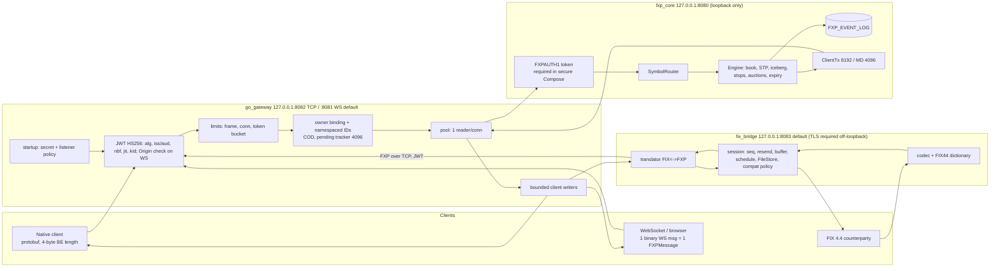

# FXP: Technical Analysis, Round 5 (re-run + demo-console readiness)

**Repository:** https://github.com/StephT0560/fxp, analyzed at `main` @ `f784045` (merge of PR #29). That is 36 commits after round 4's `5334383`: PRs #23 (CI gate), #26 (secure defaults), #27 (FIX conformance), #28 (R4 Low fixes) and #29 (R4 profiling). 646 files changed, +24.3k / −0.6k lines. 550 of those files are raw profiling evidence under `benchmarks/round4/`; excluding `benchmarks/` it is 96 files, +5.3k / −0.6k.
**Scope:** Read-only, with the same parameters as rounds 1–4. In addition, this round classifies every finding as either a **blocker for the demo console** (the UI in the companion spec, *FXP Console spec v0.2*) or **backlog**. Nothing on `main` was changed and no PR was opened. Probes ran in scratch directories. Earlier reports are in this branch's history: round 1 `f0d310c`, round 2 `12b1809`, round 3 `07b2c46`, round 4 `c3d4195` / `e6adcf9`.
**Environment:** same VM. Ubuntu 22.04 KVM (kernel 6.8.0-1061-aws), 8 vCPU Intel Xeon, 31 GiB. rustc 1.97.1, Go go1.26.10, protoc 25.3, Python 3.10.12.

---

## 0. Executive summary

**All Round-4 Medium items are fixed. Of the Low items, everything except the ruleset is fixed. I verified each one by running something or by reading the hosted CI log.** No Critical, High or Medium findings remain.

**Demo console verdict: nothing found blocks creating the console.** The WebSocket path the browser will use works as specified: binary protobuf frames, JWT Logon, Origin enforcement (verified live, §4). Three items need to be done *alongside* the console, and they are logged as console prerequisites (§7). None of them is a defect that stops work starting:
- **C1** The public trade feed (approved) is not implemented in the core yet. The gateway already routes `TradeCaptureReport` to subscribers, so the work is core emission + FIX mapping only.
- **C2** The trading-day simulator ignores `FXP_JWT_SECRET` and always signs with the hard-coded dev secret. Against any non-default secret, every logon fails. I confirmed this live. That includes the Compose dev profile, which binds the gateway to `0.0.0.0`, where the dev secret is now refused at startup.
- **C3** The console must be served same-origin, or its origin must be listed in `FXP_GW_WS_ALLOWED_ORIGINS`. A foreign origin gets HTTP 403 (verified live).

| R4 # | R4 item | R5 status |
|---|---|---|
| M1 | QuickFIX 28/59 strict; echo-fixture blocked; ReverseRoute / out-of-order buffering / repeated low ResendRequest gaps | ✅ **45/59 strict under the default policy (14 allow-listed, 0 unexpected), 57/59 under `FXP_FIX_COMPAT=quickfix` (2 allow-listed).** Read from hosted run `40230401640`. A compile-gated echo fixture fills absent `OrderQty` so definitions reach their session checks. OnBehalfOf/DeliverTo reversal, bounded high-sequence buffering and idempotent low-sequence resend are implemented |
| M2 | TLS and core auth off by default; plaintext non-loopback only warns | ✅ All listeners default to `127.0.0.1`. A non-loopback plaintext listener is **refused** unless `FXP_ALLOW_PLAINTEXT=true`, which logs an `INSECURE` warning at every level. JWT/previous secrets must be at least 24 bytes, and the dev secret is forbidden on non-loopback listeners. `docker-compose.yml` requires TLS and a core token; `docker-compose.dev.yml --profile dev` is the explicit plaintext profile |
| L3 | Required checks not enforced on `main` | ⚠ **Still open (operator action).** `docs/repo-settings.md` documents the ruleset (`ci-success` aggregate check, `scripts/ci_success.py`, fail-closed). `gh api repos/StephT0560/fxp/rulesets` still returns `[]`. `delete_branch_on_merge` is `false`, and 5 Dependabot branches are on the remote |
| L4 | `massCancelRoutes` no timeout / disconnect cleanup | ✅ A shared `pendingTracker` (`go_gateway/transport/pending.go`) bounds pending mass-cancel and status routes at 4096, with per-request timers and per-connection `clear`. `pending_test.go` covers it |
| L5 | `35=H` unknown → `35=j`; `35=AE` dictionary-validated first | ✅ Unknown/other-owner `35=H` → `35=8 150=I 39=8 58=Unknown order` (`TestRejectedSingleStatusIsPrivateExecutionReport`). Unsupported types are rejected before body dictionary validation (`TestUnsupportedTypesPrecedeBodyDictionaryValidation`) |
| L6 | README drift (roadmap, test counts, GTC wording) | ✅ Roadmap checked, test totals now point at CI instead of a copied table, GTC wording fixed. ⚠ New small drift: the last paragraph of `docs/fix-conformance.md` still says the `35=H`/`35=AE` edge replies are not implemented |
| I7 | Stale P09; pegs design-only; no tags/releases; bus factor | ✅ P09 is now `p09_cascade_uses_every_print_not_only_the_last_print` (calls `run_stop_cascade`). ⚠ Pegs still design-only. No tags/releases yet (`CHANGELOG` and `docs/release-process.md` prepare 0.1.0). Single maintainer |
| R4 §5 | Open-loop p50 ~7× closed-loop p50, unexplained | ✅ Attributed by PR #29 (`docs/performance/profile-r4.md`): about 0.5 ms of the ~0.6 ms per-run mean gap is sender lateness from the `time.Sleep` pacer, and about 0.1 ms is post-send. The harness, not the system, explains most of it |

**Checks (local unless marked hosted; all clean):**
- Rust: 193 lib + 2 integration tests pass, 0 build warnings, clippy `-D warnings` clean, `cargo audit` 0 (131 crates), `cargo deny` ok.
- Go: `vet`, `staticcheck`, `govulncheck` and `go test -race` clean in both modules. New tested packages: `startup`, `diagnostics`.
- `scripts/e2e.sh`: **75/75** FIX checks (69 in R4), 29/29 order types, plus 7/7, 3 × 2/2, 1/1 and 3/3 persistence/restart checks. Exit 0.
- **Hosted CI** on `f784045` (run `40230401640`): all 9 jobs green: `rust`, `cargo-deny`, `proto`, `go (go_gateway)`, `go (fix_bridge)`, `e2e`, `quickfix-acceptance (default)`, `quickfix-acceptance (quickfix)`, `ci-success`.

**What's left (no Critical, High or Medium):**

| # | Severity | Open item | Console impact |
|---|---|---|---|
| 1 | Low | Ruleset not active on `main`; head branches not auto-deleted (5 Dependabot branches) | None |
| 2 | Low | Simulator signs with a hard-coded dev secret and gateway address (C2) | **Prerequisite** for "Start simulator" and scenarios |
| 3 | Low | No public trade feed: `TradeCaptureReport` defined and routed by the gateway, never emitted by the core (C1) | **Prerequisite** for trade tape, last price and chart. Approved |
| 4 | Info | QuickFIX default policy keeps 14 allow-listed definitions. 12 are deliberate policy choices that the `quickfix` preset switches; `14a` (legacy tag syntax) and `21` (SecurityDefinition) remain in both | None |
| 5 | Info | FIX bridge observed knee is 1k–2k orders/s in the CPU-shared profiling layout; FXP native knee 20k–40k/s (§5) | None for a demo; size before hosting |
| 6 | Info | Market-data fan-out cost is steep in the shared-CPU fixture (100 subscribers: 22.4k → 1.5k completed orders/s) | Hosted mode: BFF must multiplex one upstream subscription (§7) |
| 7 | Info | No metrics/admin endpoints (unchanged) | Needed for v0.2 tiles / v0.3 session monitor |
| 8 | Info | Doc drift in `docs/fix-conformance.md` (last paragraph); pegs design-only; HS256 symmetric only; no releases; bus factor 1 | None |

**Updated readiness (my judgement):** matching engine **8.5/10** (unchanged; no engine logic changed this round), FIX bridge **9/10** for counterparty certification (8 in R4), gateway **9/10** (8.5 in R4). What remains is governance, the trade feed and packaging, not correctness.

---

## 1. Orientation

### 1.1 What changed structurally since round 4
- **Gateway (Go):** `startup/` (`ValidateSecrets`, `Address` with loopback defaults `FXP_GW_TCP_ADDR=127.0.0.1:8082`, `FXP_GW_WS_ADDR=127.0.0.1:8081`), `tlsconfig/server.go` plaintext-refusal policy (`FXP_ALLOW_PLAINTEXT`), `transport/pending.go` (bounded pending tracker), and `diagnostics/` (opt-in hop/alloc trace side-channel, off by default, no wire fields).
- **FIX bridge:** route reversal, high-sequence buffering (64 messages / 256 KiB / distance 4096, overflow closes), idempotent low-sequence resend, `FXP_FIX_COMPAT` presets and explicit policy booleans, the `quickfix_fixture` build-tagged echo fixture, `FXP_FIX_ADDR` default `127.0.0.1:8083`, and corrected status/unsupported replies.
- **Deployment:** `docker-compose.yml` (secure: TLS + core token + read-only config/cert mounts) and `docker-compose.dev.yml --profile dev` (plaintext, ports published on `127.0.0.1` only, an `INSECURE DEVELOPMENT` banner).
- **CI / process:** a `ci-success` aggregate job (`scripts/ci_success.py`), a QuickFIX matrix (`default`, `quickfix`), grouped and bounded Dependabot, `docs/{repo-settings,releasing,release-process}.md`, and a 0.1.0 CHANGELOG.
- **Performance tooling:** `scripts/profile_r4.py`, `profile_guard.py`, `collect_hops.py`, open-loop FIX loads, pacer experiments (sleep / busy-spin / hybrid), and `docs/performance/profile-r4.md` with raw evidence in `benchmarks/round4/` (SHA256SUMS, no binaries).
- **Core (Rust):** opt-in `FXP_HOP_TRACE` instrumentation and a test-assertion fix (`243bae6`). Matching logic is unchanged.

### 1.2 Architecture (unchanged topology; defaults changed)



The order paths are unchanged from R4. Native: client → gateway auth/limits/owner binding → pooled TCP → core auth → per-symbol engine task → `ExecutionReport` → pooled reader → bounded client writer. FIX: dictionary validation, the session layer and translation in front of the same gateway hop; outbound messages are sequenced and stored before sending.

### 1.3 Build and test log

| Step | Command | R4 | R5 |
|---|---|---|---|
| Codegen | `bash scripts/gen_proto.sh` | ✅ | ✅ exit 0 |
| Rust build | `cargo build --all-targets` | 0 warnings | ✅ 0 warnings |
| Rust tests | `cargo test` | 191 + 2 | ✅ **193 lib + 2 integration** |
| Clippy | `cargo clippy --all-targets -- -D warnings` | clean | ✅ clean |
| cargo audit | `cargo audit` | 0 (120 crates) | ✅ 0 (131 crates) |
| cargo deny | `cargo deny check` | ok | ✅ advisories / bans / licenses / sources ok |
| Go build + vet | both modules | clean | ✅ clean |
| Go tests | `go test -race -count=1 ./...` | pass | ✅ pass. go_gateway: `coreauth`, `diagnostics`, `logging`, `startup`, `symbolconfig`, `devjwt`, `tlsconfig`, `transport`. fix_bridge: root, `codec`, `gateway`, `session`, `translator` |
| staticcheck / govulncheck | both modules | clean / 0 | ✅ clean / 0 |
| E2E | `bash scripts/e2e.sh` | 69/69 + 29/29 + … | ✅ **75/75** + 29/29 + 7/7 + 2/2 ×3 + 1/1 + 3/3, exit 0 |
| Hosted CI | `gh run view 40230401640` | 7/7 | ✅ 9/9 incl. `ci-success` |
| QuickFIX (hosted log) | `quickfix_acceptance.py --compat default` / `--compat quickfix` | 28 passed / 31 allow | ✅ **45** / 14 / 0 unexpected; **57** / 2 / 0 unexpected |
| Simulator vs non-default secret | `simday -duration 5 -symbols 2 -participants 4 -seed 7` | not run | ❌ `logon rejected: … JWT signature verification failed`, exit 1 (C2) |
| WS handshake / logon | `ws_client -single`; raw upgrade with 3 Origin values | not run | ✅ Logon accepted. No Origin → 101, same origin → 101, `http://localhost:3000` → **403** |

I still did not run QuickFIX locally (no Ruby on this VM). Counts come from the hosted job logs.

---

## 2. Matching engine (Rust)

**No engine logic changed this round.** The core diff is opt-in hop instrumentation and one test assertion fix. All R4 conclusions stand: price-time FIFO, passive-price trades, per-print stop cascades in stop-price order, STP (5 modes), iceberg/reserve, mass cancel, COD, per-symbol tick/lot/scale, auctions, expiry, event-log replay and bounded backpressure.

- **Round-1 proposed tests: 11/11 effectively pass.** The stale P09 was replaced by an integration regression that exercises `run_stop_cascade`.
- **Pegged orders:** still design-only (`docs/pegged-orders.md`).
- **Hot path:** still four `String`-keyed maps per order. The R4 profiling (`profile-r4.md` §5, dhat/perf) confirms allocation is visible but not the limit at measured rates; no optimization was retained, which is the right call given the reverted framing trial.

**Trade-feed impact (approved backlog, C1):** each fill already produces two private `ExecutionReport`s. A public print is an additional *output* on the existing per-symbol market-data path, so matching order, event-log inputs and replay determinism are unaffected. Edge cases the trade-feed tests must cover: one print per fill in a multi-level sweep; iceberg slice fills (print shows the executed quantity only); auction uncross prints at the uncross price; STP cancels and restatements produce **no** print; and `buy_order_id`/`sell_order_id` stay empty on the public message.

---

## 3. FIX bridge (FIX 4.4)

| Probe / test | R4 | R5 |
|---|---|---|
| Logon/auth, resend/GapFill, durable seq, bad checksum, NOS validation | ✅ | ✅ (e2e 75/75) |
| `35=H` own order | ✅ `35=8 150=I` | ✅ |
| `35=H` unknown / other owner | ⚠ `35=j` | ✅ `35=8 150=I 39=8 58=Unknown order`, same shape for both (no ownership oracle) |
| `35=AE` (unsupported) | ⚠ `35=3` required-tag | ✅ unsupported-type reject before dictionary validation |
| OnBehalfOf / DeliverTo on immediate replies | ❌ | ✅ CompID/SubID/LocationID reversed; no route leakage to async replies |
| Out-of-order (high-sequence) messages | ❌ not buffered | ✅ buffered (64 / 256 KiB / 4096), dispatched once after recovery |
| Repeated low-sequence ResendRequest | ❌ rejected | ✅ served again without advancing state |

**QuickFIX acceptance.** Default policy: 45 strict passes. The 14 allow-listed definitions are 7 Logon-silence differences (FXP sends an explanatory Logout), 4 fatal-close differences, 1 heartbeat-expiry Logout, `14a_BadField` and `21_RepeatingGroupSpecifierWithValueOfZero`. `FXP_FIX_COMPAT=quickfix` turns on silent Logon failures, bounded wait for the peer's Logout and silent TestRequest expiry, and passes 57. The echo fixture needs a build tag, a flag, an env var, literal loopback and no TLS/core token, so it cannot reach production images. This closes the R4 concern that a quarter of the suite never reached its session checks: no allow-list entry is now blocked on missing quantity.

**Still absent:** pegs (`18`/`211`), initiator mode, SecurityDefinition, TradeCaptureReport, and market-data trade entries (`269=2`), which come with C1.

**Certification rating: 9/10.** The remaining differences are documented, switchable policies, plus two out-of-scope definitions.

---

## 4. Gateway, protocol and security

| Item | R5 status |
|---|---|
| Listener defaults | ✅ All loopback by default. Any non-loopback plaintext listener refuses to start unless `FXP_ALLOW_PLAINTEXT=true` (then a visible `INSECURE` warning) |
| Secret policy | ✅ `startup.ValidateSecrets`: `FXP_JWT_SECRET` (and previous) ≥ 24 bytes, the dev secret refused on any non-loopback listener (IPv4/IPv6/mixed tested), core token validated (24–1024 bytes). Tested for both binaries (`e9f2953`) |
| Compose | ✅ Secure file requires TLS + core token, read-only config and cert mounts. Dev file is an explicit opt-in (`--profile dev`), plaintext, ports published on 127.0.0.1 only |
| Pending routes | ✅ Bounded tracker (4096), per-request timeout, per-connection cleanup (R4 L4 closed) |
| WebSocket | ✅ Verified live this round: binary protobuf `FXPMessage` per WS message, Logon (JWT) required first, LogonAck returned; Origin absent or same-origin → 101, other → 403 unless in `FXP_GW_WS_ALLOWED_ORIGINS` |
| Market-data routing | ✅ `ForwardMarketData` already handles `TradeCaptureReport`, alongside snapshot, incremental, `TradingSessionStatus` and `AuctionInfo`, keyed by symbol, to TCP and WS subscribers. `pool.go:415` forwards it from the core. **The core never emits it** (C1) |
| Symmetric HS256 | ⚠ unchanged; JWKS/asymmetric still recommended before multi-tenant hosting |

**New Low (C2): simulator credentials.** `go_gateway/simulation/trading_day.go` checks only that `FXP_JWT_SECRET` is set (`main`, line ~983), then signs every Logon with the constant `jwtSecret = "dev-secret-change-in-production"` (line 59, used at line 241). It also dials the constant `gatewayAddr = "127.0.0.1:8082"` in plaintext. Reproduced: core + gateway with a random 32-byte secret on loopback → every participant gets `JWT signature verification failed` and the simulator exits 1. Because the dev Compose profile binds the gateway to `0.0.0.0` inside the container, where the dev secret is now refused, the simulator cannot log on to any Compose stack. Fix: sign with the `secret` variable, and add `-gateway`/`FXP_SIM_GATEWAY_ADDR` plus an optional TLS CA flag (the same `options.Flags` the test clients use).

Static analysis: all clean (§1.3).

---

## 5. Performance and benchmarks

### 5.1 Methodology
R4's harness (intended-time open loop, closed loop, HDR, warmup, 5 repetitions, exact counts, fail on any reject or miss) is unchanged. PR #29 adds what R4 asked for: pacer A/B (sleep / busy-spin / hybrid), paired sender-lag attribution, `taskset` CPU placement, perf/pprof/dhat profiles, a capacity ramp with failures kept as failures, fan-out and FIX-persistence profiles, fail-closed trace checks, and a five-run A/B that **reverted** a framing change because its gain did not exceed spread. The report is careful about what is not claimed: no SLOs, no cross-environment comparisons, preliminary runs excluded but retained. This is now a strong methodology.

### 5.2 Results this round (this VM, `scripts/bench.sh`, GOMAXPROCS=2, TOKIO_WORKER_THREADS=2, no pinning; median of 5 runs [min–max]; ms)

| Scenario | Orders/s | ACK p50 | ACK p99 | ACK p99.9 | Fill p50 | Fill p99 |
|---|---:|---:|---:|---:|---:|---:|
| open, c=1, 1000/s | 999.9 | 0.777 | 2.712 [1.57–18.2] | 4.61 | 1.305 | 3.680 |
| open, c=10, 1000/s each | 9956.8 | 0.901 | 3.889 [2.49–4.84] | 6.14 | 1.475 | 4.653 |
| closed, c=1 | 4957.5 [4783–5755] | 0.132 | 0.916 | 3.69 | 0.230 | 1.804 |

Compared with R4 on the same VM, p50s are within run-to-run noise (0.777 vs 0.776; 0.901 vs 0.836; 0.132 vs 0.115). Closed-c1 throughput and p99s are worse (4958 vs 6754/s; ACK p99 0.92 vs 0.45 ms) with wide ranges, and no code on the order path changed. I attribute that to shared-VM noise, but I did not prove it.

*Encoding (Criterion medians, ns):* NOS encode reused FXP 104.3 / FIX 75.1 / SBE 20.4; NOS decode FXP 279.0 / FIX 1,567 / SBE 91.0; NOS roundtrip FXP 383.8 / FIX 1,664.9 / SBE 100.1; ER encode FXP 123.4 / FIX 371.7 / SBE 14.0; snapshot-5L FXP 330.7; 10k batch FXP 1.03 ms / FIX 3.90 ms / SBE 158.6 µs. Same ranking as R4.

### 5.3 Maintainer profiling findings (`docs/performance/profile-r4.md`, different environment: 2-CPU cgroup quota, pinned)
- **Open/closed gap:** about 0.5 ms of the ~0.6 ms mean gap is sender lateness (sleep pacer). The busy-spin pacer is *worse* under the CPU quota (p50 10 ms), and the hybrid pacer is slightly better than sleep. The R4 §5 question is answered: report post-send ACK alongside intended-time ACK.
- **Capacity knee:** 20k–40k completed orders/s for FXP native. 80k/s fails with core critical-queue overflow, slow-consumer disconnects and gateway pool resets. That is the designed bounded-queue behavior, observed directly for the first time.
- **FIX path:** 1k/s matches the offered rate; 2k/s builds seconds of backlog in that layout (bridge shares a CPU with the gateway; async FileStore).
- **Fan-out:** 0 / 10 / 100 subscribers → 22.4k / 8.8k / 1.5k completed orders/s, ACK p50 0.36 / 1.02 / 6.46 ms. Subscribers share a CPU with the generator, so this is whole-path contention, not pure gateway cost. It still matters for a hosted console (§7).

### 5.4 Top 5 likely bottlenecks (re-ranked)
| # | Bottleneck | How to confirm |
|---|---|---|
| 1 | Per-subscriber market-data encode/write fan-out in gateway | pprof at N=100 subscribers on separate CPUs; encode once per symbol update and share the bytes |
| 2 | FIX bridge single-CPU path (translate + FileStore + gateway hop) | Re-run the FIX ramp with the bridge on its own CPU; perf on the bridge at 2k/s |
| 3 | Core critical-queue overflow at 40k–80k/s | Queue-depth counters from the hop trace; confirm the gateway pool reader is the drain bottleneck |
| 4 | Gateway per-message re-marshal and owner-namespacing strings | pprof alloc at closed c=50 (profiles exist in `benchmarks/round4/`) |
| 5 | String-keyed book maps | dhat (exists); A/B with interned IDs only if #1–#4 are resolved |

---

## 6. Gaps, roadmap and project health

- **Original known gaps** (auctions, seqnum persistence, CI/CD) stay closed.
- **Governance (Low #1):** `docs/repo-settings.md` describes exactly the right ruleset (require `ci-success`, up-to-date branches, block force pushes and deletions, no bypass actors), but it is not active: `gh api repos/StephT0560/fxp/rulesets` → `[]`. Also enable "Automatically delete head branches" (`delete_branch_on_merge` = `false`). Remote Dependabot branches: `constant_time_eq-0.6.1`, `criterion-0.8.2`, `prost-build-0.14.4`, `setup-go-7` and `github-actions-updates-4eb699f393`.
- **Docs:** the README is now accurate on everything I checked. Fix the last paragraph of `docs/fix-conformance.md` (it says the `35=H`/`35=AE` reply changes are not implemented).
- **Hygiene:** MIT + SPDX, `SECURITY.md`, CHANGELOG with 0.1.0 prepared, release workflow with checksums and SBOM. No tag or release yet. Old 6.6 MB binary still in history (optional purge). Single maintainer.

**Suggested next steps (ordered; console-first):**
1. Implement the public trade feed (C1, approved): core emission, FIX `269=2`, tests (§2 list).
2. Fix the simulator credentials and address (C2).
3. Build console v0.1 per the companion spec.
4. Activate the `main` ruleset and auto-delete head branches (Low #1).
5. Cut v0.1.0 so the console can pin a released backend.
6. Read-only `/metrics` on gateway and bridge (for console v0.2).
7. Pegs, JWKS, fan-out encode-once optimization, FIX bridge CPU isolation.

---

## 7. Demo-console readiness (new this round)

| ID | Class | Item | Evidence | Needed by |
|---|---|---|---|---|
| — | **Blocker** | *None found* | WS path, Logon, MD subscription, order entry, Origin policy verified live; all checks green | — |
| C1 | Prerequisite (approved) | Public trade feed: core emits anonymous `TradeCaptureReport` per fill; FIX maps to `35=X 269=2` | `grep` shows no emitter in `fxp_core/src`; gateway already forwards it (`pool.go:415`, `ForwardMarketData`) | v0.1 tape / last / chart |
| C2 | Prerequisite | Simulator signs with the hard-coded dev secret and dials a fixed plaintext address | Live repro, exit 1 | v0.1 "Start simulator" |
| C3 | Constraint | Same-origin or `FXP_GW_WS_ALLOWED_ORIGINS` | Live: foreign Origin → 403 | v0.1 (BFF reverse-proxy) |
| C4 | Constraint | Secure Compose requires TLS + core token; dev profile is plaintext on 127.0.0.1 | `docker-compose.yml`, `docker-compose.dev.yml` | v0.1 packaging decision |
| C5 | Constraint | Fan-out cost grows steeply with subscribers | `profile-r4.md` fan-out table | Hosted sandbox only (BFF multiplexing) |
| C6 | Backlog | No metrics/admin API | unchanged | v0.2 tiles, v0.3 session monitor |

---

## Appendix: commands used this round

```bash
git fetch origin && git checkout -B review origin/main             # f784045
bash scripts/gen_proto.sh
cd fxp_core && cargo build --all-targets && cargo test \
  && cargo clippy --all-targets -- -D warnings && cargo audit && cargo deny check
for m in go_gateway fix_bridge; do (cd $m && go build ./... && go vet ./... \
  && go test -race -count=1 ./... && staticcheck ./... && govulncheck ./...); done
bash scripts/e2e.sh
bash scripts/bench.sh <out-dir>                                     # live + Criterion
# simulator repro (scratch): core + gateway with a random 32-byte FXP_JWT_SECRET, then
simday -duration 5 -symbols 2 -participants 4 -seed 7
ws_client -single; raw WS upgrade with Origin: none / same-origin / http://localhost:3000
gh run view 40230401640 --json jobs; gh run view 40230401640 --log  # hosted CI + QuickFIX counts
gh api repos/StephT0560/fxp/rulesets; gh api repos/StephT0560/fxp --jq .delete_branch_on_merge
```
