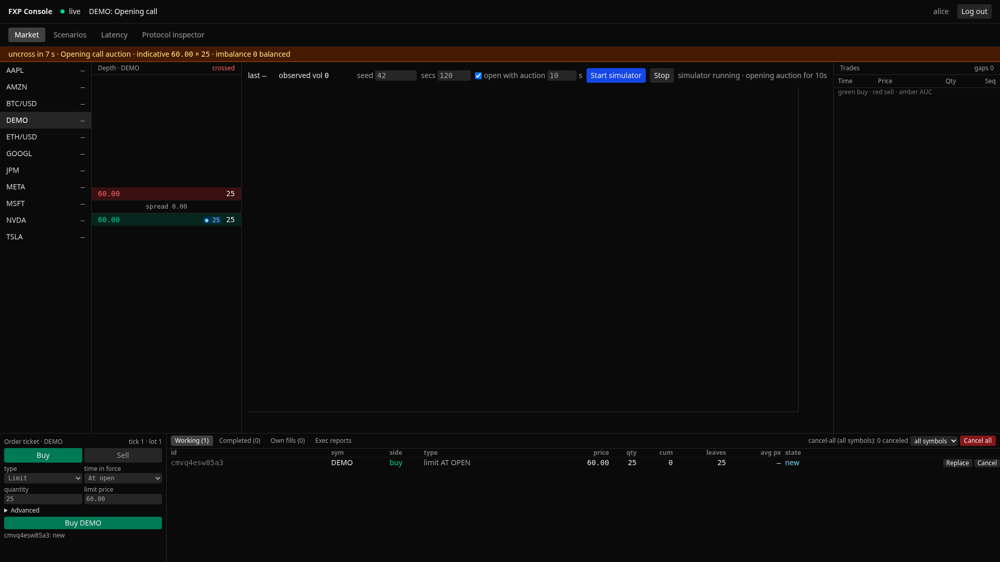
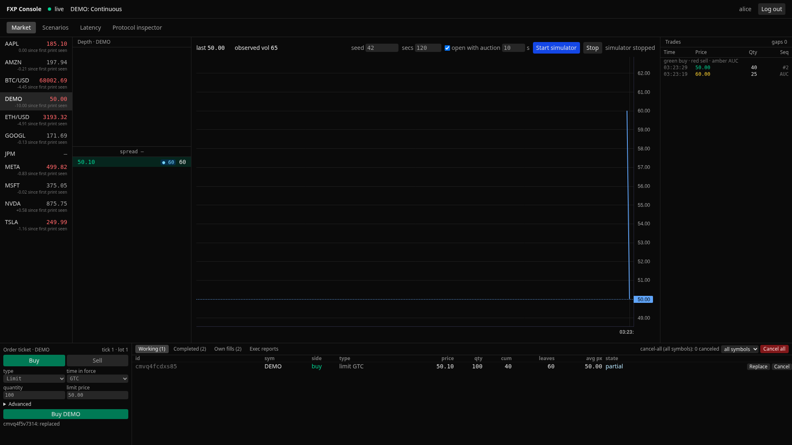
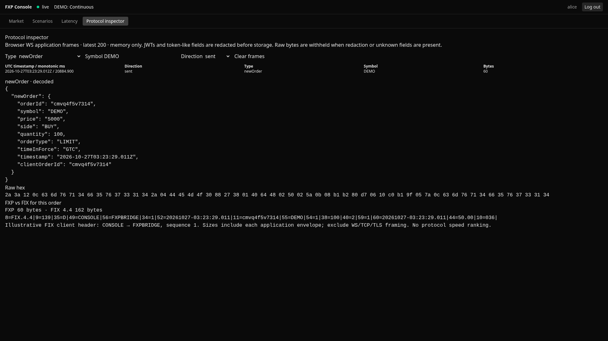

# FXP Protocol

A high-performance binary trading protocol and matching engine built as an open-source alternative to FIX 4.x for institutional electronic trading infrastructure.

## Demo

The local [FXP Console](docs/console/README.md) shows a real Rust matching engine
through the Go gateway: a live ten-level ladder, public tape with sequence-gap
counter, price chart, session phase/auction banner, simulator controls and an
order blotter. The [~75-second script](docs/console/demo-script.md) follows three
beats in Alice's browser; Bob supplies the counterparty in an unrecorded context.

<!--
**Video:** _Maintainer upload pending — the recording harness generates a WebM
for local MP4 conversion; replace this line with the uploaded final video._
-->







- **Auction to execution:** the opening call counts down, then uncrosses into
  amber AUC prints on the tape.
- **An order's lifecycle:** Alice crosses Bob, partially fills, replaces the
  remainder and sees her own resting quantity marked in the ladder.
- **Inspect and measure honestly:** redacted browser frames and authoritative
  FIX 4.4 order previews; recorded R4 intended-time and post-send ACK latency,
  min/max repetition spread and environment. Plaintext loopback only; a tested
  knee, not an SLO, with no WAN or cross-protocol ranking claim.

### Local FXP Console demo

```bash
make demo
# Open http://127.0.0.1:3000 and choose Quick demo or alice.
# When finished:
make demo-down
```

**Windows:** use Git Bash or WSL with Docker Desktop and Compose >=2.24.4.

Requires Docker Compose >=2.24.4 and Python 3. The command builds the console UI
and creates a private, gitignored `.env.demo` with random credentials. Only the
UI/BFF port is published; gateway and core remain private. The BFF offers
short-lived demo JWTs, a same-origin binary WebSocket proxy and supervised
simulator control. See [API, configuration and security model](docs/console/README.md).

Regenerate the video and these stills after UI changes with the
[Playwright recording harness](docs/console/recording.md). The
[extended script](docs/console/demo-script-extended.md) covers rejects, cancel-all
and reconnect as well. Seeded, narrated [console scenarios](docs/console/scenarios.md)
demonstrate auction uncross, stop cascades, five STP modes, iceberg priority, COD
and FIX restart/resend recovery from the Scenarios page with `make demo`.

### What this demo is and is not

A local-only demonstration with simulator data and no real orders. Its plaintext
loopback setup is for a disposable, trusted workstation, not a hosted service or
production deployment. Demo timings and the separate recorded benchmark artifacts
do not establish WAN performance or a service guarantee. The secure Compose
setup and its TLS/mTLS caveats remain documented below.

**Stack:** Rust matching engine · Go gateway · Protobuf binary encoding · JWT authentication

---

## Why FXP?

FXP combines a versioned binary schema, session handling and a matching engine.
The corrected local NewOrder fixture measurements are:

| Operation | FXP | FIX | SBE |
|---|---:|---:|---:|
| Encode, reused buffer / SBE stack | 149.3 ns | 133.8 ns | 29.6 ns |
| Decode, owned output | 377.2 ns | 1938.5 ns generic tag map | 110.2 ns |
| Measured encode+decode | 535.1 ns | 2150.7 ns | 122.1 ns |
| Fixture size, timestamp/TIF included | 94 B | 164 B | 95 B |

**Reusable FIX encoding is faster than FXP in this run.** Decoder implementations
and field layouts differ; this table is not a universal protocol speed ranking.
Shared Linux VM, loopback, single host, no explicit pinning. See
[full results, five-run spreads and caveats](Benchmark.md).

---

## Architecture

```
Client (TCP/WebSocket)
    │  FXP binary frames (4-byte length prefix + Protobuf body)
    ▼
Go Gateway  :8082
    ├── JWT authentication (HS256)
    ├── Session management
    ├── Connection pool (`runtime.NumCPU()` default; 5 on the recorded benchmark host)
    └── orderClientMap (routes ExecutionReports back to originators)
    │
    ▼
Rust Core  :8080
    ├── SymbolRouter: one Tokio task per symbol, messages delivered over mpsc
    ├── Symbol-to-task map guarded by a global mutex
    ├── BTreeMap price-time priority order book
    └── Full order type support: Market, Limit, IOC, FOK, Stop, StopLimit
    │
    ▼
Client ← ExecutionReport + MarketDataIncrementalUpdate
```

**Key design decisions:**
- Per-symbol Tokio tasks own their order books; the symbol-to-task map is protected by a global mutex
- Tokio `mpsc` channels carry messages to the socket writer
- The Go connection pool defaults to `runtime.NumCPU()` and can be tuned with `SetPoolSize`; the measured host exposed 5 logical CPUs
- Protobuf binary encoding with reusable buffers; measured implementations and allocation variants are documented in Benchmark.md

---

## Order Types

| Type | Behaviour | Status |
|---|---|---|
| `LIMIT` DAY/GTC/GTD | Continuous matching; during a call, rests without matching until uncross | ✅ |
| `LIMIT` IOC | Fill available qty, cancel remainder; rejected during calls | ✅ |
| `LIMIT` FOK | Fill all or cancel all; rejected during calls | ✅ |
| `MARKET` | Continuous: sweep then cancel remainder. Call: queue off-book until uncross, then cancel remainder | ✅ |
| `STOP` | Parks until a continuous print or opening auction price triggers it as a market order; never triggers during calls or on the closing print | ✅ |
| `STOP_LIMIT` | Same trigger rules as STOP, executes as a limit | ✅ |
| `AT_OPEN` | Limit/market accepted only during OpeningCall; unfilled remainder canceled at open | ✅ Full schedule required |
| `AT_CLOSE` | Limit/market held off-book during Continuous/OpeningCall, joins ClosingCall; remainder canceled at close | ✅ Full schedule required |

Day orders expire at configured close, after the closing uncross. GTD orders expire at midnight UTC following their date, with or without a schedule. GTC orders survive sessions and are restored across process restarts when `FXP_EVENT_LOG` is configured; without it, orders remain in memory only. Price levels use FIFO order (`VecDeque::push_back` on add and `pop_front` on match), covered by `p01_time_priority_fifo_within_level`.

Closed rejects new orders and replaces but permits cancellation. Calls may expose a crossed limit book; they never run continuous matching. Replaces during a call lose priority and do not match. Held AT_CLOSE orders can be canceled but not replaced. When moved at close_call, held limits retain their original arrival order relative to each other but queue behind orders already resting at the same price. Auction-only TIFs are not supported for stops. With no full schedule, AT_OPEN and AT_CLOSE are rejected.

Auction price selection maximizes volume, minimizes imbalance, prefers the reference (last trade) price, then resolves pressure ties. Allocations use market/price/time priority. Auction fills have `auction=true`; opening prints elect parked stops after the Continuous phase status, while closing prints update the reference without electing stops. TradingSessionStatus and deduplicated AuctionInfo updates are streamed to symbol subscribers.

**Cancel workflows:**
- `OrderCancelRequest` — cancel a working order
- `OrderCancelReplaceRequest` — cancel the original and add a replacement; the replacement loses the original's FIFO priority
- `OrderMassCancelRequest` — cancel all of the caller's orders (including parked stops), optionally by symbol and side

**Risk controls** (all off by default, see [docs/risk-controls.md](docs/risk-controls.md)): self-trade prevention per order or via `FXP_STP_DEFAULT` (cancel-newest, cancel-oldest, cancel-both, decrement-and-cancel; scoped to the owner or an STP group), owner-scoped mass cancel, and per-session cancel-on-disconnect.

---

## Proto Schema (v2.6)

Full institutional-grade message coverage:

```
NewOrderSingle          — order entry with stop_price, expire_date, account
OrderCancelRequest      — cancel working order
OrderCancelReplaceRequest — amend price/quantity
ExecutionReport         — lifecycle reports with leaves_qty, avg_px, cum_qty
MarketDataSnapshot      — full order book depth
MarketDataIncrementalUpdate — level changes
TradeCaptureReport      — anonymous public trade feed, one per fill
TradingSessionStatus    — trading phase by symbol
AuctionInfo             — indicative auction price, volume and imbalance
ErrorMessage            — structured error responses
OrderMassCancelRequest / OrderMassCancelReport — owner-scoped mass cancel
```

Version 2.6 adds optional `SessionControl.symbol` (field 4), letting a local scenario open a call on just its own book; an empty value retains all-symbol behavior. Version 2.5 adds `TradeCaptureReport.aggressor_side`, `seq` and `is_auction` for the anonymous public trade feed, which the core now emits once per fill to every market-data subscriber of the symbol; see [market data](docs/market-data.md). Version 2.4 adds optional iceberg display quantities on entry/replacement and execution reports; see [iceberg behavior](docs/iceberg-orders.md). Version 2.3 adds owner-scoped order-status request/response messages and `EXEC_ORDER_STATUS` (10). Version 2.2 adds self-trade prevention (`NewOrderSingle.stp_mode`/`stp_group`, `EXEC_RESTATED`), `Logon.cancel_on_disconnect` and the mass-cancel messages, all additively. Version 2.1 adds auction/session messages and an ExecutionReport auction flag without changing existing wire identifiers. Version 2.0 shifted all existing enum numbers by one and is wire-breaking against 1.x. All enums use a per-enum `*_UNSPECIFIED = 0` sentinel; existing named values start at 1. Unknown and unspecified order-entry enums are rejected. In an `OrderCancelReplaceRequest`, `new_time_in_force = TIME_IN_FORCE_UNSPECIFIED (0)` means keep the current value.

**TimeInForce:** `TIME_IN_FORCE_UNSPECIFIED=0` · `DAY=1` · `GTC=2` · `IOC=3` · `FOK=4` · `AT_OPEN=5` · `AT_CLOSE=6` · `GTD=7`

**ExecutionType:** EXEC_NEW · EXEC_FILLED · EXEC_CANCELED · EXEC_REPLACED · EXEC_REJECTED · EXEC_EXPIRED · EXEC_RESTATED

Custom firm extensions: field numbers 1000–1999 reserved per message.

---

## Quick Start

### Prerequisites

- Rust toolchain (`rustup`)
- Go 1.25.0+ (the modules select Go 1.26.10)
- `protoc` (the generation script installs the pinned `protoc-gen-go` plugin when needed)
- Python 3 for the FIX end-to-end suite

`scripts/gen_proto.sh` and `scripts/e2e.sh` need `go` on `PATH`; if it is not, they fall back to `/usr/local/go/bin/go` and fail with an error when neither exists.

### 1. Generate protobuf bindings

```bash
./scripts/gen_proto.sh
```

Equivalent raw command:

```bash
cd fxp_core/proto && mkdir -p ../../go_gateway/protobuf && protoc --go_out=../../go_gateway/protobuf --go_opt=paths=source_relative fxp.proto
```

### 2. Start Rust Core

```bash
cd fxp_core
cargo run
# INFO fxp_core::server: FXP Core running on 127.0.0.1:8080
```

### 3. Start Go Gateway

```bash
cd go_gateway
export FXP_JWT_SECRET="dev-secret-change-in-production"
go run .
# level=INFO msg="✅ TCP Server started on 127.0.0.1:8082"
```

### 4. Run the encoding benchmarks

```bash
cd fxp_core
cargo bench --bench encoding_benchmark
# Prints size comparison table + criterion timing results
```

### 5. Run the end-to-end benchmark

With a fresh release core and gateway running and compatible `FXP_JWT_*` settings:

```bash
cd go_gateway
go run ./benchmark --mode open --rate 1000 --concurrency 1 --orders 1000 --warmup 100 --repetitions 5
go run ./benchmark --mode closed --concurrency 1 --orders 1000 --warmup 100 --repetitions 5
```

JSON contains per-run HDR histograms, separate ACK/final-fill endpoints and
median/min/max summaries; Markdown is printed and saved alongside it. Open-loop
latency includes sender backlog from intended send times. See the
[methodology and limitations](docs/benchmark-methodology.md).

### Logging

Logs go to stderr. Per-order, per-fill and per-message events are logged at debug level and are off by default.

| Component | Variable | Default | Example |
|---|---|---|---|
| `fxp_core` | `RUST_LOG` ([`EnvFilter`](https://docs.rs/tracing-subscriber/latest/tracing_subscriber/filter/struct.EnvFilter.html) syntax) | `info` | `RUST_LOG=fxp_core=debug` |
| `fxp_core` | `FXP_SESSION_SCHEDULE` | unset (no Day expiry) | `close=16:30:00` |
| `fxp_core` | `FXP_STP_DEFAULT` (`none`, `cancel-newest`, `cancel-oldest`, `cancel-both`, `decrement-and-cancel`): self-trade prevention for orders that do not set `stp_mode` | `none` | `FXP_STP_DEFAULT=cancel-newest` |
| `fxp_core` | `FXP_SYMBOLS` (comma-separated symbol allow-list; unset allows any symbol) | unset | `FXP_SYMBOLS=BTC-USD,ETH-USD` |
| `fxp_core` | `FXP_MAX_SYMBOLS` (positive maximum number of admitted symbols) | unlimited | `FXP_MAX_SYMBOLS=500` |
| `fxp_core`, `go_gateway`, `fix_bridge` | `FXP_SHUTDOWN_TIMEOUT_SEC` (graceful-shutdown deadline) | `5` | `FXP_SHUTDOWN_TIMEOUT_SEC=10` |
| `go_gateway`, `fix_bridge` | `FXP_LOG_LEVEL` (`debug`, `info`, `warn`, `error`) | `info` | `FXP_LOG_LEVEL=debug` |

Existing symbols restored from the core event log remain available even if
they are outside the current allow-list or symbol limit; new symbols still
follow the configured admission policy.

Core, gateway, and bridge handle SIGINT/SIGTERM and shut down within
`FXP_SHUTDOWN_TIMEOUT_SEC` (default 5 seconds). Compose grants each service a
15-second stop grace period and uses an init process to forward signals. See
[docs/operations.md](docs/operations.md) for backpressure and shutdown behavior.

The optional core session schedule is a strict comma-separated `key=value`
list of UTC `HH:MM[:SS]` times. Only two forms are valid:
- `close=16:30`: always Continuous, with daily Day expiry (no auctions).
- `open_call=08:30,open=09:00,close_call=16:25,close=16:30`: all four keys,
  strictly ordered within one day. OpeningCall is [open_call, open),
  Continuous is [open, close_call), ClosingCall is [close_call, close),
  and the market is Closed otherwise.

Unknown/duplicate keys, partial schedules, unordered times, invalid times and
an explicitly empty value prevent startup. Unset means always Continuous and
no Day expiry. With a schedule, resting Day orders and parked Day stops expire
at close. Phase and expiry boundaries advance before each request and on a
one-second timer, including every missed daily auction after a time jump.

GTD orders require `expire_date=YYYY-MM-DD` (FIX `59=6`, `432=YYYYMMDD`).
They expire at midnight UTC following that date, independently of the session
schedule. Missing, malformed and already-expired dates are rejected. Dates on
non-GTD orders are ignored. Cancel/replace retains the original date; changing
to GTD requires that retained date to be valid and not already expired.

### Docker

Optional single-node core persistence is enabled with `FXP_EVENT_LOG=<path>`.
Unset means fully disabled, with the existing in-memory behavior. Every engine
input is fsynced before application, and startup replays the input log before
accepting clients. All live orders are restored, not just GTC; missed expiry and
auction boundaries run on the first startup tick without subscribers.

The parent directory must already exist. In Compose, use
`FXP_EVENT_LOG=/data/core_store/events.log` for the named core volume.
The log is exclusively locked, schedule/version mismatches fail startup, and
torn/corrupt suffixes are truncated with a warning. **Gateway orderClientMap is
not restored**, so reports for restored orders cannot be routed to old clients.
There is no compaction, replication or exactly-once client delivery. Disabling
the flag does not migrate state; re-enabling an old log restores its history.
See [the persistence design and rollout guide](docs/gtc-persistence.md).

Secure local Compose quickstart (breaking defaults: TLS/mTLS and core auth):

```bash
cp .env.example .env
# Fill .env with independent random JWT/core values (openssl rand -hex 32),
# FXP_FIX_CREDENTIALS=FIRM01:<random password>, and FXP_CERT_GID from id -g.
make dev-certs
docker compose up --build -d --wait
# Export your .env values for the host smoke client (do not print credentials):
set -a; . ./.env; set +a
python3 scripts/compose_smoke.py
```

`make dev-certs` creates throwaway two-day certificates for local use. Use managed
certificates and restricted key access for production. The default stack requires
client certificates, verifies bridge→gateway TLS, and requires a matching core
token. The core port stays private. See [.env.example](.env.example).

Explicit insecure local development (still fill JWT/FIX credentials in `.env`):

```bash
# If the secure stack is running, stop it first using its populated .env:
# docker compose down
docker compose -f docker-compose.dev.yml --profile dev up --build
# Logs an INSECURE DEVELOPMENT banner. No TLS, no core token; host ports
# are loopback-only. JWT and FIX authentication still apply.
```

The dev file deliberately overrides TLS and empties the core token, even if
present in `.env`. Traffic and credentials are exposed and local processes with
core access can impersonate traders. It is unsuitable for production/shared
hosts. Separate files avoid secure required-variable interpolation in inactive
profiles. Full [migration notes and certificate permissions](docs/tls-trust.md#breaking-configuration-migration-round-4-2)
explain this breaking change. `bash scripts/compose_check.sh` runs a disposable
secure build and smoke check with generated credentials.

### 6. Run the trading day simulation

Set `FXP_JWT_SECRET` in the environment to the gateway's secret (at least 24
bytes); the simulator has no secret flag or fallback. JWT issuer, audience and
key id use `FXP_JWT_ISSUER`, `FXP_JWT_AUDIENCE` and `FXP_JWT_KID`, matching the
gateway. See [simulator configuration and smoke checks](docs/simulator.md).

```bash
cd go_gateway

# Default: 5 symbols, 20 participants, 120 seconds
go run simulation/trading_day.go

# Larger simulation
go run simulation/trading_day.go --symbols 10 --participants 50 --duration 300

# Fixed random seed (live interleaving still depends on scheduling)
go run simulation/trading_day.go --seed 42 --verbose

# Override the gateway; flags take precedence over environment defaults
go run simulation/trading_day.go -gateway localhost:8082 -tls \
  -tls-ca ../certs/ca.crt -tls-cert ../certs/client.crt \
  -tls-key ../certs/client.key -tls-server-name localhost
```

---

## Trading Day Simulation

Simulates a realistic institutional trading session with 4 participant archetypes across 5 session phases.

**Participant types:**

| Type | Behaviour | Rate |
|---|---|---|
| Market Maker | Posts bid/ask quotes, re-quotes aggressively, occasional IOC crosses | 8 orders/sec |
| Institutional | Large limit orders, AT_OPEN/AT_CLOSE participation, 30% cancel/replace | 1 order/sec |
| Retail | Mix of market (50%), limit (30%), IOC (20%), small sizes | 0.5 orders/sec |
| Hedge Fund | Stop orders for risk management, aggressive IOC, FOK block trades | 2 orders/sec |

**Session phases** (scaled to wall-clock `--duration`):

| Phase | Duration | Behaviour |
|---|---|---|
| PRE_MARKET | 5% | Minimal activity |
| OPEN_AUCTION | 5% | 3× burst, AT_OPEN orders |
| CONTINUOUS | 80% | Normal matching |
| CLOSE_AUCTION | 8% | 2× burst, AT_CLOSE/MOC orders |
| CLOSED | 2% | Wind-down |

The engine supports scheduled opening/closing call books and batch uncrosses. The simulation phase labels alone do not configure the engine schedule: set `FXP_SESSION_SCHEDULE` on the core to exercise matching at those boundaries. The configuration table above documents the schedule format.

**Sample output (120s, 5 symbols, 20 participants):**

```
Orders placed:     11,129       Fill rate:    56.4%
Orders filled:      6,275       Cancel rate:  32.8%
Orders cancelled:   3,647
Cancel/Replaces:      175       p50 RTT:      4.0ms
Stops fired:            0       p95 RTT:    154ms

AAPL   open=$185.00  last=$185.38  vol=76,682
MSFT   open=$375.00  last=$375.49  vol=52,553
GOOGL  open=$172.00  last=$171.12  vol=72,200
AMZN   open=$198.00  last=$197.07  vol=51,359
NVDA   open=$875.00  last=$875.15  vol=38,359
```

---

## FIX Message Support

The FIX 4.4 bridge (`fix_bridge`, port 8083) handles these inbound messages:

| MsgType | Message | Support |
|---|---|---|
| `A`, `0`, `1`, `2`, `3`, `4`, `5` | Logon, Heartbeat, TestRequest, ResendRequest, Reject, SequenceReset, Logout | ✅ Session layer; Logon `8013=Y` enables cancel-on-disconnect |
| `D` | NewOrderSingle | ✅ incl. STP `2362` SelfMatchPreventionID, `2964` SelfMatchPreventionInstruction (1/2/3, 99 = decrement-and-cancel) |
| `F` | OrderCancelRequest | ✅ |
| `G` | OrderCancelReplaceRequest | ✅ |
| `V` | MarketDataRequest (snapshot, subscribe, unsubscribe) | ✅ |
| `q` | OrderMassCancelRequest (`530=7` all orders, `530=1` by symbol; optional `54`) | ✅ answered with `35=r` (531/532/533); other 530 values rejected with `531=0 532=0` |
| `H`, `AF` | OrderStatusRequest / OrderMassStatusRequest | ✅ owner-scoped snapshots, including retained terminal orders; mass types 1 (symbol) and 7 (all) |
| any other application type | e.g. `AE`, `AD`, `c`, unknown `ZZ` | ❌ BusinessMessageReject (`35=j`, `380=3`) before application body dictionary validation; supported types retain full dictionary checks |

Outbound: ExecutionReport (`8`, ExecType `D` = restated by decrement-and-cancel STP), OrderCancelReject (`9`), OrderMassCancelReport (`r`), MarketDataSnapshotFullRefresh (`W`), MarketDataIncrementalRefresh (`X`; public trades as `269=2` entries, see [docs/market-data.md](docs/market-data.md)), BusinessMessageReject (`j`) plus the session messages.

Required fields follow the FIX 4.4 spec (`fix_bridge/codec/dictionary.go`):
`D` needs 11, 55, 54, 60, 40; `F` needs 41, 11, 55, 54, 60; `G` needs 41, 11, 55, 54, 60, 40;
`V` needs 262, 263, 264, 267, 269, 146, 55; `q` needs 11, 530, 60. A message missing one of them gets
Reject (`35=3`) with `373=1` (Required tag missing), `371` (the missing tag) and `372`.

## FIX Session Store

The FIX bridge keeps each session's sequence numbers and sent messages per
`(BeginString, SenderCompID, TargetCompID)`, so a client that reconnects — or
logs on again after a bridge restart — resumes where it left off and can
ResendRequest earlier messages. Each session has a directory holding a
CRC-protected append-only `outbound.log` (a torn tail is truncated on start)
and a `seqnums` file replaced atomically on every change.

| Variable | Default | Meaning |
|---|---|---|
| `FXP_FIX_GATEWAY_ADDR` | `127.0.0.1:8082` | Bridge upstream gateway address; owned scenario bridge inherits the BFF gateway |
| `FXP_FIX_STORE_DIR` | native `fix_store`; Compose `/data/fix_store` | Store root; set empty for in-memory state (lost on restart) |
| `FXP_FIX_STORE_FSYNC` | `strict` | `strict`: fsync every write; `group`: fsync every `FXP_FIX_STORE_GROUP_INTERVAL` (default `10ms`); `async`: never fsync. All modes survive a killed process; they differ only on power loss |
| `FXP_FIX_STORE_MAX_MESSAGES` | `100000` | Outbound messages retained for resend; older ones are answered with SequenceReset-GapFill |

A second Logon for a session that is already logged on is rejected. Session
schedules and reset policies are optional; see [FIX conformance](docs/fix-conformance.md).

### Gateway authentication

Clients log on with an HS256 JWT. The header `alg` must be `HS256`
(`none` and every other algorithm are rejected before the MAC is checked);
the claims must carry `sub`, `exp`, `iat`, the configured `iss` and `aud`;
`nbf` is honoured with a small leeway. The bridge, `devjwt`, the benchmark and
the simulation read the same variables when minting.

| Variable | Default | Meaning |
|---|---|---|
| `FXP_JWT_SECRET` | (required) | Current HS256 key, minimum 24 bytes; known dev key forbidden on non-loopback binds |
| `FXP_JWT_KID` | unset | `kid` of the current key; tokens without `kid` always use the current key |
| `FXP_JWT_PREVIOUS_KID` / `FXP_JWT_PREVIOUS_SECRET` | unset | Previous key, set both with a distinct kid; minimum 24 bytes and no known dev key on non-loopback binds; accepted for that `kid` during rotation |
| `FXP_JWT_ISSUER` | `fxp-dev` | Required `iss` |
| `FXP_JWT_AUDIENCE` | `fxp-gateway` | Required `aud` (string or array) |
| `FXP_JWT_LEEWAY_SEC` | `30` | Clock-skew leeway on `nbf` |
| `FXP_JWT_REPLAY_CACHE` | off | `on`: require `jti` and reject a reused `jti` until its token expires (per gateway process) |
| `FXP_GW_WS_ALLOWED_ORIGINS` | unset | Comma-separated browser origins allowed to open the WebSocket. Same-origin requests and clients sending no `Origin` header are always allowed; any other origin gets 403 |
| `FXP_GW_CLIENT_QUEUE` | `8192` | Bounded per-client queue for execution reports and other critical output; overflow closes the client |
| `FXP_GW_MASS_CANCEL_TIMEOUT_SEC` | `30` | Pending mass-cancel confirmation deadline in seconds (1–86400; invalid values fall back to 30); timeout rejects the request but does not roll back core actions. Status uses a fixed 30s deadline; both share a 4096-entry cap and disconnect cleanup |
| `FXP_GW_MD_QUEUE` | `4096` | Bounded per-client market-data queue; overflow drops market data and increments `MarketDataDropped()` |

## Tests

The [CI workflow](https://github.com/StephT0560/fxp/actions/workflows/ci.yml)
runs Rust/Go unit and race checks, schema compatibility, production FIX/order-type
and restart E2E, TLS/mTLS and secure Compose smoke tests, and both QuickFIX
acceptance profiles. Require the stable `ci-success` check. Test totals are
reported by each run rather than copied here, so this section cannot drift as
coverage grows. Local commands are in [CONTRIBUTING.md](CONTRIBUTING.md).

P09 is already the per-print integration regression
[`p09_cascade_uses_every_print_not_only_the_last_print`](fxp_core/src/order_book/edge_tests.rs):
it calls `run_stop_cascade`. The separate `drain_triggered_stops` unit tests
remain because they check the lower-level predicate, not cascade behavior.

---

## Benchmark Results

Five repetitions on a shared Linux VM (AMD EPYC 7763, 5 visible CPUs), Rust
1.99.1 and Go 1.26.10; Go/core each configured with two workers, affinity 0–4
without explicit pinning. Live counts are exact, with a separate 100-order
warmup and 1000 measured orders per connection per run.

| Scenario | Completed orders/s | ACK p50 / p99 ms | Final-fill p50 / p99 ms |
|---|---:|---:|---:|
| open-c1 | 999.7 | 0.777 / 1.537 | 1.337 / 2.466 |
| open-c10 | 9969.5 | 0.961 / 2.542 | 1.688 / 3.334 |
| closed-c1 | 3901.1 | 0.226 / 0.453 | 0.353 / 0.809 |


Values are medians of per-run statistics; [Benchmark.md](Benchmark.md) includes
all min/max spreads, p90/p99.9/max, encoding confidence intervals, raw artifacts
and commands. Open-loop offers 1000 orders/s/connection and measures from intended
send time, including backlog. Closed-loop is ACK-controlled. Finite paired-order
bursts and loopback figures are not production capacity or WAN SLO claims.

---

## Repository Structure

```text
fxp/
├── .github/                    CI, benchmark/release workflows and Dependabot
├── fxp_core/                   Rust matching engine, protobuf v2.6, Criterion
│   └── src/                    server/core auth, engine, order_book, event log,
│                               schedule, symbol configuration and regressions
├── go_gateway/                 Native TCP/WebSocket gateway
│   ├── transport/              pooling, bounded writers, pending-request routing
│   ├── coreauth/, tlsconfig/   shared core-token/TLS support
│   ├── startup/, logging/      startup policy and slog configuration
│   └── benchmark/, simulation/, test_clients/
├── fix_bridge/                 FIX codec/dictionary, session, gateway, translators
│   └── fixture_*.go            compile-gated QuickFIX echo fixture / rejecting stub
├── fix_test_client/            Python FIX and order-type E2E clients
├── tests/                      CI/Compose/security/release/QuickFIX gate tests,
│                               cross-implementation wire vectors (tests/vectors)
├── scripts/
│   ├── gen_proto.sh            pinned protobuf generation
│   ├── ci_success.py           stable required-check aggregator
│   ├── e2e.sh, e2e_tls.sh      production FIX/order/persistence and TLS probes
│   ├── compose_check.sh, compose_smoke.py
│   ├── gen_test_certs.sh, tls_reload_probe.py, core_healthcheck.sh
│   ├── quickfix_acceptance.py  both pinned upstream acceptance profiles
│   └── bench.sh, collect_encoding.py, build_release.sh, verify_static_elf.py
├── docs/                       operations.md, risk-controls.md, fix-conformance.md,
│                               gtc-persistence.md, symbol-config.md, tls-trust.md,
│                               iceberg-orders.md, pegged-orders.md, market-data.md,
│                               benchmark-methodology.md, repo-settings.md,
│                               releasing.md, release-process.md
├── config/                     symbol CSV examples
├── benchmarks/                 retained measurements and provenance
├── Dockerfile, docker-compose.yml, docker-compose.dev.yml
├── .env.example, go.work, Makefile
└── README.md, CHANGELOG.md, CONTRIBUTING.md, SECURITY.md, LICENSE
```

---

## Roadmap

- [x] Opening/closing auction batch matching at phase transitions
- [x] Stop/StopLimit trigger on live last-trade-price feed
- [x] `OrderCancelRequest` / `OrderCancelReplaceRequest` full round-trip in simulation
- [x] Release build benchmarks
- [x] CI/CD pipeline (GitHub Actions: `.github/workflows/ci.yml`)
- [x] Optional TLS/mTLS listeners and authenticated core connections
- [x] FIX 4.x bridge (inbound FIX → FXP translation layer)

---

## License

MIT
### FIX session schedule configuration

All settings are optional. See [FIX conformance](docs/fix-conformance.md) for boundaries and archival behavior.

| Variable | Default | Meaning |
|---|---|---|
| `FXP_FIX_DICTIONARY_STRICT` | `false` | Reject undeclared user-defined tags (>=5000); standard tags always validated |
| `FXP_FIX_START_TIME` / `FXP_FIX_END_TIME` | unset | Local `HH:MM:SS` window; both required to enable |
| `FXP_FIX_START_DAY` / `FXP_FIX_END_DAY` | unset | Full weekday names; both enable a weekly window |
| `FXP_FIX_TIME_ZONE` | `UTC` | IANA timezone |
| `FXP_FIX_RESET_ON_LOGON` | `false` | Reset on authenticated Logon; requires inbound sequence 1 |
| `FXP_FIX_RESET_ON_LOGOUT` | `false` | Reset after Logout |
| `FXP_FIX_RESET_ON_DISCONNECT` | `false` | Reset after a logged-on connection ends |

### FIX conformance

The bridge loads the pinned QuickFIX FIX 4.4 XML dictionary at startup, with
[documented venue extensions](fix_bridge/codec/spec/README.md). It validates
required tags, membership, datatypes, enums, duplicates and repeating-group
counts/order; invalid messages receive Reject(3) with 371/372/373. See
[conformance details](docs/fix-conformance.md). Unsupported application message types
remain BusinessMessageReject(j). Dictionary validation changes an invalid
Side enum from an ExecutionReport rejection to session Reject reason 5.

Order status replies use ExecutionReport `150=I`, `17=0`, the current `39`,
and original cumulative/leaves quantities. Queries do not redirect fills.
Single status echoes OrdStatusReqID(790); mass status echoes 584 and includes
911/912 count/final markers. Unknown/foreign single-order IDs get indistinguishable status ExecutionReports
(`35=8`, `150=I`, `39=8`, `103=5`, `37=NONE`, zero quantities). Only request
identifiers, Symbol and Side are echoed; the owner receives nothing. Empty mass
results still get BusinessMessageReject (`380=1`). See [status retention and consistency](docs/fix-conformance.md#order-status).

#### FIX conformance

CI runs all 59 pinned QuickFIX v1.15.1 FIX44 server definitions with the official
POSIX runner under both policy configurations:

| Configuration | Strict pass | Allow-listed | Unexpected failures / runner errors |
|---|---:|---:|---:|
| Default policy | 45 | 14 | 0 / 0 |
| `FXP_FIX_COMPAT=quickfix` | 57 | 2 | 0 / 0 |

The preset's remaining entries are **14a** (legacy zero/negative tag parsing and
user-tag policy) and **21** (out-of-scope SecurityDefinition echo). Default policy
also retains 7 explanatory-Logon-vs-silent-disconnect cases, 4 immediate-fatal-close
cases (2f/2i/2k/2o), and 1 heartbeat-timeout Logout case (6).
[Exact grouped names and reasons](tests/quickfix/README.md#remaining-allow-listed-entries-by-reason)
are maintained separately for [default](tests/quickfix/expected-failures.json) and
[preset](tests/quickfix/expected-failures-quickfix.json).

These are **test-fixture session results**, not matching-venue certification.
The isolated echo adapter supplies only absent OrderQty (`38=1`), keeps malformed
explicit values, and does not forward orders to the engine. It is absent from
normal builds and additionally requires a test build, explicit flag/environment,
literal loopback and disabled TLS/core auth. Production order validation remains
unchanged. The fixture fixes `TestReqID=TEST` only for upstream expectations;
production IDs remain unique. Default fatal-close races can produce reported
unexpected passes rather than stable compatibility. See the full
[adapter and guard details](tests/quickfix/README.md) and
[session policy configuration](docs/fix-conformance.md#session-policy-configuration).

Status batches are bounded by both 64 reports and the gateway's 1 MiB frame
limit, so large valid order identifiers cannot disconnect the core pool.
Dictionary `MONTHYEAR` accepts only real dates or weeks 1–5; invalid Boolean
values and negative nonnegative-integer fields use Reject reason 5, while
malformed integer syntax uses reason 6.

### Symbol tick, precision and quantity configuration

Set `FXP_SYMBOL_CONFIG` on the core and FIX bridge to the same CSV file.
Unset means the existing defaults: 2 decimal places, one-minor-unit tick,
lot/minimum 1, maximum 2,147,483,647. See [symbol configuration](docs/symbol-config.md)
and [example CSV](config/symbols.example.csv). This does not change prices on
the wire: they remain signed int64 minor units. Native clients must use the
same symbol scales. FIX execution reports and market data use those scales.

| Variable | Default | Components | Meaning |
|---|---|---|---|
| `FXP_SYMBOL_CONFIG` | unset | core, FIX bridge | Validated per-symbol CSV, loaded once at startup; in Compose use `/etc/fxp/config/symbols.example.csv` or another file under the mounted `config/` directory |

Price-only amendments retain STP-restated totals even below entry quantity
minimums; explicit new totals still undergo lot/min/max validation.

Unused market-order limit prices and unused non-stop trigger fields are ignored
by core tick validation. Active limit/trigger prices still require tick alignment.

## Reserve and pegged orders

Limit DAY/GTC/GTD orders can opt into reserve using FIX MaxFloor (111) or native
`display_quantity`; zero keeps fully displayed behavior. Only the current slice
appears in market data. Replenishment moves the order to the back of its price
level, and private reports accumulate fills against the total. Replace resets the
slice and priority; omitted MaxFloor retains it and explicit zero disables it.
Iceberg IOC/FOK, stops and full-auction schedules are rejected. Ordinary IOC/FOK
orders can consume reserve with the existing STP policy. See the complete
[iceberg contract](docs/iceberg-orders.md) and [symbol precision](docs/symbol-config.md).


Pegged orders (Stage C) are deferred; the [design note](docs/pegged-orders.md)
specifies references, cycles, priority, caps, interactions and acceptance tests.
They are not enabled by this change.

## Nightly benchmarks and draft releases

`bash scripts/bench.sh target/bench` builds an isolated release stack, runs
five-repetition intended-time/open and labeled closed-loop scenarios, then the
corrected encoding suite. JSON, Markdown, raw Criterion estimates and actual
build/affinity metadata are retained. Nightly/manual [bench.yml](.github/workflows/bench.yml)
uses `ubuntu-24.04` with no numerical regression threshold.

Tagged [release.yml](.github/workflows/release.yml) builds static Linux amd64 and
arm64 core/gateway/bridge archives, SHA256SUMS and CycloneDX inventories, and
attaches them to a draft for manual review. Manual workflow runs build artifacts
only. See [required checks and repository configuration](docs/releasing.md).

### TLS and core trust

Native listeners default to loopback, where plaintext remains available.
Non-loopback plaintext refuses startup unless `FXP_ALLOW_PLAINTEXT=true`.
Compose defaults to required TLS/mTLS and core authentication; JWT/FIX
authentication remains required. The core always binds
`127.0.0.1:8080`; set the same distinct token on core and gateway to admit only
trusted forwarding connections. The bridge reaches the core through the gateway.
See [deployment, reload and client examples](docs/tls-trust.md) and the
[trust model](SECURITY.md#trust-model).

| Variable | Default | Applies to / behavior |
|---|---|---|
| `FXP_FIX_COMPAT` | `default` | Bridge session preset: `quickfix` enables silent Logon failures, bounded fatal Logout waiting and silent heartbeat-expiry close; explicit policy booleans override the first two |
| `FXP_FIX_SILENT_LOGON_FAILURES` | unset (preset; default false) | Bridge silently disconnects on failed Logon instead of explanatory Logout |
| `FXP_FIX_WAIT_PEER_LOGOUT` | unset (preset; default false) | Bridge waits for peer Logout after a fatal error, bounded by `FXP_FIX_LOGOUT_TIMEOUT` (5s default) |
| `FXP_FIX_LOGOUT_TIMEOUT` | `5s` | Bridge graceful/fatal Logout wait bound; nonpositive values use a 5s safety bound for fatal waiting |
| `FXP_FIX_TEST_FIXTURE` | unset | Test build only: `quickfix` also requires `-test-fixture`, literal loopback, no TLS/core token; normal binaries reject it; disabled in Compose |
| `FXP_ALLOW_PLAINTEXT` | `false` | Explicitly permit non-loopback plaintext, with a startup warning; does not bypass TLS-required or secret policy |
| `FXP_GW_TCP_ADDR` / `FXP_GW_WS_ADDR` | native `127.0.0.1:8082` / `127.0.0.1:8081`; Compose `0.0.0.0` at those ports | Gateway listener binds |
| `FXP_FIX_ADDR` | native `127.0.0.1:8083`; Compose `0.0.0.0:8083` | FIX bind; `-addr` overrides |
| `FXP_CERTS_DIR` | `./certs` | Host certificate directory for Compose and `make dev-certs` |
| `FXP_CERT_GID` | `1000` | Secure Compose supplementary group for read-only certificate access; set to host certificate group |
| `FXP_TLS_CERT_FILE` / `FXP_TLS_KEY_FILE` | native unset; secure Compose `/etc/fxp/certs/server.crt` / `server.key` | Gateway and bridge server certificate/key PEM; both required to enable TLS 1.2–1.3 |
| `FXP_TLS_CLIENT_CA_FILE` | native unset; secure Compose `/etc/fxp/certs/ca.crt` | Gateway and bridge: require and verify client certificates against this PEM CA bundle |
| `FXP_TLS_REQUIRED` | native `false`; secure Compose `true` | Gateway and bridge refuse startup without TLS; malformed booleans fail startup |
| `FXP_CORE_AUTH_TOKEN` | native unset; secure Compose required | Core and gateway only: optional natively, required in secure Compose; shared token, 24–1024 UTF-8 bytes when nonempty; use a random secret distinct from JWT |
| `FXP_GATEWAY_TLS` | native `false`; secure Compose `true` | Bridge enables verified TLS to the gateway |
| `FXP_GATEWAY_TLS_CA_FILE` | native system roots; secure Compose `/etc/fxp/certs/ca.crt` | Bridge's trusted gateway CA bundle |
| `FXP_GATEWAY_TLS_CERT_FILE` / `FXP_GATEWAY_TLS_KEY_FILE` | native unset; secure Compose `/etc/fxp/certs/client.crt` / `client.key` | Bridge's optional upstream mTLS identity |
| `FXP_GATEWAY_TLS_SERVER_NAME` | native dial host; secure Compose `localhost` | Bridge's verified upstream server name |
| `FXP_DEMO_ADDR` | `127.0.0.1:3000` | Local demo API listen address; external bind requires `FXP_ALLOW_PLAINTEXT=true` |
| `FXP_DEMO_ORIGIN` | `http://127.0.0.1:3000` | Exact browser Origin and Host accepted by the BFF |
| `FXP_DEMO_GATEWAY_WS_URL` | `ws://127.0.0.1:8081/ws` | Private gateway WebSocket upstream |
| `FXP_DEMO_STATIC_DIR` | `web/dist` | Static UI directory (`-static-dir` overrides); placeholder when absent |
| `FXP_DEMO_FIX_BINARY` | `bin/fix_bridge` | Trusted owned bridge subprocess for seeded FIX restart scenarios |
| `FXP_DEMO_SIM_BINARY` | `bin/simday` | Trusted simulator executable |
| `FXP_DEMO_TOKEN_TTL_SEC` | `900` | Demo JWT lifetime, 1–900 seconds |
| `FXP_DEMO_TOKEN_RATE_PER_MIN` | `10` | Token attempts per IP/minute, 1–120 |
| `FXP_SIM_GATEWAY_ADDR` | `127.0.0.1:8082` | Simulator TCP gateway; overridden by `-gateway` |
| `FXP_CLIENT_TLS` | `false` | Go TCP/WS clients, simulator, benchmark and Python FIX client enable verified TLS |
| `FXP_CLIENT_TLS_CA_FILE` | system roots | Tool clients' trusted server CA bundle |
| `FXP_CLIENT_TLS_CERT_FILE` / `FXP_CLIENT_TLS_KEY_FILE` | unset | Tool clients' optional mTLS identity |
| `FXP_CLIENT_TLS_SERVER_NAME` | dial host | Tool clients' verified server name |

Server and bridge settings are exposed in Compose; tool-only `FXP_CLIENT_*` settings
are for host clients. Compose mounts `./certs:/etc/fxp/certs:ro`; configure container
paths and ensure UID 10001 can read the key. Certificate/key/client-CA file contents
are checked every second and new connections use the last valid snapshot.
`bash scripts/e2e_tls.sh` exercises all listeners with mTLS, live certificate
rotation, authenticated core forwarding, the full FIX/order/restart checks and the
benchmark smoke scenarios. Test certificates are temporary and deleted on exit.

### Optional local profiling

Diagnostics are off by default and add no wire fields.

| Process | Variable | Default | Purpose |
|---|---|---|---|
| Core, gateway, benchmark | `FXP_HOP_TRACE` | unset | Local Linux CLOCK_MONOTONIC hop-event file |
| Gateway, bridge, Go benchmark | `FXP_PROFILE_DIR` / `FXP_TRACE_FILE` | unset | Go CPU/alloc/block/mutex profiles / runtime trace |
| Compose | `FXP_CORE_HOP_TRACE`, `FXP_GW_HOP_TRACE` | unset | Per-container hop file paths; mount an output directory explicitly |
| Compose | `FXP_GW_PROFILE_DIR`, `FXP_FIX_PROFILE_DIR`, `FXP_GW_TRACE_FILE`, `FXP_FIX_TRACE_FILE` | unset | Per-container Go profile/trace paths |
| Core built with optional `dhat` feature | `FXP_DHAT_FILE` | `dhat-heap.json` | Tracking-allocator output; ignored by normal builds |

See [profiling instrumentation](docs/performance-r4-instrumentation.md) for
measurement boundaries, file handling, CPU pinning and the runner, and the
[round-4 profile report](docs/performance/profile-r4.md) for measured limits.

### Required CI check

PRs (including Dependabot) run CI with read-only repository permissions and no
private secrets. Require the stable `ci-success` check on `main`; it fails if
any dependency fails, is cancelled, or is skipped, including either Go matrix
leg. See [repository settings](docs/repo-settings.md) for the manual ruleset.
Dependabot groups Cargo/Go minor and patch updates and all Actions updates,
with at most five open PRs per ecosystem and the `dependencies` label.
Auto-merge is not enabled.

First-release preparation and exact maintainer-only tagging commands are in
[the release process](docs/release-process.md); the prepared changelog does not
indicate an existing release. Manual release builds create artifacts only.
