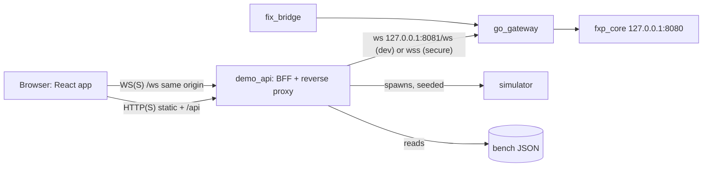

# FXP Console: product spec, scope and stack (v0.2)

**Status:** Draft v0.2. It supersedes v0.1 and is based on the round-5 audit of `main` @ `f784045` (`ANALYSIS.md` §7 on `devin/analysis`). The public trade feed is **approved but not built**. Every interface claim below was checked against the code or live.

## 1. Purpose and audience
A browser console that makes FXP **visible in under 2 minutes**: a live book, a trade tape, real orders, risk controls and auctions running, and honest latency numbers.

| Audience | What they need to see |
|---|---|
| Prospects (FIX-cert buyers, small venues) | It works, it's fast, and it handles the edge cases (auction, stop cascade, STP, cancel-on-disconnect, FIX recovery) |
| Contributors / GitHub visitors | A one-command demo and a 90-second recording in the README |
| You, presenting | Seeded scenarios that run the same way every time, locally or in a hosted sandbox |

**Not a goal for v1:** a production trading front-end, real accounts or real money.

## 2. Audit outcome for the console
**No blockers.** Verified in round 5: binary protobuf over `/ws`, JWT Logon → LogonAck, market-data subscription, order entry, and Origin enforcement (absent or same-origin → 101, other → 403). All CI is green, including both QuickFIX profiles.

| ID | Item | Type | Plan |
|---|---|---|---|
| C1 | **Public trade feed** not yet emitted by the core. The gateway already forwards `TradeCaptureReport` per symbol | Prerequisite, **approved** | Separate core PR before console v0.1 ships (§3) |
| C2 | Simulator signs with a hard-coded dev secret and dials fixed plaintext `127.0.0.1:8082`. It fails against any real secret, including the Compose dev profile | Prerequisite | Small fix in the same PR or a sibling PR: use `FXP_JWT_SECRET`, add `-gateway` / TLS CA flags |
| C3 | WS Origin must be same-origin or in `FXP_GW_WS_ALLOWED_ORIGINS` | Constraint | BFF serves the UI and reverse-proxies `/ws` on one origin |
| C4 | Secure Compose requires TLS + core token; dev profile is plaintext, published on 127.0.0.1 only | Constraint | `demo` profile layers on `docker-compose.dev.yml` locally; hosted mode uses the secure file (§6) |
| C5 | Market-data fan-out cost rises steeply per subscriber (100 subs: 22.4k → 1.5k orders/s in the shared-CPU profile) | Constraint (hosted only) | BFF holds **one** upstream subscription per symbol and fans out to browsers |
| C6 | No metrics/admin API | Backlog | v0.2 `/metrics`, v0.3 `/admin/sessions` |

## 3. Public trade feed (approved; backend work item)
- **Core:** for every fill, emit a `TradeCaptureReport` on the existing per-symbol market-data path. Auction uncross: **one print per matched pair at the uncross price** (`is_auction = true`; resolved, §9). STP cancels and restatements produce no print.
- **Proto (additive, new field numbers):** `aggressor_side`, per-symbol `seq`, `is_auction`. `buy_order_id`/`sell_order_id` stay **empty** on the public feed. Counterparties still get private `ExecutionReport`s.
- **Delivery:** on for every market-data subscriber of the symbol (resolved, §9). Same drop-not-block backpressure as other market data; the UI detects gaps from `seq` and shows "tape gap".
- **FIX:** `35=X` with `269=2`, `270`, `271`, `273`.
- **Tests:** single fill, multi-level sweep, iceberg slice, auction uncross, STP no-print, privacy (no order IDs reach a second session), WS/TCP delivery, FIX `269=2` mapping.
- **Rule:** the UI must not show a "live tape" until C1 is merged and tested. Before that, the tape panel shows *own fills only* and is labeled as such.

## 4. Scope by milestone
**v0.1 "Live market" (MVP)**
- Demo login (pick a user; the BFF returns a short-lived JWT). Status bar: connection, `TradingSessionStatus` phase, auction banner from `AuctionInfo`.
- Symbol list and **depth ladder** (snapshot + incremental, 10 levels).
- **Trade tape + last price + volume + price chart** from the public feed (C1).
- **Order ticket:** limit, market, stop, stop-limit; IOC/FOK/GTC/Day/GTD; iceberg display quantity; STP mode; client-side tick/lot validation.
- **Blotter:** working and filled orders, cancel, replace, cancel-all (mass cancel), and an exec-report log.
- **Start simulator** (BFF launches the fixed `trading_day` with a seed; needs C2).

**v0.2 "Show the hard parts"**
- **Scenario runner** (seeded, narrated): opening auction uncross · stop cascade · STP modes side by side · iceberg replenish losing priority · cancel-on-disconnect · FIX restart with sequence recovery.
- **Latency panel** from bench JSON: shows intended-time ACK **and** post-send ACK (per R4 profiling), with an environment card. It never mixes loopback and WAN numbers, and never shows capacity as an SLO.
- **Protocol inspector:** decoded frames; FXP vs FIX bytes for the same order.
- Prometheus tiles (needs `/metrics`, C6).

**v0.3 "Operator console":** FIX session monitor, symbol halt/resume, per-owner kill switch, risk limits. Needs new admin APIs; scope separately.

## 5. Architecture and stack

| Layer | Choice | Why |
|---|---|---|
| UI | **React 18 + TypeScript + Vite** | Mainstream, fast dev loop, easy for contributors |
| Protobuf in browser | **`@bufbuild/protobuf` (protobuf-es)** generated from `fxp_core/proto/fxp.proto` with `buf generate` | Buf already in CI. int64 prices as `bigint`, never JS `number` |
| Wire | One binary WS message = one `FXPMessage`; **no** 4-byte length prefix (that is TCP-only) | Verified in `ws_server.go` / `client_writer.go` |
| State | **Zustand**, one store per stream (book, tape, orders, session) | Small; fine at 1–10k updates/s with batched renders |
| Ladder / tape | Custom components, `requestAnimationFrame` batching, `@tanstack/react-virtual` | No re-render per incremental |
| Charts | **TradingView `lightweight-charts`** (Apache-2.0) for price; **Recharts** for latency | Looks like trading software; permissive licences |
| Styling | **Tailwind CSS**, neutral dark theme | Fast and consistent until branding exists |
| BFF | **Go `demo_api/`**: `/api/token`, `/api/sim/*`, `/api/scenarios/*`, `/api/bench`, static files, `/ws` proxy, per-symbol MD multiplexer (hosted mode) | Keeps the JWT secret server-side, satisfies Origin (C3), handles fan-out (C5), reuses `devjwt` and the Go proto package |
| Packaging | `docker compose -f docker-compose.dev.yml -f docker-compose.demo.yml --profile dev --profile demo up` → UI on `127.0.0.1:3000` | One command, loopback only, gateway/core stay private |
| Tests | Vitest (decoders, stores, tape gap detection); Playwright scenarios against the Compose stack in CI | Scenarios double as e2e tests and demo scripts |

## 6. Security and deployment modes
- **Local demo (default):** dev profile, plaintext on 127.0.0.1 only, random `FXP_JWT_SECRET` (≥ 24 bytes) generated by a `make demo` wrapper. The dev default secret is refused because the gateway binds `0.0.0.0` inside the container.
- **Hosted sandbox (later):** secure Compose (TLS + core token). The BFF terminates browser TLS and dials the gateway over `wss` with the test CA. Demo JWTs last ≤ 15 min, `sub` is scoped per demo user, the BFF rate-limits token issuance, a reset job restores the book, and read-only viewers get market data only via the BFF multiplexer.
- **Never** put the JWT secret or core token in the browser bundle.

## 7. Non-functional requirements
- **Performance:** ladder at 60 fps with 2k incrementals/s; first paint < 1.5 s on a laptop.
- **Honesty:** every latency figure states its mode, hardware and build. Capacity figures are labeled "tested knee", not SLOs. The tape shows "own fills only" until C1 lands.
- **Determinism:** scenarios use fixed seeds.
- **Resilience:** the UI shows tape/book gaps (dropped MD under backpressure) instead of hiding them; it reconnects and re-subscribes after a disconnect.

## 8. Delivery plan
1. **PR A (backend, approved):** trade feed (C1) + simulator fix (C2). Tests per §3.
2. **PR B:** `web/` + `demo_api/` + demo Compose overlay = console v0.1 + Playwright smoke.
3. **PR C:** v0.2 scenarios, latency panel, inspector; `/metrics` if approved.

## 9. Decisions resolved
Resolved by the product owner; these override the earlier recommendations unless changed explicitly.
1. Auction prints: **one print per matched pair** at the uncross price, `is_auction = true`.
2. Trade feed: **on for every market-data subscriber** of the symbol (no opt-in flag).
3. Location: **in-repo** `web/` (UI) and `demo_api/` (Go BFF).
4. Hosting: **local demo only** for now; hosted-mode items are out of scope.
5. Branding: **neutral dark theme**, no branding.

## 10. Success criteria for v0.1
`make demo` (or the Compose command above) → open `http://127.0.0.1:3000` → pick a user → book **and tape** moving within 5 s → place, fill, partially fill, replace and cancel orders and watch an opening auction uncross on the tape, all without a terminal. A 90-second recording goes in the README.
