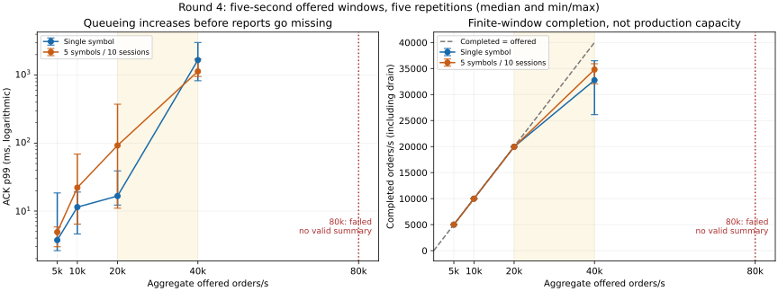

# Round-4 profiling: measured limits and a reverted optimization

No engine optimization is retained. One gateway framing trial reduced allocation
count but slowed the microbenchmark and did not improve completed throughput;
it was reverted. The useful results are latency attribution, a bounded-load
failure point, persistence/fan-out costs, and reproducible profiling fixtures.

## Environment and contract

This reproduces the corrected methodology on a **different environment** from
ANALYSIS.md §5: Intel Xeon Platinum 8573C, Linux container, three visible affinity
CPUs and a shared **two-CPU cgroup quota** (`cpu.max = 200000 100000`). These are
not before/after results against the historical 0.78/0.115 ms measurements.
See [environment.txt](../../benchmarks/round4/environment.txt) for build versions,
CPU topology and OS. All processes run on one host over plaintext loopback.

- Core CPU **0**, gateway CPU **1**, generator CPU **2**, using `taskset`.
  The FIX bridge shares CPU **1** with the gateway; four processes cannot each
  have a disjoint CPU here. `GOMAXPROCS=1`, `TOKIO_WORKER_THREADS=1`.
- `FXP_GW_RATE=1000000`, `FXP_GW_RATE_BURST=1000000` per connection. Other queue
  limits and the default core connection pool remain unchanged. The limiter
  is not the ceiling. No TLS cost is included in these baseline measurements.
- Five independent repetitions with fresh connections and a completed 100-order
  warmup/session. Each scenario starts a fresh stack. Each session alternates
  paired, equal-price GTC BUY/SELL orders, quantity 1, STP NONE. ACK is EXEC_NEW;
  terminal fill is a separate endpoint. All expected ACKs/fills must arrive.
- Pacing/closed runs use 1,000 measured orders/session. Open capacity runs use
  `rate_per_session * 5` orders: five-second intended windows, followed by full
  drain. Open latency starts at the **intended** time, including sender backlog.
  Closed concurrency is ACK-controlled. Spread mode pairs adjacent sessions:
  c=10 uses 5 symbols, c=50 uses 25, c=100 uses 50.
- Tables show **median [min–max] of per-run statistics**, not pooled percentiles.
  Failed workloads have no success summary; an aborted first repetition does
  not establish a five-run failure probability. Microbenchmarks have five
  repetitions too. The A/B uses the same harness, CPU placement and load sizes.

The CPU quota, shared VM pauses, scheduling, allocation sampling, filesystem and
finite durations constrain interpretation. A successful five-second run is not
a production capacity/SLO guarantee. Diagnostics are off by default, add no wire
fields and change no matching behavior. [Instrumentation boundaries and
configuration](../performance-r4-instrumentation.md) document the side channel.

## 1. Open/closed gap and pacing

Latency and lag below are milliseconds. `max_send_lag` is the median [range] of
per-run maxima; its upper endpoint is the worst observed lag across all runs.

| Scenario | Intended ACK p50 | ACK p99 | Sender lag p50 | Post-send ACK p50 | max_send_lag |
| --- | --- | --- | --- | --- | --- |
| open-c1-sleep | 0.711 [0.680–0.857] | 2.195 [1.561–108.528] | 0.498 [0.493–0.639] | 0.202 [0.197–0.225] | 2.004 [1.452–110.667] |
| open-c1-busy-spin | 10.052 [9.839–10.248] | 20.283 [20.087–21.447] | 0.000 [0.000–0.000] | 10.002 [9.814–10.183] | 1.994 [0.484–3.357] |
| open-c1-hybrid | 0.654 [0.653–0.664] | 1.928 [1.693–2.189] | 0.426 [0.405–0.462] | 0.201 [0.194–0.209] | 2.072 [1.553–2.663] |
| closed-c1 | 0.141 [0.141–0.144] | 0.457 [0.419–1.777] | 0.000 [0.000–0.000] | 0.140 [0.140–0.144] | 0.067 [0.002–0.189] |
| open-c10 | 0.948 [0.919–0.962] | 3.662 [3.105–13.443] | 0.449 [0.422–0.488] | 0.449 [0.434–0.460] | 2.065 [1.738–2.298] |

| HDR-derived mean (ms) | Open sleep c1 | Closed c1 |
| --- | --- | --- |
| ack_mean_ns | 0.771 [0.722–8.069] | 0.159 [0.158–0.214] |
| post_send_ack_mean_ns | 0.265 [0.229–1.193] | 0.159 [0.157–0.213] |
| sender_lag_mean_ns | 0.506 [0.493–6.876] | 0.001 [0.000–0.001] |

The typical per-run mean gap is about **0.612 ms**: roughly **0.505 ms** is
additional sender lateness and **0.106 ms** remains in the post-send interval.
These are rounded differences of independently summarized per-run HDR means
(about 83%/17%); they are **not** an exact causal split of the p50 gap. Durations
add per sample; percentiles do not. The HDR means also carry histogram rounding.
The post-send interval includes ID/order construction, serialization, blocked
writes, all server hops and client decoding; calling all of it wakeup time would
be wrong. The primary sleep run includes a 110.7 ms sender pause; retain its
108.5 ms worst-run ACK p99 rather than hiding that outlier.

Hybrid's median p50 is lower, but its gain is smaller than the sleep run spread;
the default pacer remains sleep. Tight busy-spin removes typical timer lateness
but starves other generator work with one Go P: ACK p50 becomes about 10 ms.
It is not a useful default. The busy-spin run's cgroup counters do not support
blaming quota throttling for this effect.

At 1k/s, `go tool trace -pprof=sched` reports **3,824 ms** aggregate client
scheduler delay with spin versus **77 ms** with sleep, over whole instrumented
processes including warmup/setup/output. Those are summed goroutine delays,
not per-order latency. The 10 ms latency pattern, one-P tight loop and trace
support generator scheduling interference; they do not prove kernel wakeup
latency. Gateway and client traces, plus sched profiles, are retained as
`trace-{sleep,busy-spin}-*`.

`perf sched record` and `perf sched latency` were attempted but scheduler
tracepoints are unavailable because tracefs is not mounted; see
[the exact failure](../../benchmarks/round4/perf-sched.txt). User CPU sampling
works with locally extracted Debian perf 6.12.111. Consequently **the pure
idle-to-busy kernel wakeup portion of the remaining ~0.106 ms is unresolved**.
The following hop measurements bound where time is spent; they cannot turn
that residual into a causal wakeup number.

## 2. Per-hop monotonic attribution

Optional buffered local events use CLOCK_MONOTONIC across the three processes.
Tracing performs clock reads, locking, formatting and extra protobuf decoding
at writer boundaries; **do not substitute traced totals for untraced latency**.
RX timestamps are after frame/protobuf decoding. Core write/client write are
before socket syscalls. Engine start/end bracket tick/validation/matching and
output construction on the symbol task. Client send is before order construction
but after ID/pending-map preparation, slightly later than the primary harness's
post-pacer timestamp. Transport intervals include the corresponding scheduling,
framing, decode and instrumentation work, not just kernel networking.

Each table uses nearest-rank raw-nanosecond per-run percentiles, then median and
min/max; the main workload uses HDR. Warmup is excluded. Missing/duplicate events
or clock reversals fail the collector rather than silently producing success.

### hops-open-c1: 5,000 complete measured orders, 0 incomplete, 5 repetitions

| Hop | p50 µs [range] | p99 µs [range] |
| --- | --- | --- |
| client_send -> gateway_receive | 45.195 [44.145–45.874] | 637.763 [489.116–1,259.838] |
| gateway_receive -> gateway_core_write | 8.961 [8.892–9.143] | 74.038 [66.857–146.717] |
| gateway_core_write -> core_receive | 33.113 [32.517–33.575] | 259.568 [238.783–676.201] |
| core_receive -> engine_start | 2.015 [1.971–2.038] | 28.871 [21.879–38.152] |
| engine_start -> engine_end | 6.671 [6.559–6.757] | 29.289 [24.713–41.602] |
| engine_end -> core_write | 3.960 [3.867–4.099] | 33.344 [25.690–40.846] |
| core_write -> gateway_core_receive | 27.379 [23.328–28.737] | 279.431 [191.593–343.353] |
| gateway_core_receive -> gateway_client_write | 19.704 [18.973–19.847] | 158.616 [128.756–275.358] |
| gateway_client_write -> client_receive | 37.093 [35.081–38.887] | 233.872 [221.455–315.577] |

### hops-open-c10: 50,000 complete measured orders, 0 incomplete, 5 repetitions

| Hop | p50 µs [range] | p99 µs [range] |
| --- | --- | --- |
| client_send -> gateway_receive | 133.226 [128.099–136.090] | 2,305.392 [1,826.172–2,617.375] |
| gateway_receive -> gateway_core_write | 5.119 [5.086–5.179] | 50.043 [42.841–76.402] |
| gateway_core_write -> core_receive | 20.682 [19.508–22.727] | 1,071.527 [362.998–12,842.314] |
| core_receive -> engine_start | 4.002 [2.540–5.166] | 201.274 [145.920–377.801] |
| engine_start -> engine_end | 4.583 [4.420–4.635] | 21.679 [19.266–22.592] |
| engine_end -> core_write | 3.118 [3.074–3.251] | 37.703 [28.196–76.627] |
| core_write -> gateway_core_receive | 90.401 [84.826–96.019] | 1,378.864 [1,085.451–2,058.464] |
| gateway_core_receive -> gateway_client_write | 143.879 [135.578–146.578] | 1,291.378 [956.571–1,723.648] |
| gateway_client_write -> client_receive | 42.680 [41.806–44.320] | 1,395.479 [509.945–1,724.553] |

### hops-closed-c1: 5,000 complete measured orders, 0 incomplete, 5 repetitions

| Hop | p50 µs [range] | p99 µs [range] |
| --- | --- | --- |
| client_send -> gateway_receive | 22.293 [21.809–29.842] | 194.254 [173.775–283.299] |
| gateway_receive -> gateway_core_write | 6.727 [6.722–7.271] | 58.796 [35.746–108.997] |
| gateway_core_write -> core_receive | 17.069 [16.992–27.773] | 185.544 [134.885–328.937] |
| core_receive -> engine_start | 1.689 [1.677–1.705] | 4.143 [2.871–6.818] |
| engine_start -> engine_end | 5.668 [5.650–5.757] | 22.908 [17.436–35.461] |
| engine_end -> core_write | 3.331 [3.293–3.403] | 11.088 [9.550–17.980] |
| core_write -> gateway_core_receive | 20.569 [19.395–30.628] | 173.544 [150.360–314.563] |
| gateway_core_receive -> gateway_client_write | 16.064 [15.853–16.175] | 84.833 [79.819–125.315] |
| gateway_client_write -> client_receive | 24.808 [23.810–33.577] | 151.725 [135.319–212.945] |

These traces locate queueing/transport work outside the matching span. They do
not establish how much of each hop is wakeup, buffering or userspace work.
There is no per-order wire extension, protocol version change, or new auth mode.

## 3. Capacity knee: both symbol layouts

### Closed concurrency

| Symbols | Concurrency | Completed orders/s | ACK p99 ms |
| --- | --- | --- | --- |
| single | 1 | 5,705 [5,547–6,151] | 0.546 [0.347–0.574] |
| single | 10 | 23,360 [20,381–24,844] | 1.829 [1.440–2.410] |
| single | 50 | 24,573 [24,347–25,350] | 9.306 [8.700–9.806] |
| single | 100 | 24,187 [21,617–24,934] | 14.410 [14.156–15.393] |
| spread | 1 | 5,862 [5,692–6,077] | 0.552 [0.451–0.587] |
| spread | 10 | 23,641 [18,721–24,987] | 1.862 [1.484–2.710] |
| spread | 50 | 22,151 [20,470–24,470] | 10.879 [10.158–11.821] |
| spread | 100 | 24,091 [20,398–24,141] | 16.572 [15.630–22.069] |

### Open offered load

| Symbols | Offered orders/s | Completed orders/s | ACK p99 ms or failure | Successful reps |
| --- | --- | --- | --- | --- |
| single | 5,000 | 4,994 [4,992–4,996] | 3.736 [2.615–18.465] | 5 |
| single | 10,000 | 9,987 [9,985–9,989] | 11.436 [4.588–19.022] | 5 |
| single | 20,000 | 19,967 [19,963–19,972] | 16.638 [12.247–38.994] | 5 |
| single | 40,000 | 32,757 [26,126–36,488] | 1,668.284 [826.802–3,019.899] | 5 |
| single | 80,000 | FAILED; no success summary | repetition 1: read with ack=14712/40000 fill=14711/40000: read tcp 127.0.0.1:53080->127.0.0.1:8082: i/o timeout | 0 |
| spread | 5,000 | 4,995 [4,989–4,996] | 4.907 [2.978–5.829] | 5 |
| spread | 10,000 | 9,984 [9,972–9,987] | 22.118 [6.431–69.009] | 5 |
| spread | 20,000 | 19,945 [19,906–19,960] | 92.340 [11.010–373.555] | 5 |
| spread | 40,000 | 34,801 [32,075–35,914] | 1,134.559 [954.728–1,723.859] | 5 |
| spread | 80,000 | FAILED; no success summary | repetition 1: read with ack=11541/40000 fill=11539/40000: read tcp 127.0.0.1:37938->127.0.0.1:8082: i/o timeout | 0 |



At 20k/s the prescribed traffic completes close to its offered rate, with
already-visible tail variation. At 40k/s backlog and ACK p99 grow sharply;
throughput matching the offered rate is no longer reliable. At 80k/s both
layouts fail with missing ACK/fill reports and timeouts. Thus the tested
completion-throughput knee lies **between 20k and 40k/s** for these five-second
loads/layouts; this is not an exchange capacity number or a claim of low tails
at 20k/s. The stress workload is finite and ACK-controlled closed load cannot
be used to infer an independent open arrival process.

A separate 80k/s diagnostic replay with warning/info logs confirms **critical
core output queues filling and slow-consumer disconnects**, followed by gateway
pool connection resets/reconnects. See `overload-{single,spread}-core.txt` and
`*-gateway.txt`. This is the first directly observed bounded queue overflow,
not a token-bucket rejection. The normal-load artifacts suppress routine logs;
the diagnostic variants are not additional successful latency samples. Pending
reports are incomplete, so no percentile/throughput summary is published.

Before failure, the gateway consumes more of its assigned CPU than the core;
Go profiles are syscall-heavy and show decode/encode/allocation work. The core
egress queue overflowing is consistent with insufficient downstream drain.
The **gateway/egress path is the first observed application pressure point**
under this placement; the shared quota and generator remain part of the system.
This does not prove a standalone engine ceiling or isolate every cause of
backpressure. Cgroup and process CPU totals are retained per command; they
include setup/warmup/output and are not peak-utilization measurements.

The preliminary short 1,000-order open ramp completed even at 80k/s. It is
explicitly excluded: it missed the longer-window failure, demonstrating why
brief completed throughput is not a sustainable-capacity claim.

## 4. Coverage gaps and cost

### Core persistence, same FXP fixture

| Core event log | ACK p50 ms | ACK p99 ms | Completed orders/s |
| --- | --- | --- | --- |
| off | 0.141 [0.141–0.144] | 0.457 [0.419–1.777] | 5,983 [4,485–6,047] |
| on (synchronous durable log) | 0.575 [0.563–0.592] | 2.128 [1.332–2.644] | 1,538 [1,397–1,584] |

`FXP_EVENT_LOG` is a fresh real file for each scenario and stays enabled across
its five repetitions. This core exposes synchronous durability, not a separate
core strict/group/async switch. Those three modes below belong to the FIX store.

### Real FIX path, dictionary validation enabled

| FileStore | Core log | ACK p50 ms | ACK p99 ms | Completed orders/s |
| --- | --- | --- | --- | --- |
| memory | off | 0.458 [0.446–0.469] | 1.946 [1.895–2.118] | 1,795 [1,750–1,897] |
| strict | off | 4.694 [4.637–4.760] | 9.589 [8.837–11.656] | 208 [207–214] |
| group | off | 1.351 [1.295–1.385] | 4.293 [3.666–4.436] | 642 [624–674] |
| async | off | 1.192 [1.156–1.226] | 3.084 [2.686–3.297] | 765 [747–793] |
| memory | on | 1.030 [1.011–1.061] | 2.786 [2.609–2.881] | 872 [857–894] |
| strict | on | 7.331 [5.192–7.541] | 19.788 [10.001–20.155] | 126 [120–190] |
| group | on | 2.697 [2.383–2.813] | 9.026 [7.521–10.920] | 321 [302–342] |
| async | on | 1.910 [1.866–2.314] | 4.318 [3.694–16.106] | 498 [296–504] |

The Python client sends real FIX 4.4 frames through bridge → gateway → core,
with the normal dictionary and FileStore. It bypasses the test client's fixed
sleeps, records one sample per ACK and terminal fill, rejects duplicate/unknown
responses, drains fills, and excludes separate warmup. This is not the QuickFIX
echo fixture. Memory disables the store explicitly; group uses the existing
10 ms default; async still writes records/sequence files but does not fsync.
Strict remains the production default. Filesystem and durability semantics
matter: group/async's lower latency trades away crash durability.

Compare store modes **within this FIX fixture**. Do not divide these numbers by
the Go FXP fixture's latency to rank protocols: generators, framing, dictionary,
session/store behavior and CPU placement differ.

### Active market-data fan-out, same FXP c10/single-symbol fixture

| Subscribers | ACK p50 ms | ACK p99 ms | Completed orders/s | Updates received/run |
| --- | --- | --- | --- | --- |
| 0 | 0.355 [0.346–0.367] | 1.853 [1.628–2.056] | 22,372 [21,877–23,849] | 0–0 |
| 10 | 1.017 [1.010–1.038] | 3.158 [3.064–4.612] | 8,817 [8,268–8,992] | 149,968–149,984 |
| 100 | 6.463 [6.357–6.484] | 14.696 [13.836–18.776] | 1,507 [1,443–1,523] | 1,499,604–1,499,888 |

Subscribers and generator share CPU 2; this measures the whole delivery/read
path and its CPU contention, not a gateway-only fan-out cost. Subscriptions
follow warmup and each waits for a snapshot before measurement. The first
fixture subscribed before symbol creation and silently skipped fan-out in its
first repetition: those `preliminary-fanout-*` artifacts are excluded. The new
barrier has a regression test and all corrected nonzero-subscriber repetitions
receive updates. Counts exclude messages still in flight at measurement end;
no feed-loss or slow-reader/drop guarantee is inferred.

### Additional FIX open ramp (async FileStore, one symbol)

| Offered orders/s | Completed orders/s | ACK p99 ms | Outcome |
| --- | --- | --- | --- |
| 1,000 | 999 [997–1,000] | 31.568 [20.688–113.043] | 5 successful repetitions |
| 2,000 | 1,335 [1,220–1,420] | 3,717.773 [3,298.558–5,073.957] | 5 successful repetitions |
| 5,000 | 1,241 [1,204–1,386] | 15,251.104 [13,342.301–16,164.053] | 5 successful repetitions |
| 10,000 | 1,161 [942–1,244] | 38,054.741 [35,440.594–48,208.442] | 5 successful repetitions |
| 20,000 | — | — | drain timeout |

This bridge+gateway CPU-sharing layout has a much lower observed operating
region: 1k/s matches the offered rate; 2k/s already builds substantial backlog.
The nominal below-knee bridge profile therefore uses 1k/s, not the FXP path's
20k/s. The initial calibration also tried a 10 ms ACK-p99 target; no rate met
it, so 1k/s was its explicit fallback. That is **not** a 10 ms SLO result. The
above throughput evidence independently places the tested knee between 1k and
2k/s. This is a fixture/layout limit, not a cross-protocol ranking.

## 5. CPU and allocation profiles

Raw pprof CPU/alloc/block/mutex captures exist for gateway and bridge at closed
c=50 and their respective below-knee offered loads. Startup, logon and warmup
are included. Full block/mutex sampling and any runtime tracing perturb load;
use these profiles for attribution, not capacity. Allocation pprof uses Go's
sampling, while dhat tracks the profiling allocator's recorded churn.

- Gateway: `perf-closed-c50-gateway-*` and `perf-below-knee-gateway-*`.
- Bridge: `bridge-c50-*`, `bridge-below-knee-*`, with raw profiles in the
  corresponding `profile-fix-*-bridge-profiles/` directories.
- Rust: [closed c50 flamegraph](../../benchmarks/round4/perf-closed-c50-core.svg)
  and [below-knee flamegraph](../../benchmarks/round4/perf-below-knee-core.svg),
  folded/raw perf-script stacks and text reports. Dedicated symbolized builds
  use `-C force-frame-pointers=yes -C debuginfo=1`, user `cpu-clock:u`, 99 Hz.
  These sample userspace only; percentages are not directly comparable with Go
  pprof's syscall attribution. There are only hundreds of Rust samples, so
  fine function-rank differences are weak evidence.
- Dhat: `dhat-{closed-c50,below-knee}-dhat.json.gz` and summaries. Separate optional
  allocator build, 100 measured orders/session at c50 and 1,000/session below
  knee, with 100 warmup/session and five repetitions. Tracking overhead makes
  their timing/throughput unsuitable as normal-allocator capacity evidence.

The initial hop traces overlapped early build/test work; those captures are
retained as `preliminary-hops-*` and the three primary hop scenarios were
repeated serially after all builds/tests stopped.

The first Rust c50 capture accidentally still loaded the framing-trial gateway;
its different Go build ID exposed that. It is retained as `preliminary-trial-*`
and the restored-binary capture was repeated. Primary A/B measurements remain
separate. No concurrent build/load experiment is intended in the primary runner;
this is still a shared interactive VM, not a hardware-isolated laboratory.

| Dhat capture | Allocated churn | Allocation blocks | Bytes in String::clone stacks (overlapping category) |
| --- | --- | --- | --- |
| dhat-closed-c50 | 417.6 MB | 4,337,963 | 16.3% |
| dhat-below-knee | 440.9 MB | 4,771,598 | 16.9% |

Output-vector growth is the largest leaf application-type allocation group
in the c50 dhat capture (128 MB, about 31% of recorded churn). Hash-table growth
and string cloning are visible; whole-core String::clone stacks account for
about 16%, including reports/market data, not just four order-ID maps. These
categories overlap. This does not establish the gain from interning engine IDs.

Go profiles show large syscall attribution (around 40–45% flat in gateway
captures, about 61% in the bridge c50 capture), protobuf work and allocation.
Gateway writer `select` waits dominate the block profile: **idle waiting is not
proof of lock contention**. Bridge mutex paths include FileStore Save/sequence
updates and logon Registry acquisition; summed parallel delays include setup
and cannot be read as per-order costs. See the full CPU/alloc/block/mutex text
and raw profiles rather than inferring a bottleneck from `Mutex.Unlock` alone.

The proposed "move decode off the symbol task" is already true on current main:
`handle_tcp_client_with_shutdown` decodes frames before routing typed SymbolMsg
values; the symbol task calls `engine.new_order` with the decoded order. No
production decode move was made.

### Microbenchmarks

Engine 10k/50%-cancel: **26.151 ms [25.872–26.994]** per 10,000-operation batch, or 2.615 µs/operation as an arithmetic batch average. Five Criterion invocations, ten samples each; raw confidence intervals are retained.

The fixture starts with 10,000 buys across 100 levels, excludes seeding from
timing, then cancels 5,000 existing orders and adds 5,000 new resting buys. Outputs
are consumed/dropped inside timing; input-engine destruction is excluded. This
is not a bare matching, adversarial single-level-cancel or network benchmark.

| Go benchmark (CPU 2, one P) | Median [range] | Bytes | Allocations |
| --- | --- | --- | --- |
| NamespacedOrderID | 45.99 [45.23–48.16] ns/op | 48 B/op | 1 alloc/op |
| BindOwner | 58.63 [58.16–64.56] ns/op | 48 B/op | 1 alloc/op |

These use escaping sinks and reset the original ID each bindOwner iteration,
so they do not accidentally grow namespaced strings. No microbenchmark result
is presented as end-to-end latency.

## 6. Evidence-ranked changes and negative result

| Same-harness A/B | Before completed orders/s | Trial completed orders/s | Median delta | Larger observed run spread |
| --- | --- | --- | --- | --- |
| closed-c50 | 24,235 [22,925–24,507] | 24,061 [20,279–24,973] | -0.72% | 4,693 orders/s |
| below-knee | 19,967 [19,940–19,972] | 19,960 [19,956–19,971] | -0.04% | 32 orders/s |

The trial appended protobuf directly after a four-byte frame prefix, avoiding
one buffer/copy but adding an explicit size pass. Five microbenchmark runs
changed **96 B/2 allocations to 48 B/1 allocation**, while median encode time
increased from **474.1 ns [458.4–574.1]** to **577.8 ns [574.0–640.9]**. The
predeclared primary target was c50 completed throughput; its −0.7% change was
far inside the spread. ACK p99 did not supply an independent clear win either.
The implementation was reverted, not renamed as an allocation "optimization".
The exact-byte framing test and regression microbenchmark remain.

| Bottleneck / hypothesis | Evidence | Change | Measured delta / decision |
| --- | --- | --- | --- |
| Timer lateness / open gap | Paired lag/ACK histograms; Go traces; missing kernel sched view | Optional pacers and attribution; default unchanged | Typical sender lag ≈0.506 ms; pure wakeup residual unresolved; spin worsens ACK to ≈10 ms |
| Gateway proto/framing allocation | CPU/alloc pprof and exact-byte microbenchmark | Single-buffer trial c5210ec; reverted by 16c0514 | c50 throughput −0.72%; no retained optimization |
| Core ID maps | Dhat string/table churn; Engine cancel-mix benchmark | Measurement only; no interning | No measured A/B gain; no claim |
| Decode on symbol task | Current source decodes in connection task | No change needed | Hypothesis does not match current architecture |
| Persistence | Same-fixture off/on and FileStore-mode runs | Coverage only; durability defaults unchanged | Strict adds milliseconds in this filesystem; no protocol ranking |
| Fan-out | N=0/10/100, same fixture; consistent nonzero update counts | Fix subscription barrier; add regression | Cost measured honestly; no production speedup claim |
| Overload / egress | 5-second ramp; core critical queue overflow logs | No queue-policy/limit change | 20–40k FXP knee region; failures at 80k under this layout |

## Reproduction and artifacts

Activate the repository's supported toolchains, ensure ports 8080–8083 are free,
and build normal binaries outside committed artifacts:

```bash
bash scripts/gen_proto.sh
(cd fxp_core && cargo build --release --locked)
mkdir -p work/r4-profile
(cd go_gateway && go build -o ../work/r4-profile/gateway . && go build -o ../work/r4-profile/bench ./benchmark)
(cd fix_bridge && go build -o ../work/r4-profile/bridge .)
python3 scripts/profile_r4.py --suite pacing
python3 scripts/profile_r4.py --suite hops
python3 scripts/profile_r4.py --suite capacity
python3 scripts/profile_r4.py --suite coverage
python3 scripts/profile_r4.py --suite pacer-traces
python3 scripts/profile_r4.py --suite fix-capacity
python3 scripts/profile_r4.py --suite fix-below --offered-rate 1000
python3 scripts/profile_r4.py --suite overload
for name in open-c1 open-c10 closed-c1; do
  python3 scripts/collect_hops.py benchmarks/round4/hops-$name
done
(cd go_gateway && go run ./benchmark/analyze ../benchmarks/round4/open-c1-sleep.json.gz ../benchmarks/round4/closed-c1.json.gz)
```

The runner requires CPUs 0–2; adapt the explicit layout only when reporting a
new environment, not silently. Run suites serially, without concurrent builds.
`coverage` includes the longer closed-c50 bridge profile; `fanout` reruns just
that fixture. Results overwrite matching scenario names: use `--output` to
preserve separate experiments. Open rates are per connection in the Go/FIX
executables and aggregate in report scenario names.

For symbolized Rust profiles, build a separate target directory and pass its
binary to `--suite rust-profiles --label perf --core-binary PATH --perf-binary
PATH`. Use `RUSTFLAGS='-C force-frame-pointers=yes -C debuginfo=1'`; perf requires
working user CPU events. Dhat uses another build with `--features dhat`, then
`--suite rust-profiles --label dhat --core-binary PATH --dhat`. No huge build
products or perf.data are committed. Raw 1k/s runtime traces remain; incidental
large below-knee runtime traces were reduced to scheduler profiles. Raw pprof,
perf-script stacks, folded stacks, flamegraphs, dhat, HDR and measured samples
remain under [benchmarks/round4](../../benchmarks/round4/README.md).

The frame trial and its revert are separate commits. To reproduce the A/B,
build each revision's gateway, keep the same benchmark executable and normal
core, then run `--suite ab --label before` / `--label after`, five repetitions.
Do not change the load size or CPU layout between variants. The current branch
has the original implementation; this command alone does not enable the trial.

## Supported and unsupported claims

Supported: a substantial generator-delay component in the open/closed gap;
a measured post-send residual rather than a fabricated pure wakeup number;
finite-load knee/overflow evidence on this layout; filesystem/durability and
active fan-out costs within their fixtures; visible allocation/syscall work;
and a reverted optimization that did not improve throughput beyond noise.

Not supported: cross-protocol rankings, universal benefits from busy-spin or
ID interning, standalone engine capacity, long-duration stability, a production
SLO, WAN/TLS latency conclusions, or capacity beyond the offered-rate tests.
Bare-metal/hardware runs, scheduler tracepoints on a suitable host, longer soak
windows, kernel/network profiling and isolated generator/bridge CPUs remain
future work. No new auth feature, matching rule or wire-format change is made.

## Validation

Race validation exposed a pre-existing FIX fixture race: test cleanup restored a
package-global heartbeat unit while an older session goroutine still read it.
The minimal repair moves the global into test code and captures its value per
peer before Run. Production sessions retain an immutable one-second unit;
heartbeat policy, configuration, wire replies and matching behavior are unchanged.
The deterministic override test failed first; ten focused race repetitions,
full default/tagged FIX race suites and unchanged E2E/TLS scripts pass after the
fix. This separate validation repair is outside the profiling instrumentation
and is **not** a claimed performance improvement.


See the PR for final command output and hosted CI. Measurement controls include
first-failing pacer/attribution/diagnostics/framing tests, a first-failing empty
trace test, exact ACK/fill counts, the fan-out snapshot-barrier regression, and
an exact-byte frame regression. Existing engine/property/E2E checks must remain
green. The unrelated golangci-lint baseline is disclosed rather than hidden.


Final local results:

| Check | Result |
|---|---|
| `make fmt-check lint test` | Formatting, clippy and vets pass; lint stops at the same 39 pre-existing findings (35 errcheck, 1 staticcheck, 3 unconvert) |
| `make test` separately | PASS |
| `cargo test` and `cargo test --all-features` | PASS, 193 unit + 2 integration tests each |
| `cargo clippy --all-targets --all-features -- -D warnings` | PASS |
| `cargo audit`, `cargo deny check` (all-feature graph) | PASS |
| `go vet ./... && go test -race -count=1 ./...`, both modules | PASS |
| Tagged FIX race suite and 10 repeated heartbeat regression runs | PASS |
| Standalone staticcheck, both modules | PASS |
| Local govulncheck | Database fetch blocked by this environment's `vuln.go.dev` policy (HTTP 403); hosted CI runs the required scan |
| `bash scripts/gen_proto.sh && bash scripts/e2e.sh` | PASS, 75/75 FIX, 29/29 order types, COD/persistence/core boundary checks |
| `bash scripts/e2e_tls.sh` unchanged, including after fixture repair | PASS, including certificate reload and smoke benchmark |
| Python fixture/collector regressions | 7 PASS; included in CI |
| Primary hop capture integrity | 5 repetitions each, 60,000 complete measured orders total, zero incomplete |

The hosted CI result and its `ci-success` check are linked in the PR. Raw local
command outcomes are retained in `benchmarks/round4/verification.txt`.

The runner also rejects occupied core/gateway/FIX listener ports before deleting
fixture state or launching a workload, and rejects child startup failures.
First-failing guard tests cover both isolation and readiness.
